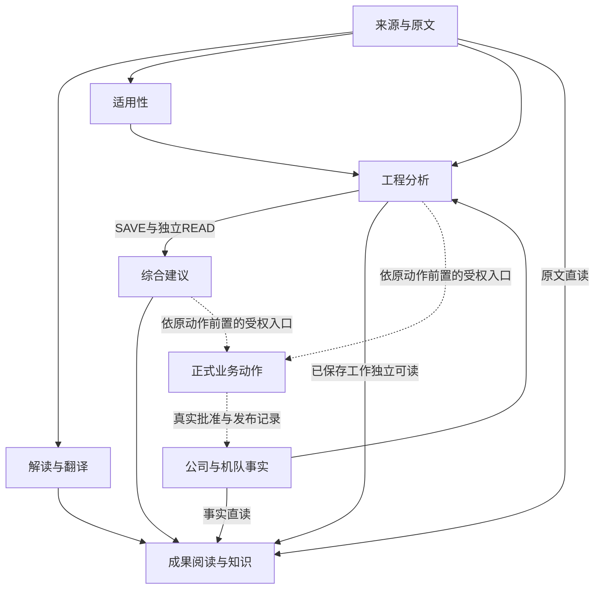
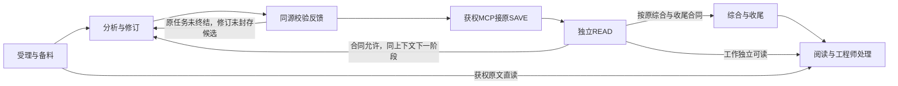

# WiseLink 主线流程图契约

**现行目标：正式自动化主链为企业授权范围内、具备OpenAPI与MCP接入能力的Aily企业智能体，GLM-5.3可用时优先，否则使用DeepSeek V4 Pro，不强制备用；Host保有工程业务权威。** 企业伙伴执行完整Agent Loop和平台会话，Host现有接入承接可信任务、MCP领域工具、原保存恢复与只读过程投影。保留本机v1.11结构及业务边界；本地维护：2026-10-29。

本文“企业伙伴”是企业授权范围内、具备OpenAPI与MCP接入能力的Aily自主智能体这一职责的简称，不限定旧Team页面或某一创建入口。具体对象的企业类别、额度适用性、发布版和渠道按该对象核证。

本机现行职责按用户v2.6直接Goal语义修订，沿[mainline.graph.json](runtime-monitor/mainline.graph.json)及原生成器维护，不按外部同号节点或工作卡覆盖。历史v2.4文稿、原[增量11分享](https://chatgpt.com/share/6ae2846a-f780-83e8-9234-684d77323ec6)、[Codex职责候选分享](https://chatgpt.com/share/6ae2adf4-b884-83e8-a07b-264a0eaa083d)、v1.11页面和v1.10目录保留各自来源与证据身份。目标修订不证明产品配置、迁移、发布或真实业务已完成。

## 1. 先看主线

**企业伙伴在获准任务内自主调查、调用工具、吸收反馈和修订，并可通过可信MCP调用原Host SAVE；Host决定身份、授权、来源、版本、CAS、准确READ、请求收尾和正式采用。** 模型按当前Goal：GLM-5.3可用时优先，否则使用DeepSeek V4 Pro，不强制备用。选择记录、企业配置与实际运行模型分别核证，平台Auto或回答自称不能代替实际模型证据。

正式自动化主链为Aily企业智能体。交互复核即使不保存成果，也须登录WiseLink后经企业链与Host显式受理；打开链接或登录本身只完成导航／鉴权，不创建业务任务。既有获权后台自动触发按原授权和生命周期保留。

团队入口仅提供获权只读问答、解释、进度查询和导航，不新建、续办、取消或写业务。需要交互复核或业务操作时，导航到WiseLink并登录后显式受理，不能以“不保存”为由从团队入口发起。

两入口按当前权限共享同一Host保存的准确成果与版本，不复制完整聊天；私人会话、群发起人与群受众的可见范围分别核对，不因同一智能体或同租户扩大受众。平台身份、Skill允许工具或模型user_id不授业务写权；工作流只作有明确局部收益的受限工具，不另立主执行方案。

打开[主线接线图](runtime-monitor/WiseLink_Mainline.html)，先看系统接线或一次评估流程，再展开相关节点和方案卡。[完整规范目录](runtime-monitor/mainline.reference.md)保留13个业务节点、47类关系、58个场景与10条规则；展示分组和步骤不增加业务实体，目录数量不表示完成率，也不要求首单补齐所有接线。

翻译、适用性语义、工程分析、必要综合、知识整理和复核逐消费者接同一企业伙伴，各用自己的成果标准。解析、OCR、分块、索引、embedding、reranker、确定性匹配和页面投影保留自身职责。原文、解读、译文、已保存工作及公司和构型事实分别可读，工作不等待Overall。公司批准、AEO反馈、LCM构型来自原系统，模型不能生成这些正式事实；连线不自动派任务。

## 2. 一次评估怎样形成成果

| 步骤 | 输入与产物 | 完成条件 |
| --- | --- | --- |
| 受理与备料 | 获权请求、准确来源、已有工作及完整要求 → Host封存任务与当次内容投递 | 目标、版本、范围、权限成立；问题／检查单／方法／标准实际到达，不只给ID、hash或链接 |
| 分析与修订 | 完整任务、原文和真实工具反馈 → 领域候选、三扩展及实际引用 | 企业伙伴自主补查、比较和修订；材料及方法进入实际分析，未知与冲突可核 |
| 同源校验反馈 | 同版明确规则及准确候选 → 可定位诊断 | 复用无写预检或原SAVE写前校验，不固定多一次预检；可修反馈回活跃循环，权限拒绝不可改答案规避 |
| 原SAVE | 领域候选及可信侧原操作上下文 → Host保存修订 | MCP可信主体及获权任务成立；原事务重核来源、期限、owner／fence、版本及CAS，模型意图不算保存 |
| 独立READ | 原SAVE key／requestId与准确修订 → 实际物化正文、三扩展、引用及读取观察 | 不用SAVE响应、latest、旧基线或候选副本替代；READ未定不重SAVE |
| 综合与收尾 | 准确READ → 同版Overall；合法B及请求final后收尾 | Program Overall保留Host确定性投影；A可独立交付，合法B未结束不提前FINISH／ACK |
| 阅读与处理 | 同版成果、来源、同次过程和执行投影 → 原资料库／工作台阅读 | 按当前权限返回，临时流与已保存成果分开；机器接受、工程质量、采用及实施分别判断 |

## 3. 共同边界

| 规则 | 含义 |
| --- | --- |
| R01 独立阅读与过程只读 | 成果与事实独立交付，团队仅获权只读；页面／链接打开、登录、刷新或重连不创建、续办或取消业务任务 |
| R02 原文与方法 | 准确原文和获权记录用于判断；翻译、摘要、Skill和目录不代真实读取，方法参考／应用／义务分开 |
| R03 阶段与完成 | seal、SAVE、独立READ、合法B、Overall、平台终态、任务final、FINISH／ACK和正式采用分别成立，B失败不抹A |
| R04 要求实际消费 | Host固定任务／方法版本，把检查单及成果标准实质送入当次上下文；获权补查记录真实读取和引用，候选变化后重验 |
| R05 机器与语义 | Host核结构、权限、来源、引用、版本和事务；证据充分性、因果、方法适合性另审，不能机器确定的保留NOT_MACHINE_ASSESSED |
| R06 按影响更新 | 匹配实际消费引用和待补条件，仅推进相关范围，普通刷新不自动重跑模型 |
| R07 真实并行 | 独立请求可并行，共享写由有效owner／fence／CAS约束；平台真实限流、期限和已获准资源分别成立，无人工预算／处理总量／calls帽 |
| R08 原操作恢复 | 断流查原chat，受理未知不盲新POST；SAVE UNKNOWN／COMMITTING先查原操作，保持原payload／key／owner／期限，已存先独立READ |
| R09 企业执行与团队只读 | 企业智能体／Host承接正式自动化及登录后显式受理的交互复核（含不保存）；团队仅问答／解释／查进度／导航，不新建／续办／取消／写业务；既有获权后台触发保留 |
| R10 本机同源 | 按v2.6直接Goal语义维护本机JSON、原生成器、契约与复制卡；13／47／58、R01—R10及8项RC1标识保留，目标与各层证据分开 |

任务输入复用Goal、Context、Capabilities、Guardrails、Acceptance，包含本轮问题、触发条件、必要信息、方法、证据标准、最低成果及允许未决／结束条件。稳定规范可用已批准说明或版本化Skill；必答要求进入任务正文或必经任务READ，不能依赖可选Skill命中。原文的连续条件、否定、例外、表格单位及脚注不得静默截断；主来源换版或扩大目标通过既有合法后继，原范围内可追加获权参考并记录实际读取。

工程任务沿用ENG-SCOPE-01/02、ENG-EVIDENCE-01、ENG-METHOD-01、ENG-RISK-01、ENG-ACTION-01、ENG-STATUS-01、ENG-CLOSE-01八项。RC1保留独立版本及TRIAL_CANDIDATE状态；INCLUDE／WHEN_TRIGGERED／EXCLUDE_OPTIONAL沿原定义，未知不当false，核心项不因缺材料自判跳过。checklistBinding由Host拥有，checklistResults指向最终合并正文和真实证据，methodUsage按issueKey及准确methodRef表达REFERENCE_ONLY／APPLIED／UNDETERMINED；三扩展随正文同存同读，不复制勾选正文、不无声清空或陈旧保留。ANSWERED不表示措施实施，OPEN可保存不自动允许结束，DEFERRED只用于被允许延后的分析。

工程任务、Host request／attempt、平台agent／session／chat及阶段revision各有身份，不能按名称合并；Host OAuth session也不是平台session。可信MCP身份先映射原Host主体，再由获权任务、原service-scope和当前执行权派生tenant／actor／来源／attempt；模型的任务引用只是选择器，不取最近任务补空。lease／generation、owner／fence、原CAS基线和操作身份由可信侧注入，不从模型自报或hash伪恢复；凭据及授权wrapper不进提示词，不另造保存API或授权平台。

阶段seal只固定该revision及同key payload，不终结任务或session。原任务仍获权、期限有效且合同允许时，将A独立Host READ的实际物化正文、引用、准确revision和保存引用沿既有full／view提供获权投影给B；候选副本、摘要或成功文字不能替代，可信身份／凭据wrapper不进入模型。B按自身合法操作身份及CAS保存，不暗改A；合同不支持继续、目标变化或任务已结束才按既有入口受理合法后继，不强制每SAVE新请求／session。任务final后不暗起修补模型。

候选只含领域内容，已有候选直交、BEGIN修复和原保存／历史reader直接复用，不重列待开发。可信binding／full／view、三个ref、五个revision、全空／部分缺失、ordinary／isolated、内部hook、body-only、显式`[]`、methodUsage和issuePatches保持原schema语义。旧Provider字节、封存完整性及未知结果记录保留原执行器身份，旧reader只恢复原结果，不改名为企业伙伴已验。

## 4. 恢复与独立交付

先辨明原Host request／attempt、实际平台session／chat、有效owner及业务保存状态，再决定合法动作。准确chat已知时查询原chat，快照替换对应投影，不当delta重复追加；未取得chat且不能唯一核同原受理轮次时保持UNKNOWN，不取最后一条、时间相近或新POST来猜恢复。平台结果查询不证明上下文完整恢复，也不代替Host保存状态。

| 原请求事实 | 接续方式 |
| --- | --- |
| 原任务活跃、候选未seal、绑定有效 | 企业伙伴吸收真实可修反馈并重验；权限拒绝不改答案绕过 |
| A已SAVE／独立READ、任务未final | 原授权／期限／合同允许才供同session的B消费实际READ；A不变，B使用合法原操作身份 |
| 任务明确final后候选被拒 | 保留诊断并阻断，不暗起修补模型 |
| SAVE UNKNOWN／COMMITTING | 查询原操作，保留原payload／key／owner／期限，不竞争生成或保存；READ空／失败不授新SAVE |
| 已SAVE未READ | 只独立读取原操作的准确修订，不取latest替代 |
| 已READ未Overall | 恢复同一保存修订的确定性投影，不重生成 |
| A Overall已成、请求尚合法续B | A独立可读，不提前FINISH／ACK；B失败不抹A |
| 原final／收尾条件成立而ACK未完 | 仅恢复该请求原FINISH与外层ACK；BLOCK不表示成功ACK |
| 撤权、旧fence、版本或CAS冲突 | 拒绝新动作并核原结果；需要时经合法后继受理，取消不等回滚 |

平台补权限后重发原指令或重新排队，仍先核原平台执行和原SAVE；不延授权、不换payload／key，不冒称工具断点恢复。平台对象／发布版改变不转移旧授权或session，原session不能合法续接时，以当前获权Host成果和准确来源建立显式后继，不拼历史冒充原生恢复。

公司企业伙伴不限使用额度作为设计依据，不推导API／SDK免费、全部模型含费、无限吞吐或零成本。不新增人工预算、文档／事项总量和模型／工具调用次数帽；平台实际限流、绝对期限、租约、网络／流空闲超时及已获准资源分别生效。重试不重置原期限，各层重试责任明确，未知usage不填0。Host取消先拒绝迟到业务写，平台取消、停止推理／计费另核，外部在途副作用仍对账；不能凭HTTP错误、空目录、TTL或时间形态推定未提交。

回退先停新的企业dispatch并保留成果、原未决操作和reader；不自动启动旧C、跨执行器重放UNKNOWN或恢复暂停／取消项。翻译按块保存／检查／选用，Wiki消费准确成员及根来源，TDMS、批准意见、AEO与LCM各守原语义，不作为首单统一前置。

## 5. 图和记录各自维护什么

[mainline.graph.json](runtime-monitor/mainline.graph.json)是本机图唯一数据源，原`sync_mainline_graph.py`只将其同步入HTML的唯一`graph-data`节点；本契约及受影响当前文档按同义维护。节点、接线和关联W卡的复制内容来自本JSON，不以外部snapshot或同号卡代替真实消费者。旧规范附录按原文追溯，当前执行职责以本契约和原开发卡为准。

记录准确agent／应用发布版、批准渠道、目标模型配置与可得actual模型、Host版本和实际消费者；不把requestedModelRef、UI选择或平台Auto当实际运行。没有字段就标不可取得，不自造Header、平台幂等键、事件名或取消API。一般接线缺口沿企业方案解决，必要能力根本不满足才报告具体影响并明确设计复核，不自动改走另一harness。

WiseLink复用原资料库、JobAid工作台、翻译reader和执行活动只读通路，关联原request／attempt与实际agent／session／chat。仅显示真实平台公开增量、Host工具活动和SAVE／READ回执，保留原类型、时间及可得标识；无事件／call标识明确缺项，不伪造工具成功、隐藏推理、用量或百分比。跨渠道缺原生流不另跑一次分析制造过程；临时预览不冒充已保存成果。撤权、身份／对象切换清退受限预览与缓存，拒绝迟到回包；刷新只订阅或查原结果。

实现、离线验证、目标配置／发布和真实业务分别记在原开发记录及[集成记录](coordination/M_INTEGRATION.md)。旧[验证阅读器](history/mainline-graph/20261029-retired-verification/WiseLink_Wiring_Verification.html)保留原观察时点，不改成企业伙伴已验。主图不记录本轮接收、提交、安装、失败轮次或发布日志，不因文档换SHA重跑所有历史。

## 6. 统一最小实施方案（企业主线）

保留Host、原SAVE／READ／恢复、INITIAL／Review、CHAT／UPDATE和ordinary／isolated合同；本机W1—W6身份与范围按语义映射，W6继续组织交付，外部同号不代表同义。

| 原工作卡 | 目标交付 | 最小验收 |
| --- | --- | --- |
| W1 企业任务与可信工具 | 完整要求、模型、可信身份与引用到正式企业链；团队准入仅只读 | 含不保存的交互复核须登录WiseLink后显式受理；链接／登录／团队消息不建任务，后台获权触发保留 |
| W2 原保存、恢复及同次过程 | MCP接原SAVE、独立READ、原操作查询、实际session／chat及原页面投影 | 实际正文与ref／revision读回，UNKNOWN不重放；合法B消费A，平台终态与原final／ACK分列 |
| W3 评估及代表翻译首链 | 先合成，再同一企业Agent的真实评估及后续阶段、代表性翻译 | 两类要求、模型身份、真实过程、原保存和reader各有证据，仅代表准确组合 |
| W4 Wiki显式维护 | 读取无维护写，复用显式入口及同一到期未领取active预约的due→reconcile闭包 | 原身份、锁后重读、已存结果优先和backoff保持，不新增扫描器或调度器 |
| W5 搜索发现与授权 | 发现资格、exact核权和索引时效分层；依法可读的其他创建者工作可进入核权 | 固定语料／主体／权限时点／等价过滤；无权与撤权不释放，准确版本及跨页合法命中成立 |
| W6 交付组织 | 准确组合及最小接线→合成→获准单事项→代表翻译→逐消费者迁出旧dispatch | 受影响验证、目标部署和真实业务分层，独立支线不作首单总门槛，旧状态与历史身份保留 |

实施顺序：**接准企业对象、完整任务、当前模型策略及可信工具 → 原初评保存／恢复／阅读与同次过程接线 → 受影响合成验证 → 获准单事项真实评估及合法B → 代表性翻译 → 其他生成消费者逐类迁入，验收及批准范围内再停相应旧新任务dispatch。** 已接受的候选直交和BEGIN修复直接复用；旧Codex三批、SDK／App Server替换不再作为第二条新任务主链。

主控协调原唯一作者和单应用操作员，Sol编辑、Astra审查、Terra执行与核验，集成／发布串行。Wiki、搜索、全来源、全翻译历史、万级压测、团队扩围、长期灾备及高级主子任务按真实依赖后接，不前置本人首单，也不据首单通过宣称这些已验。不新增harness、聊天历史库、任务DSL、session管理器、队列或发布gate，旧暂停／取消项不自动恢复。

## 7. 怎样确认交付有效

合成验证覆盖实际任务正文／三扩展、准确引用／投影、错误身份／来源／期限／owner／CAS、原SAVE回包丢失、READ失败、合法B与final／ACK、断流／重复／迟到、撤权和旧reader；入口负例核团队“更新／继续／取消／不保存复核”及单独链接／登录不产生业务任务，正式显式受理与后台获权触发分别保留；只补本次差额。合成输入含八项全文、准确源文、来源冲突、未知构型和前版工作，不以文档或静态测试证明真实模型／平台已通。

真实首链在准确获权组合下沿正常页面／任务入口处理经准确授权的一个真实工程事项及其WorkItem、资料版本/来源（FTD/SB/AD按正常类型准入），证明材料与检查单／方法真正进入分析，原SAVE→独立READ→同版确定性Overall→合法B→原final／FINISH／ACK及资料库阅读逐项对应。随后代表性翻译沿原workspace／producer／reader验证准确版本及源块定位、数字／单位／件号／否定／条件／告警／术语／引用、遗漏与不确定性、保存／选用／阅读，不强套工程八项。

记录实际agent／发布版、可信主体、配置与可得actual模型、request／attempt／session／chat、保存owner和原回执。实现证明消费者接入，离线验证证明受测边界，技术发布证明目标版本，真实业务证明该准确任务；答案、测试数或图不能代替业务与工程内容验收。普通可逆维护沿既有授权，新增权限／凭据／业务对象、不可恢复删除或超范围运行才核对应授权。

效率按真实受理、就绪、首次有效保存／可读及终态分析，未知时间、费用和usage保持未知；净收益按实际退出旧入口、减少重复生成和人工恢复判断，不为速度削弱来源、授权、版本、事务及正式采用边界。
