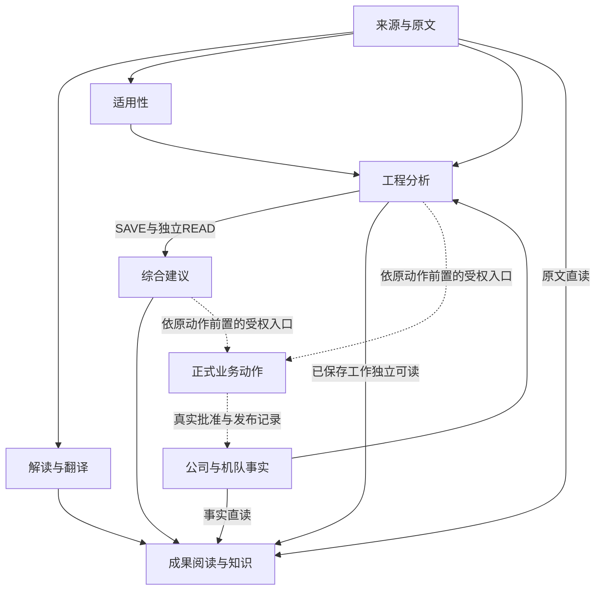
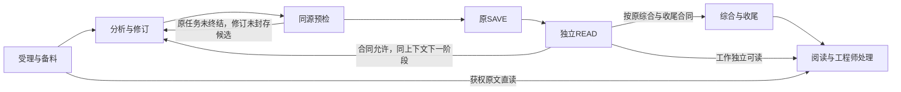

# WiseLink 主线流程图契约

**现行主线：v1.11结构＋Codex原生职责修订。最高优先级是在准确版本上充分复用Codex执行循环、会话、上下文、结构化事件与合法恢复；LiteLLM作通用转换，Host持业务权威，Native只留必要可信任务／工具／运行及保存恢复接线。** 保留原轻量导航与增量11接缝，合并用户本轮完整Agent与Native精简要求；本地维护：2026-10-29。

本轮依据用户提供的《WiseLink Native：Codex 原生能力复用、简化清单与图契约修订候选》（2026-10-29，N01—N24及十条约束）、[新分享](https://chatgpt.com/share/6ae2adf4-b884-83e8-a07b-264a0eaa083d)和最新直接 Goal 合并：保留 Codex＋LiteLLM＋Host，发挥完整 Agent 循环，Native 收敛为最小可信业务接线；分享中条件性 DSH 替换建议不采纳。原[增量11分享](https://chatgpt.com/share/6ae2846a-f780-83e8-9234-684d77323ec6)、已取得的 v1.11 页面和 v1.10 目录继续作为结构与业务边界来源；尚未取得该次 Library 附件完整原字节，不冒称逐字镜像。本次合并是现行设计修订，不是已实施、安装或真实业务运行证明。

## 1. 先看主线

**Codex 在获准任务内自主规划、调用模型和工具、吸收反馈并修订；LiteLLM 负责通用模型协议适配；Host 管业务事实、权限和事务；Native 负责可信任务接入、受限领域工具、运行控制及原保存恢复接线；工程师通过既有入口审阅与采用。**

Codex 管理所选正式接口支持的会话、上下文和原生事件，不把 Native 变成逐轮指挥模型的第二执行核心。模型请求仍经 LiteLLM 到既定妙搭 GLM／官方 Hosted profile；通用协议转换不接管 Agent 循环或业务完成判断。Native 保留身份和会话关联、受限业务工具注入、取消／期限／心跳、候选交付与原结果对账，不按 session、gateway、while 或日志文件名整删领域职责，也不另建通用 Agent 管理器、消息历史或第二业务队列。

打开 [主线接线图](runtime-monitor/WiseLink_Mainline.html)，先看系统接线或一次评估流程，再展开相关节点和方案卡。[完整规范目录](runtime-monitor/mainline.reference.md)保留 13 个业务节点、47 类关系、58 个验收场景及 10 条共同规则；展示分组和流程步骤不增加业务实体，目录数量不表示完成率，也不要求首单补齐所有接线。

原文、解读、译文、已保存工作及公司和构型事实分别可读；工作阅读不等待 Overall。公司批准、AEO 反馈、LCM 构型来自各自原系统，分析结果不能生成这些正式事实。连线表达消费或动作条件，不据此自动派发任务。

## 2. 一次评估怎样形成成果

| 步骤 | 输入与产物 | 完成条件 |
| --- | --- | --- |
| 受理与备料 | 获权请求、准确来源、已有工作、方法及检查单 → Host 封存任务与可定位材料 | 对象、来源、版本、范围及权限成立；目录可见不等于实际 READ |
| 分析与修订 | 原任务及实际工具反馈 → 类型明确的内部候选与准确执行记录 | 原任务未明确终结时自主补查、比较和修订未seal候选；阶段保存后按合同同session继续，不改可信绑定或旧revision，不经合成Chat包装往返 |
| 同源预检 | 同版规则和准确候选 → 无写诊断 | 接受或拒绝可定位；可修反馈只回原活跃核心，候选改变后重验 |
| 原 SAVE | 准确候选、原幂等键及 expectedRevision → Host 保存修订 | 原事务重新核权限、来源、期限、fence、版本和 CAS；模型意图不算保存 |
| 独立 READ | 原 SAVE key 和准确 workRef/revision → 完整保存工作与读取观察 | 不用 SAVE 响应、latest 或旧基线替代；READ 未定不重 SAVE |
| 综合与收尾 | 准确 READ 修订 → 同版 Overall、attempt 终态及外层 ACK | Program 链由 Host 确定性投影；提交、终态与 ACK 分别有回执 |
| 阅读与处理 | 同版工作、Overall、来源和执行投影 → 工程师可读成果 | 按原权限准确返回；机器接受、工程质量、正式采用及实施分别判断 |

## 3. 共同边界

| 规则 | 含义 |
| --- | --- |
| R01 直接阅读 | 内容、状态和图的读取无调度维护写；已有成果独立可见 |
| R02 原文判断 | 分析使用准确原文和原始记录；摘要、Skill、目录可见与全文翻译不替代真实取证 |
| R03 独立保存 | 分支分别保存，局部失败保留有效成果；turn、候选封存、SAVE、READ、Overall、终态／ACK与采用分别成立 |
| R04 准确消费 | 主基线固定，原范围内可补查并记录准确引用；工具及明确字段规则同源，候选变化后重验 |
| R05 分开表达 | 执行、成果、依据覆盖、正式业务分列；结构化输出、沙箱和确定性校验不替代授权或工程语义质量 |
| R06 按影响更新 | 变化命中实际使用关系和待补条件；只推进有关范围 |
| R07 真实并行 | 输入就绪与资源准入分开；独立任务可并行，共享写入由 Host 事务/CAS 控制 |
| R08 复用与恢复 | 先核Host原请求与结果，再判原session合法接续；阶段SAVE不等于任务final，UNKNOWN／COMMITTING先对账，任务明确终结后不暗起模型 |
| R09 责任清楚 | Codex持任务内循环，LiteLLM作通用转换，Native作可信业务接线，Host持业务真值；每请求一个有效owner，无人为模型／工具次数帽 |
| R10 图文同源 | 图、消费者和验证同义；设计、实现、离线、部署与业务验收分层，图不产生第二套状态或完成率 |

请求基线固定目标、主来源版次、已有工作和必要规则；新增参考在原范围和权限内记录实际读取，不把初始材料当永久白名单。换主版本、扩目标或实质更正通过既有合法后继处理。原件连续条件、否定、例外、表格单位及脚注不得静默截断。

intake、stage/action 和 SAVE requestId 各有含义，attemptId 不替代 requestId。外层领取与内层 attempt 的 owner/token/generation/期限分别校验。启动前关联原请求、准确输入、模型、检查点与 child run；完整响应和实际工具观察可追溯，退出码或摘要不代替完整留存。

工程任务、Host请求／attempt、Codex session／turn和阶段候选revision分别有身份与边界，不能按名称相近合并。工程任务可包含经原入口合法受理的回合；任务内模型与工具轮次由Codex推进。进程退出、`turn.completed`、阶段候选seal、SAVE、独立READ、任务明确final、Overall、attempt终态、ACK和正式采用分别成立。阶段seal只锁定该候选revision，不能暗改它或在同key下换payload，不自动终结任务或session。任务仍获权、原期限有效且Host合同允许时，可信程序可将准确SAVE／READ回执交回同一session继续下一阶段；只有原合同不支持继续写、目标变化或任务已明确终结等情形才按既有规则受理合法后继，不强制每次SAVE新建请求或session。任务明确final后不暗起修补模型，turn结束本身不证明任务final或授予新写权。

新路径以类型明确的内部候选交接，移除 `final → 合成 chat.completion/tool_calls → candidate` 往返；现有候选提交通道可保留，不强制改为文本。模型只产领域候选，外封身份、来源、期限与完整性由可信层提供；既有封存语义、真实Provider响应字节和未知结果记录不因去包装删除。旧封存结果继续按原reader只读恢复、不重新生成该结果，内部兼容包装不冒称厂商原响应。预检关联准确候选内容／hash与校验版本，未封存候选变化后重验；阶段seal后新鲜校验只接受或阻断该revision，不暗改另一候选、不以SAVE试写代替预检。原任务未终结且合同允许的下一阶段可形成新的候选revision，任务明确final后才不得暗起模型补写。

机器规则接受仅说明可确定检查的结构、身份、版本、规则和事务条件成立。任意语义充分性保留 `NOT_MACHINE_ASSESSED`；`ANSWERED` 不表示现实已实施。模型不改租约、身份、来源授权或正式决定，也不制造人工回执。

## 4. 恢复与独立交付

优先复用准确版本Codex的执行、MCP、事件、会话、上下文与中断接口。当前可沿既有 `exec --json` 接线精简；SDK或App Server只在能替代相应自建封装时选择，不三套叠加，也不成为首链前置。原生能力须在固定Codex＋LiteLLM＋GLM组合验证，不能复制其他模型参数或假定网关支持压缩；必要任务条件不只靠可选Skill发现，摘要不成为原文或引用资格。

需要恢复的正式任务，关联原Host request／attempt／有效owner和显式Codex session／thread及已验证的隔离持久目录；先核原请求、当前权限、来源和结果，再合法调用原生会话恢复。不用 `--last`、目录时间或最近日志猜身份，不要求所选接口未提供的turn字段。目录持久性、租户隔离和保留期限验证后才启用持久恢复；无恢复需求的临时任务可保留ephemeral，会话缺失不能静默新建。会话接续不授予新业务写权、不清空旧pending，也不新增第二任务表；阶段保存后的同session连续工作是合同允许的能力要求，不因当前某入口采用最终候选后接保存尾部而永久禁止，也不据此宣称中途SAVE已实现。

| 原请求事实 | 接续方式 |
| --- | --- |
| 原任务未明确终结、当前候选未seal、绑定有效 | 在原任务内吸收可修诊断并重新校验 |
| 阶段revision已SAVE／READ、任务未final | 原授权、期限和Host合同允许时，把准确回执交回同session继续下一阶段；不改旧revision或同key的payload |
| 任务明确final后候选被拒绝 | 保留准确诊断并阻断，不暗起修补模型 |
| UNKNOWN 或 COMMITTING | 查询原请求及结果，恢复原封存 payload/回执，不换 key 或竞争生成/保存 |
| 已 SAVE 未 READ | 只读取原 key 和准确修订 |
| 已 READ 未 Overall | 消费同一保存修订恢复确定性投影 |
| Overall 已成、终态或 ACK 未成 | 只接续原收尾与外层 ACK，BLOCK 不表示成功 ACK |
| 撤权、旧 fence 或版本冲突 | 拒绝不再获准的动作，核原结果；必要时建立合法后继 |

取消、绝对期限、租约、网络请求／流空闲超时及已获准实际资源约束分别生效；恢复和重试不延原期限、不重置实际资源策略，不新增人为模型／工具次数上限。明确Codex、LiteLLM／SDK与Native各自重试责任，避免默认重试相乘；逻辑步骤、模型请求、HTTP发送与重试分开记录，未知usage不填0。心跳独立于模型文本，取消沿所选原生接口传播到实际模型与工具，进程监管仅作兜底；外部在途写入仍须对账，中断不代表回滚。模型传输UNKNOWN与业务写入UNKNOWN分开；无证据确认未提交时，不从HTTP错误、本地空目录、TTL或约60／300秒形态推定可重生成或故障根因。切换执行器保留旧在途身份与副作用，新安装不接管旧UNKNOWN。

翻译按块保存、检查、选用与接续；Wiki 按准确成员和根来源消费；TDMS 来源、公司意见、AEO 反馈及 LCM 构型保留自身语义。它们按真实依赖推进，不自动成为首条 RC1 业务的总前置。旧数据处置与文档归档分开，本文不授权重放、删除业务记录或改变正式采用。

## 5. 图和记录各自维护什么

主图和本契约维护对象、职责、边、输入输出、拒绝边界及验收条件。节点展开提供当前问题所需的开发卡；源码位置由对应作者按准确版本绑定。规范目录与方案卡按需阅读，复制开发卡不带整份历史。

选定官方接口、准确Codex／LiteLLM／SDK／模型Profile与Native／Host组合、未复用的具体缺口、最小补丁和退出条件，记在原开发记录。能配置解决的能力不再重复编码；软件工具审批不替代Host授权或工程批准，也不新增普通去重的逐项人工准入。平台高权限凭据留在可信侧，远程MCP写入仍由服务端核权，本地沙箱和allowlist不能替代它。

优先留存原生结构化事件的标识、顺序和类型，只增加必要任务关联；页面由同一记录投影，读取不启动生成或解释用模型。未知事件和安全错误诊断可追溯，不伪造隐藏推理；SDK拒绝、Host拒绝、取消、超时、未知结果及诊断写失败分别保留，BEGIN未完整返回也不伪造attempt身份。减少重复日志／状态副本前，先证明原恢复必需记录可可靠重建，不能吞掉原异常。

实现、离线验证、目标安装/发布和真实业务回执分别保留在既有接线/证据记录及[集成记录](coordination/M_INTEGRATION.md)。旧[验证阅读器](history/mainline-graph/20261029-retired-verification/WiseLink_Wiring_Verification.html)保存原观察时点和证据身份；其目标版本、生成时间和旧状态不等于本契约的设计版本或当前业务运行。

本契约不记录每次提交、安装数量、失败轮次和发布号。当前摘要不得覆盖原证据；技术发布成功不证明前后端实际运行、同版阅读或真实业务闭环。改变依赖或完成条件时核受影响消费者和必要正反例，不因文档换 SHA 重跑所有历史，也不自动继承通过。

## 6. 统一最小修订方案（增量11）

保留 Host 业务权威、原 SAVE/READ/恢复链、INITIAL、Review、CHAT/UPDATE 和普通/isolated 分支，收敛以下五处接缝。详细条件在主图六张按需方案卡中；第六张只组织交付顺序与范围，不增加架构问题。

会话持久化与合法恢复、MCP工具发现和调用、上下文管理及结构化输出优先复用Codex原生能力，并按实际模型组合验证。LiteLLM承担通用模型协议转换；Native只保留任务接入、受限领域工具、运行控制、候选交付及原业务恢复所需可信接线，不另建Agent核心、通用会话历史／协议或上下文裁剪与修订循环。只有具体运行或接口证据证明原生能力不足，才在原开发卡记录最小适配及退出条件。工具可发现不等于来源已获权，Host始终保有主体与租户、来源与版本、期限与执行权、SAVE/CAS、正式采用和业务恢复的决定权。

| 接缝 | 稳定裁定 | 最小验收 |
| --- | --- | --- |
| Review 核心 | 已由Codex推进循环的新INITIAL／Review路径直接复用；保留按需查询、真实工具往返与校验修订。正式接口、事件、会话及受限MCP优先原生；不整搬耦合INITIAL输入的session，也不按文件名删除领域工具；失败不退旧核心 | 准确调用链与工具反馈证明同任务控制权；所选接口、取消、合法恢复和各业务分支成立，未覆盖的原生能力不宣称已启用 |
| Review 无写诊断 | 同源schema／明确字段规则、客户端预检和Host最终校验去重，保留准确Review共享无写闭包；缺运输才最小接线，INITIAL预检和Native本地检查不替代Host Review校验 | 无业务写；未seal候选变化后重验，已seal revision只接受／阻断；任务明确final后不暗起模型；SAVE重核可变条件 |
| 可信 full 与候选投影 | 优先评估新路径类型候选直接交接，移除合成Chat包装往返；可信binding、full／view、既有hash和封存完整性保留，旧封存结果沿原reader恢复。全空／部分缺失、ordinary／isolated、内部hook、body-only、显式`[]`、methodUsage和issuePatches各守原语义 | 同时核交付端与两类真实消费者；三个ref、五个revision、投影／patch与准确Host物化对应，原结果恢复和安全诊断不退化 |
| Wiki 显式维护 | 读取退出调度维护；复用已有显式入口，并核同一到期未领取 active 预约能否穿过 due 筛选到 reconcile。覆盖不足只补原维护闭包；自动 GET 改 POST 仍不成立 | 页面读取无调度维护写；同一预约可经显式入口正确收敛；身份、锁后重读、保存结果优先和 backoff 保持 |
| 搜索发现与授权 | 发现资格、exact 授权释放、索引时效分别判断；他人创建但当前依法可读的工作可以进入 exact 核权。比较固定同一已入索引语料、主体/权限时点和等价过滤 | 双主体合法发现；无权/撤权不释放；准确 revision 与跨页后合法命中成立。排序、分页边界、索引迟到另列，不要求任意时刻字节相同 |

接续顺序：**按最高优先级复用准确Codex原生能力并处理首链实际BEGIN／SAVE断点 → 第一批沿既有exec核新CODEX可达路径，优先候选包装去重，复用既有循环、同源预检、事件与安全诊断，只补真实差额 → 第二批逐一验证持久session／合法恢复、上下文与流式 → 第三批有明确净删减收益才以SDK或App Server替换对应封装。** N15是原生优先原则下的交接去重，不新建通用执行层。各批均由原唯一作者最小diff、原接收者验证准确组合，再按既有授权接续部署与业务链；不另派平行产品作者或新增审批gate。高级多Agent和接口替换不是前两批前置。

用户附件N01—N24归入原卡检查项：W1承接N01—N04、N06—N08、N11、N13—N14、N19—N23；W2承接N05、N16—N17；W3承接N09—N10、N12、N15、N18；W6承接N24与三批顺序。编号不增加业务实体、24个派工任务、状态或完成率；W4／W5沿原Wiki／搜索接缝保留。已符合的实现直接复用，不把历史旧分支或未启用的可选能力写成当前全部缺失。

Wiki、搜索、展示语义、构型事件及其他后置接入按实际依赖处理，不成为首条 RC1 的总门槛。只补影响范围内的验收，不重开全系统审查，不新增调度器、队列、语义引擎或发布 gate。旧暂停/取消项不自动恢复。

## 7. 怎样确认交付有效

实现证据回答准确消费者是否接入；测试回答受测边界；部署回执回答目标版本；真实业务证据回答同一获权任务是否消费材料、SAVE、独立 READ、生成同版 Overall、正常收尾并可读。每类证据保留自己的对象、源码、环境和观察时间。

先核准确组合与受影响正反例，再按已有授权验证真实保存和业务阅读。工程内容须真实吸收材料和方法，未知、冲突和适用限制可复核；引用号、模型完成、测试数或流程图不能代替该验收。普通可逆维护沿既有授权执行，只有新增权限、凭据、业务对象、不可恢复删除或超出原范围的部署/运行才核对应授权。

效率按受理、就绪、首次有效保存/可读和终态等真实时间分析，缺失时间或用量保留未知。首份成果更早可读、减少重复生成与人工恢复才是改进；不为速度削弱准确来源、权限、版本或恢复边界。

受影响验证覆盖真实工具反馈修订、阶段revision不可变、合同允许的同session保存后继续、任务明确final后拒绝、准确session合法与错误恢复、SAVE回执丢失、取消与截断流、上下文增长、旧结果reader及最小权限；只补本次差额，不重跑全部历史。净收益记录实际退出的入口／重复格式／状态源／通用协议与仍保留职责，不虚构预计删减百分比；可选原生能力未启用不阻首链，至少一条合法代表业务仍须以原回执证明。
