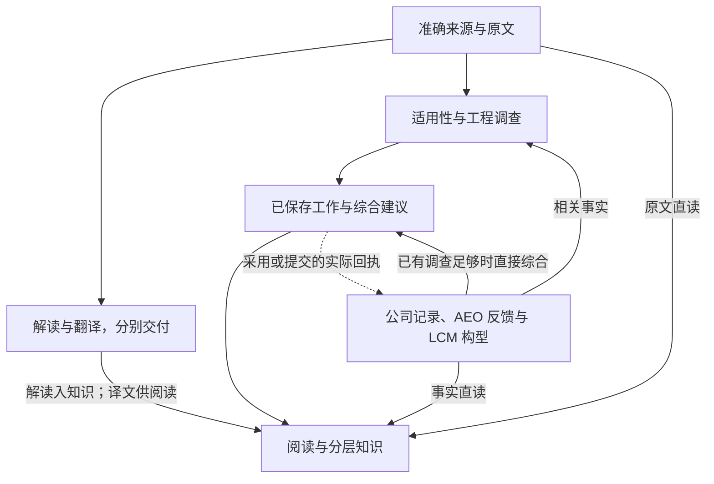
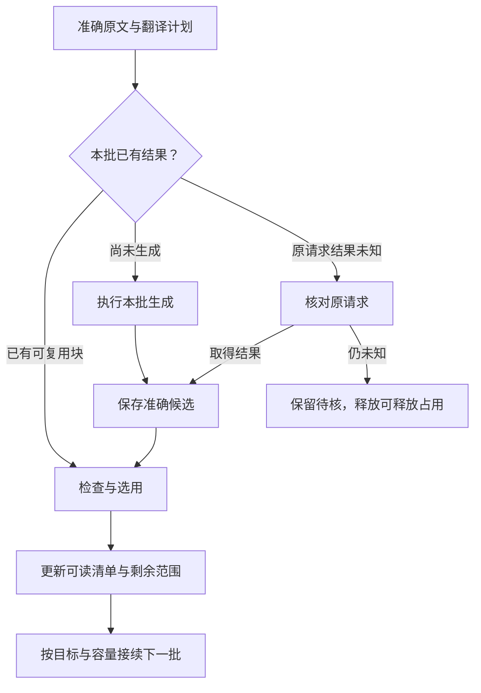

# WiseLink 主线流程图契约

版本：1.6 复核修订稿 · 日期：2026-10-23 · 业务时区：Asia/Shanghai

## 设计结论

**WiseLink 围绕准确来源和已保存的工程成果工作：能读的立即读，需要分析的按明确问题推进，正式决定与实际落实按原系统事实显示。开发和运行监控共用节点、依赖和完成含义。**

本契约保留当前 13 个能力节点及既有业务对象，收敛共同规则和实际接线。Host 管理业务真值；每类请求使用一套明确的执行与恢复协议，同一请求在任一时刻只有一个有效执行者；任务图从这些记录生成。验证阶段可直接调整不合理的串行和重复执行机制，以一条可保存、可读回、可接续的真实链路证明设计。节点、关系和场景数量是当前目录，不是禁止合理增删的业务约束。

本版在 v1.5 上修正证据匹配、接入范围、实施顺序与资源含义，并补清正常恢复、在途交接及工程内容验收。配套交付物是离线验证阅读器和单事项诊断组件；当前仅有 JobAid/Overall 的有限读模型适配，不代表线上接线或全系统运行监控已经完成。固定提交 b37 的源码核对与历史材料分别保留在附录 E；实施和业务状态以相应准确版本及实际回执维护。

### 阅读顺序

| 使用者 | 先看什么 | 需要时再看 |
| --- | --- | --- |
| 产品与工程负责人 | 第 1 节业务主线、第 5 节页面、第 7 节交付 | 附录 B 的领域规则 |
| 开发者 | 第 2—4 节共同契约、第 6 节接线 | 附录 A 节点、C 边、D 验收 |
| 运行维护者 | 第 4 节恢复、第 5 节任务监控 | 第 6 节责任绑定和附录 E 实施证据 |

主文规定共同含义；专项章节只规定领域差异；节点、边和验收目录提供索引。实现例子中的字段是语义示意，映射到现有对象即可。

## 1. 从工程师需要的结果定义主线

工程师打开系统，应快速回答：**发生什么、影响谁、公司怎么安排、落实到哪、下一步做什么、依据在哪里。** 系统工作分成三条可以独立交付的路径。

| 路径 | 主要产物 | 何时给工程师看 |
| --- | --- | --- |
| 资料与阅读 | 准确原文、定位、本版解读、按需译文 | 相应成果可读即展示 |
| 工程判断 | 适用性结果、持续保存的 JobAid 工作、综合建议、知识积累 | 按实际保存范围展示，并说明尚未覆盖的实质变化 |
| 公司安排与落实 | 已批准评估意见、工程文件及措施、AEO 反馈、LCM 构型 | 原生事实取得后展示，分析使用情况另行说明 |

### 1.1 主线概览



这是业务关系概览。实线表示按问题需要的资料或成果消费，虚线表示现有业务动作的实际回执；连线本身不派发任务。公司与机队节点汇总原系统事实，动作回执只更新其实际对应的公司记录，AEO 反馈和装机事实从各自来源取得。阅读层随时呈现已取得的成果与事实。

主界面按五组组织：**来源、阅读交付、工程工作、公司与机队事实、知识积累**。点开相关组再显示其能力节点；13 个稳定 nodeId 见附录 A。重试、批次、租约和日志属于节点详情。

### 1.2 业务对象保持准确

文档族组织正式版次；DocumentVersion 标识准确原件；解析修订标识原文结构；WorkItem 承载文件评估；EngineeringMatter 组织工程问题；保存工作、Overall 和 Wiki 各有准确修订。AEO、评估单、单机反馈及 LCM 记录保留原系统身份与时间。

一份文档可独立解读或翻译，也可为多个事项提供不同依据。相似标题、同 ATA 或同设备只能帮助发现关联。事项归属按真实问题及用途建立，执行状态归属于具体措施和对象。

## 2. 共同规则与责任

### 2.1 十项共同规则

| 规则 | 唯一规范含义 | 主要展开位置 |
| --- | --- | --- |
| R01 直接阅读 | 读取已保存内容和监控状态为只读操作；每项成果独立可见 | 第 5 节 |
| R02 原文判断 | 翻译服务于阅读，工程分析使用准确原文和原始记录；全文翻译不是调查前置 | B.1—B.3 |
| R03 独立保存 | 分支分别保存；局部失败保留其他有效成果；结束一次执行与目标完成分别判断 | 3.4、B.2 |
| R04 准确消费 | 请求基线固定，取证引用可在授权问题内增加；成果记录实际使用的准确输入 | 第 3 节 |
| R05 分开表达 | 执行、成果、依据覆盖、正式业务四类事实分别表达 | 5.3 |
| R06 按影响更新 | 匹配已消费引用及已登记待补条件，只更新有关范围；保存只关闭实际覆盖的需求 | 4.1 |
| R07 真实并行 | 数据就绪和资源准入分开；独立工作并行，共享写入由 Host 事务/CAS 控制 | 3.3、4.2 |
| R08 复用与恢复 | 已保存结果先读回；提交或生成未知先核对原请求；封存提交只恢复原准确结果 | 3.4、4.4 |
| R09 责任清楚 | Host 管理业务真值，原系统提供其正式事实，同一请求只有一个当前有效执行与恢复 owner | 2.2、6.2 |
| R10 图文同源 | 图定义、实际消费者和监控使用同一语义；图从真实记录投影 | 第 6 节 |

上述规则由系统承担。原生准确关联和确定性规则足以成立时自动处理；确有歧义、冲突或原业务规定人工动作时，进入现有处理入口。页面只显示影响当前判断或下一步的具体差异。

### 2.2 最小职责

| 责任方 | 持有的事实与动作 |
| --- | --- |
| Host | 身份/来源授权、业务对象与版本、请求范围、成果校验和幂等保存、当前成果选择、正式业务动作准入 |
| 选定的执行组件 | 请求受理后的领取、执行占用、心跳、退避、超时、延后、恢复及结束；具体组件在接线表指定 |
| 执行端 | 在准确请求范围内取证、计算或生成候选，回传结果和执行事实；本地检查点辅助恢复 |
| TDMS、LCM 等来源系统 | 提供原生文件、批准/工程记录、反馈或构型事实；保留来源状态和修订关系 |
| 工程师与既有业务角色 | 问题与更正、需要人工处理的实际分歧、原业务范围内的采用和正式动作 |
| 页面与运行图 | 读取真实成果、条件和进展，调用已有动作入口；显示责任清楚的下一步 |

来源授权表示允许处理什么；执行租约表示哪个消费者暂时占用哪次执行。两者各自有生命周期。已有双层机制若保留，必须写明各层职责和一次性释放顺序；验证证明可由一个执行组件承担时直接收敛，历史请求保留可核对记录。

## 3. 一次请求的最小可执行契约

### 3.1 身份与观察范围

每次操作关联：**nodeId、真实 subject、现有 requestId、目标范围、请求基线、执行/恢复 owner、输出引用**。attempt、batch 和 lease/fence 是下钻信息。

运行实例观察键采用现有身份组合，例如“nodeId＋subject＋requestId”；精确来源、成果和范围仍以实际引用表达。相同节点与对象可以同时存在历史成果、进行中请求和待核原请求。节点摘要保留这些请求的数量与入口，不能只取最后一条记录覆盖其他状态。暂停、恢复和取消均绑定准确请求/尝试。

不需要为观察范围新增通用 workflow 实体。节点图保持稳定，执行实例在节点下聚合。

### 3.2 固定基线，允许正常取证

| 集合 | 内容 | 运行中的处理 |
| --- | --- | --- |
| 请求基线 | 问题/目标范围、选定源文件版次、目标事实范围、已有工作或综合基线 | 受理后固定；来源正式改版、目标实质扩大形成后继 |
| 本轮取证引用 | 调查过程中在现有范围和权限内发现的新参考、原始记录及定位 | 可以追加；记录准确版本、实际读取和用途，保存时纳入实际消费集合 |
| 后继需求 | 替换基线、新目标、明确更正、后来满足的待补条件 | 归入相关对象，保留原因和范围，由后继工作处理 |

发现一份新的相关参考不必重启整轮调查。把已选源文件换成新版、把一个问题扩大为另一项调查，则须明确形成新的范围。首版采用固定基线加后继即可；无需先实现运行中任意改范围的协议。

读取、选入、实际用于判断、最终保存覆盖是四种不同事实。保存成果应能追溯实际消费的输入集合；缺失记录如实显示，不能从上下游都成功推断已经消费。

消费引用由实际取数、组装该次分析输入的路径记录，与原结果一同保存；SAVE 时不能从“当前最新资料”回填一组未经本次处理的引用。仅登记或预取不计为覆盖。引用关系可证明实际提供的输入，内容验收还需核对相关条件是否在输出中正确处理。

### 3.3 就绪与准入

Host 的既有请求准备或领域服务，按本次操作确定三类条件：**必需输入、可选输入、允许缺失并带明确限制的输入**。这可以是持久字段，也可以由准确请求及固定规则重算；执行与监控共用同一个判断。

```text
业务就绪 = 本次操作的必需输入满足，允许的限制已经明确
可以开始 = 业务就绪，授权有效，实际执行资源允许准入
判断结果 = 是否就绪 + 具体阻塞项 + 本次允许的限制
```

准入不要求先长期持有对象写锁或数据库事务。请求使用准确基线执行，提交时由 Host 做短事务和 CAS；基线已变时进入明确的冲突或后继处理。等待资源与正在执行分别观察，不通过预先占住一种资源再长期等待另一种资源制造多层排队。

例如，“提取文件适用条件”需要准确条款；“判断指定机队是否适用”还需要对应目标事实。允许逐机给出已判定与未知范围时，应在请求目标中说明；模型不能为了继续而把必需事实改成可选。

等待原因只分成工程师或维护者可处理的几类：**缺输入、等资源、按计划延后、明确暂停、核对原结果**。翻译正在运行不是 JobAid 必然缺输入；一份软件资料缺少构型不阻止其他原文问题保存。

### 3.4 保存、提交与目标完成

| 边界 | 成立条件 | 结果含义 |
| --- | --- | --- |
| 候选已产生 | 取得可核对的输出及引用 | 仍需通过相应成果校验和保存 |
| 提交已封存 | 原请求的准确提交 payload 与必要引用已持久固定，如现有 COMMITTING | 后续只恢复这份结果或核对其提交；修改内容形成关联后继 |
| 成果已保存 | Host 幂等保存成立，取得准确成果引用并能独立读回 | 已形成可复用业务成果，执行可能仍待收尾 |
| 成果可读 | 对应节点的选用/检查条件成立 | 页面可显示相应范围；保存数与可读数可以不同 |
| 请求目标完成 | 本次目标范围达到该操作的成功判据 | 不能仅由“worker 退出”或“原因已解释”推导 |
| 执行占用结束 | 执行 owner 已按协议释放或结束此次占用 | 原请求可能成功、部分、失败、取消或仍待核 |

“本次可以停止工作”和“业务目标成功”分别映射到原协议。部分结果可保存；明确失败有准确原因；未知结果保留待核。无需把所有既有服务改成同一套状态枚举。

尚未封存且明确在写入前被拒绝的候选，可按原协议纠正后提交；封存以后不能用修改 payload、普通归还后重新生成来冒充恢复。查询一次结束可以释放此次 worker 占用，原封存/待核请求仍由指定 owner 接续。

### 3.5 当前事实与当前分析

公司新批准意见、工作新修订或目标变化取得后可以立即显示。当前综合仍显示它实际使用的输入，例如“综合采用工作 3；工作 4 的构型条件尚待纳入”。

Host 以准确基线、覆盖及并发规则选择当前成果。新结果保存后再切换可读指针；较晚到达的旧基线结果可以按原协议保留为历史，不能仅凭保存时间更晚覆盖较新有效判断。某项变化经核对无影响时保存该结论，原综合仍保留原来的实际消费引用。

## 4. 更新、并行与恢复

### 4.1 更新采用一套规则

变化先匹配两类关系：**实际消费过的准确引用**，以及**已登记的待补范围/条件**。后者覆盖以前不存在的构型事实、新增目标成员和后来补齐的资料。未命中相关用途的变化只更新来源或显示。

| 变化类型 | 默认动作 | 何时需要工程分析 |
| --- | --- | --- |
| 普通 AEO 反馈、计数、索引、位置或同步时间更新 | 确定性刷新事实/统计 | 出现与已有判断有关的实际异常或反证 |
| 新批准意见、措施范围或共同前提改变 | 标记相关差额；已有工作足够时直接更新综合 | 既有调查不足以解释新条件 |
| 正式资料改版、关键原文更正、构型条件变化 | 定位受影响问题和判断 | 更新相关 JobAid，再更新实际受影响的综合/Wiki |
| 新参考在本轮问题范围内被发现 | 登记准确取证引用并继续 | 属于当前调查本身，无需另建整轮任务 |
| 待补条件满足、目标成员新增 | 唤起已登记的有关后继需求 | 仅处理受影响范围 |
| 无实质变化或变化与该结论无关 | 记录确定性比较或有依据的无影响核对 | 不为同步次数调用模型 |

后继需求在既有存储中持久保留并可补扫，触发通知只是唤醒信号。同一范围的连续变化合并；保存只关闭实际覆盖的需求，更新期间新到变化继续保留。已知错误或失效依据应立即在有关阅读处明确标识，修订生成可以随后完成。

### 4.2 并行与资源

解读、翻译和输入足够的调查可以并行；适用性只约束真正依赖其结果的问题；Overall 可以基于已经保存的工作推进，调查继续形成后继。Wiki 消费已保存成员。所有共享指针及业务状态写入由 Host 事务、版本和 CAS 校验。

按真实瓶颈分别限制执行 worker、模型调用和数据库连接。只在准备实际执行时领取；明确不自动执行的预算/暂停任务先排除。已领取后发现应延后，使用原 token/generation 的正常延后或归还入口，保留原因与下次可执行条件，并完成相关占用释放。释放前由 owner 区分普通未开始任务、已准备任务、封存提交与外部结果待核，只释放协议允许释放的占用，保留原请求及恢复绑定；已准备任务不能因外层换代留下不可接续的旧绑定。

本地检查点记录辅助信息，不替代 Host/执行 owner 的生命周期。清除本地 active-claim、归档领取文件或停止进程，均须与权威状态的真实转换对应。

资源按六种用途观察；只有确认存在独立约束或实际争用时，才增加相应准入控制：

| 资源 | 管理范围 | 占用与释放 |
| --- | --- | --- |
| 逻辑任务执行位 | 正在推进的一次请求/尝试 | 缺输入、明确暂停、等待未来时间不长期占用；执行 owner 管理 |
| worker/handler | 实际进程或并发处理能力 | 可以多个并行 worker，统一协议和责任；唯一 owner 不等于单 worker |
| 模型并发/速率 | 实际 provider/profile 的调用数、RPM/TPM 等 | 调用前取得额度；原调用结果未知时保留可能仍在执行的占用信息 |
| 提交与恢复资源 | 封存结果保存、读回、补 ACK/finish、原结果核对 | 使用有界的短恢复步骤，复用原绑定；不重新占模型生成额度 |
| 数据库连接/事务 | 读取、领取、保存等短操作 | 外部模型等待期间不持有长事务；按实际连接/锁等待调优 |
| 对象写入协调 | 同一工作修订或当前指针等真实写入冲突 | 提交时做 CAS/短协调；同对象的无冲突分支可并行 |

以上是逻辑资源分类，不要求六套额度、服务或队列。首轮复用已有执行池、实际模型限额、数据库连接池及 Host 写入控制；逻辑任务位若只是重复 worker 限制，不长期保留双重排队。确认调用结束后释放并发占用；请求数/token 速率预算按实际 provider 的时间窗口或配额规则结算。原调用未知时，按原调用查询、可确认超时或明确策略处理，不能直接当作零占用；查询接口自身的限额也应遵守。

COMMITTING 保留原准确结果与恢复 fence，目标上与模型生成容量分开。只有准确结果已持久封存、原调用状态明确、恢复能独占接续且真实 worker 可以复用时，才调整容量记账。同步核对常量、数据库约束、领取、恢复及监控；不能仅改状态名称或移出槽位就宣称释放了真实资源。优先补齐已有提交恢复路径，不另建平行保存真源。

本地 owner 锁只保护实际共享检查点/本地资源。解除单 owner 锁前，核对领取指针、检查点、预算和会话是否按请求隔离；不同请求可以由不同 worker 执行。运行数据应分别记录任务就绪等待、worker 占用、provider 容量及未知数、恢复积压、数据库连接等待；没有读到的数据显示未取得，不用历史默认数补齐。


### 4.3 四类时间各有含义

| 时间 | 起点与用途 | 对应处理 |
| --- | --- | --- |
| 排队有效期 | 从受理起，限定任务在等待中仍值得执行的时间 | 过期后重新判断输入和需要，不能伪装已经执行失败 |
| 执行超时 | 从该次实际开始执行起，限定运行资源占用；核对未知请求有独立有界步骤 | 超时先确定原结果与保存状态，再决定恢复或终止 |
| 心跳/租约 | 从领取或续租起，检测消费者是否仍持有执行权 | 失联后由指定 owner 接续；旧 fence 无权迟到写入 |
| 业务绝对截止 | 来自实际业务期限，独立于排队和重试 | 不能因续租自动延后；若当前无法按期完成，显示具体事项和时间 |

人工准备、授权等待和明确暂停如何计入排队有效期，由该任务的既有策略规定；它们不冒充已开始执行。重试必须有总尝试/累计时间或业务截止约束。用户总等待从原请求受理计算，不因重领或重试清零。调整时间语义时同步核对准备、worker、续租和过期扫描的实际判断入口。各时限依据测量配置，本契约不固化历史 30/60 分钟默认值。

### 4.4 恢复矩阵

| 观察到的事实 | 唯一恢复入口应做什么 | 页面如何表达 |
| --- | --- | --- |
| 明确未发出外部请求、尚无结果 | 按准入条件重试或延后 | 等待/延后及原因 |
| 模型请求结果未知 | 按原调用身份查询或核对；有界退避，保留待核 | 正在核对原结果 |
| 候选明确在写入前被拒绝 | 保留具体原因；在未封存边界内纠正 | 保存被拒绝及可处理原因 |
| 提交已封存 | 只恢复原准确 payload/回执；查已保存成果并补终态 | 提交处理中/核对提交 |
| 保存响应丢失 | 按原请求与幂等标识读取实际保存记录 | 保存已核实；按节点检查/选用条件显示可读状态 |
| 保存成功，ACK/finish 丢失 | 复用准确成果补收尾 | 成果已保存、执行待收尾；可读状态独立显示 |
| 租约失效、旧 worker 返回 | Host 拒绝过期 fence 写入；当前 owner 核对原结果后接续 | 执行已转交，保留原请求历史 |
| CAS 冲突或基线已变 | 核对已成立的当前结果；需要新内容时建立关联后继 | 显示已采用结果及剩余差额 |
| 翻译块已保存但待检查/未选用 | 检查和选用原块，只补不合格范围 | 已保存与可读分别计数 |
| 投影或索引暂时失败 | 从业务记录重建投影；保持仍获权的已有正文 | 内容截至时间、刷新状态 |
| 暂停、预算受限、正常延后 | 持久记录原因/恢复条件，释放允许释放的本次占用；条件满足再准入 | 暂停或延后及具体条件 |
| 取消临近提交 | 核对取消是否实际生效及已成立结果；返回准确结果 | 已取消或已保存，按事实显示 |
| 权限撤回、账号/对象切换 | 撤权时停止不再获准的读取、生成和保存，由 owner 按协议收尾或隔离；账号/对象切换时重新绑定读取范围，使不再允许显示的缓存失效 | 已有成果按当前权限显示 |

原请求由接线表指定的一个 owner 负责恢复，其他端只调用它。来源授权可复用，执行租约按原协议取得；需要“先精确领取再读取”的服务路径由该入口统一处理，避免操作脚本形成前置条件环路。

核对原结果设定查询能力、重试间隔和结束条件。供应方无法查询时，先使用现有回执、封存候选和业务保存记录；仍无法判断则保留明确未决。根据已授权策略或具体操作决定是否发出新的关联请求，避免无限自动等待或盲目重复。清理/连接关闭失败单列，不能覆盖原业务成功或真实错误。

### 4.5 在途交接与回退

验证阶段可以淘汰重复机制，不必永久双轨。切换或回退时先停止相关范围的新派发，再按真实副作用处理：未准备且无调用/结果的请求可明确交接；已准备请求核对原输入和 generation 绑定；已调用或未知请求保留原调用身份；已封存及已存待确认请求继续恢复原结果。同一请求只由一个入口取得有效恢复权。

回退代码不等于回退已经发出的调用或已经保存的业务事实。旧消费者重新启用前，确认其认识当前请求、绑定和保存格式；不删除待核结果、重置请求起点或重建同义任务来恢复表面可运行。

## 5. 页面与运行监控

### 5.1 工程事项首屏：三个区域

| 区域 | 默认展示 | 展开内容 |
| --- | --- | --- |
| 当前判断与范围 | 事项名称、当前工程重点、适用性模块结论、影响对象、决定性条件 | 适用性理由、例外及逐对象结果 |
| 公司安排与落实 | 当前已批准意见、相关工程文件/措施、逐份 AEO 进展、最近业务期限；相邻展示系统综合建议 | 多专业原意见、措施范围、单机反馈、具体差异及依据 |
| 变化与下一步 | 尚未纳入的实质变化、待核对象、下一项可执行工作 | 准确请求、保存工作、原文定位与历史 |

批准意见和系统建议用清楚标题区分，默认显示对当前工作最重要的内容。不常驻泛化的“尚未核实”提示；仍影响当前判断的具体未知、缺项和差额持续显示，有差额时写成具体一句话，例如“新增批准意见尚未纳入本次建议”。

技术进展、公司评估与措施落实分别按实际来源显示，例如已有 FTD/TFU、已发布 SB/SL、公司工程文件已颁发、某份 AEO 已反馈完成。它们不是互斥的单一事项状态；每个标签关联准确文件、对象或措施，只有真实来源记录足以成立时显示。

事项正文按需要使用背景、原理/分析、临时措施、最终措施、里程碑等段落。FTD 结构用于组织技术说明，页面不要求每项填满固定模板。文件页则以指定文件编号、标题和正式版次为首，展示该版解读，并连接事项当前情况。文件历史页保持历史版本含义。

### 5.2 阅读与任务各有默认视图

工程师先看到成果与具体下一步。任务列表默认显示：**对象/目标、正在做什么、已有成果、等待原因、下一步、最近有效进展**。按需进入“流程”查看相关节点和实际消费边；已存在的原文、双语、JobAid、Wiki、LCM 页面直接复用。全系统列表的每条记录带准确对象与请求/尝试身份；点击后进入单事项诊断。有限 latestAttempt 观察不能作为全系统请求数。

运行节点可同时显示“1 个进行中、1 个待核、已有可读成果”。事实节点显示截至时间、覆盖和记录状态。读模型没有提供某类数据时写“本视图未读取”或不展示无关空项；只有已核实系统未接入时才写“未接入”。空数组是否代表零记录，取决于返回范围是否完整；有限或未提供集合不得汇总为零任务。不存在真实请求时不虚构排队或执行条。

### 5.3 四类状态并列，不相乘成巨型状态机

| 维度 | 要回答的问题 | 显示例子 |
| --- | --- | --- |
| 执行 | 这次请求/尝试在做什么？ | 等输入、排队、运行、核对原结果、已结束 |
| 成果 | 什么已经持久可读？ | 无成果、部分可读、可读、待检查 |
| 依据覆盖 | 当前成果覆盖哪些输入与目标？ | 已覆盖、部分未知、有相关新增待纳入、已核无影响 |
| 正式业务 | 原业务状态是什么？ | 原评估已批准、工程文件已颁发、AEO 某项已反馈 |

例如“综合可读＋更新运行中”成立；“译文部分可读＋本次执行结束”成立；“公司已批准＋系统建议尚待纳入”也成立。整体图不汇总一个虚假的总完成百分比。翻译覆盖和 AEO 完成数量分别使用自身准确分母。

### 5.4 显示最少但足够的信息

默认只呈现影响判断的范围、差异与动作。精确 requestId、fence、解析修订、原始错误和 provider 回执放在维护详情。错误信息保留可定位的安全原因；任务完成次数不能代替有效进展。

页面读取保持有界：首屏取当前成果摘要、准确引用、必要范围与任务摘要；正文、长日志、历史及大矩阵按需读取。身份、对象和权限作为缓存边界。暂时读取失败可以继续展示仍获权的正文及观察时间；撤权或账号/对象切换按新权限处理。

读取时间、来源事实截至时间和最近有效进展分别保留；页面重新渲染或轮询成功不推进来源事实时间。刷新中、读取失败或保留旧快照要准确表达。父级读取层负责对象切换、撤权和迟到回包，组件负责同范围刷新时保留阅读、焦点及输入连续性。环境资源指标标明环境范围，不当作当前单一事项占用。

## 6. 让图真正约束开发，并支撑运行

### 6.1 三层共用一套含义

| 层次 | 维护什么 | 落地方式 |
| --- | --- | --- |
| 静态契约 | 稳定 nodeId、edgeId、输入/产物、成功条件、规则编号 | 代码仓库中的普通类型、常量和本文；无需另造配置语言 |
| 实际消费者与业务记录 | 准确请求、输入、保存、采用及原生事实 | 在现有服务落实就绪、保存、覆盖和恢复规则 |
| 运行投影 | 真实请求、成果、消费边、阻塞原因、观察时间 | 从权威记录适配生成，供任务列表与图共同读取 |

能够共享的就绪/覆盖判断用普通函数共享。跨进程不能直接共享时，通过同一输入输出定义及真实消费者的定向验收保持一致。图不扫描静态箭头自动派发任务；关系变化通过原执行入口受理。

五类边保留不同含义：**消费、条件依赖、更新触发、读取投影、显式操作**。条件边是否激活由本次操作决定；更新边先形成需求；正式操作经原入口成立。完整模板见附录 C。

### 6.2 每条关键链路填一行实际接线

| 接线项 | 必须写明的内容 |
| --- | --- |
| 责任 | 对应 nodeId/edgeId；实际消费者；唯一执行与恢复 owner |
| 权威记录 | 请求/attempt 所在记录；准确输入引用；成果与当前指针所在记录 |
| 判定 | 本次目标、必需输入/允许限制、成功判据、提交封存边界；真实消费者的判断入口，以及投影复用方式或对应一致性测试 |
| 读回与动作 | 真实读取入口；已有开始/延后/恢复/结束入口；操作绑定的准确身份 |
| 证据 | 源码提交、测试环境、部署指纹如有、实际输入/输出、读回结果 |

至少先接三条：JobAid 保存→Overall 实际消费；翻译块保存→检查/选用→阅读；业务保存→执行收尾。TDMS 原件路径加入原生附件→FileService→DocumentVersion→解析→消费者的绑定。

实现验证按“接线、测试、部署、真实运行”四列独立呈现。证据保留准确版本、适用范围与原始报告；源码审阅按被审代码和入口判断，明确的 unit/contract 测试可以不依赖运行环境，部署与真实运行必须绑定相应环境。旧版本证据保留为历史，缺证据、明确失败和本次范围外分别表达。已部署不推导测试通过，旧版运行成功不推导当前版本完成。计数按明确选择的场景/链路计算，开发验证不合成总完成百分比。准确消费关系补在真实消费路径中，工程师页面按实际成果显示。

### 6.3 维护约定

改变依赖、输入或完成条件时，同时更新相应实际消费者、投影及受影响场景。普通实现重构且语义不变时保留 nodeId/edgeId；图版本沿仓库版本管理。运行图不单独持有任务状态或自动修复循环。

### 6.4 Markdown、静态验证页与运行图

Markdown 维护规则正文和稳定 ID。轻量规范索引读取节点/边/场景及关联，接线记录维护真实入口，测试/部署/运行结果复用已有回执。静态 HTML 从这些材料生成或导入快照，用于筛选关键链路、定位缺口和查看证据；HTML 不另存手工“已完成”状态。

静态验证页显示契约版本、目标源码、目标环境、原始观察/生成时间和离线快照标识。导入时间不替代观察时间。未确定目标代码时不判断“当前已验证”；环境未定时仍可查看准确源码范围的审阅或明确环境独立的测试，但不能推导部署或运行通过。实际运行证据需包含准确对象、请求、输入、成果及独立读回。

证据关联带明确类型和范围。bindingId 与 edgeId 可以同名，不能因此共享通过状态；同一 V 编号也不代表另一条接线已验证。契约和源码身份缺失不能相等成有效匹配。每项证据仅归入其实际支持的链路、场景及证据类型，环境要求按前述类型区分。

原文件 SHA 用于追溯文档快照，不独立决定每项历史测试是否需要重做。纯文案或无关范围改动按受影响规则选择重验；未受影响的证据可另附明确适用说明，不能改写原执行版本或冒称已在新版本运行。配套阅读器展示精确匹配及历史记录，不承担自动证据继承或发布放行；已确认更正/撤回/取代的证据关系由原记录维护，未取得该关系时保留分歧，不能靠导入顺序或最新时间消除失败。

运行图与静态页共用节点/边含义和必要的展示逻辑，分别接收运行投影与验证快照；不要求为复用离线原型固定采用第二套前端渲染体系。运行图嵌入现有工作区内容区，保留现有主题、导航、身份和读取机制；优先接 WorkItem 的工作/综合准确关系，再用独立 adapter 接 Matter 和其他范围。父容器读取一次供正文、列表和图共同使用，图组件不创建第二轮询循环。现有读模型仅给 latestAttempt 时明确覆盖有限，不能推造全部请求集合。

运行页面提供流程、请求、资源视图；接线与验证面向实施维护，按现有权限决定是否显示。节点展开、筛选和导入快照只有读取/本地呈现作用。查看成果和刷新交回原有入口；新增恢复动作必须绑定原请求及服务端允许动作。

## 7. 实施顺序、首验收与性能

### 7.1 三批交付

| 批次 | 交付内容 | 完成判据 |
| --- | --- | --- |
| 第一批：成果与执行可闭环 | 准确来源、请求准备、保存读回、实际消费、延后释放、未知核对与封存恢复；同步做薄任务投影 | 原请求可正常推进/结束，成果独立读回，重复和迟到不产生错误业务结果 |
| 第二批：统一工程阅读 | 事项/文件首屏、实际消费连线、具体下一步；接一个真实 TDMS 事项的批准意见、措施与反馈；LCM 复用既定矩阵/单机页 | 同一成果跨入口一致，范围/批准/执行语义准确，综合真正使用有关事实 |
| 第三批：增量与实测提速 | 资料改版、批准变化、普通反馈三路更新；按瓶颈增加并行，完善 Wiki 与领域专项 | 有关变化不漏、无关变化不重算，重启/重复/恢复和性能数据符合实际目标 |

会导致任务卡住、占用不释放或已有成果重复生成的恢复缺陷放在第一批；可独立优化的排版与后续容量提升不阻塞它。已完成的能力按较新回执复用，先读原结果再补缺口。隔离验证后可明确切换执行 owner，不要求永久保留重复机制；在途及未知请求交接时保留原身份、封存结果和准确保存修订。

### 7.2 首验收的六类证明

| 组 | 关键证明 | 对应场景 |
| --- | --- | --- |
| 准确来源 | 原件与版本可追溯；TDMS 记录同步和 PDF 取得分别可核 | V01、V43—V44 |
| 独立交付 | 翻译与输入足够的原文调查并行；已存块可检查和接续 | V02、V04—V07、V49 |
| 保存与恢复 | 保存/ACK 丢失可读回；封存恢复原结果；迟到 fence 不覆盖 | V08—V11、V47 |
| 精确消费 | 新工作不冒充已纳入；正常取证继续；迟到旧基线不替代当前 | V12—V16、V45—V46、V48、V50—V51 |
| 只读监控 | 多请求不互相覆盖，读取无副作用，权限和证据层级正确 | V26、V28、V30、V52 |
| 正式事实 | 批准、多专业条件、AEO 措施/反馈与 LCM 观察分别成立 | V21、V23—V24、V36、V53—V54 |

这是首条业务闭环的场景选择，不要求一次做完所有专项。若真实 TDMS、LCM 或正式动作尚未接入，相应链路保留未验证状态；可用已有准确来源先证明基础链路。附录 D 是完整覆盖目录，按本次受影响范围选取。

### 7.3 用实际时间定位效率

从第一批记录受理、就绪、开始、首次有效保存、首次可读、终态时间；分开统计排队、外部调用、Host 保存与投影等待。页面测量冷首次、热切换、缓存失效、网络等待和可交互时间。历史数据没有相应时间戳时保留缺项。

优先改善等待占比高的环节：首屏已有正文直接显示；缺资料不占 worker；大型翻译按已有批次让出公平执行机会；普通统计不调模型；重复请求复用结果；Wiki 合并变化并避免无价值的层层生成。并发取决于实际 worker、模型额度和数据库连接，不用 Host 实例数推算。

100 毫秒、300 毫秒或 1 秒等数字只能作为待实测的体验目标。先取得代表性样本的延迟分布、有效保存耗时、待核数量/龄期、重复业务结果、恢复成功情况和模型调用数量，再决定优化幅度。样本较少时保留逐请求时间，不用少量样本推断稳定的 P95 或扩容收益。

### 7.4 成果内容与改造收益

准确引用是必要条件，工程内容仍需证明实际吸收了输入。选择一项会改变适用条件或公司措施的新依据，比较更新前后的对象、例外、结论和下一步，并独立读回新结果；不能仅因输入引用号更新就判定消费正确。翻译核对数值、单位、件号和表格关系，反馈统计核对执行要求、范围、去重与修订关系。

改造收益以首份有用成果可读时间、新依据到实际采用时间、人工恢复次数、重复调用/结果、未知及提交积压年龄、每份有效成果消耗和维护成本衡量。监控主要缩短发现与定位时间；提高并发需同时证明真实交付改善，其他资源和恢复积压没有恶化。原生与开源组件隔离验证可以并行开展，不成为原成果链的前置，也不据安装成功迁移在途请求。

## 附录 A. 能力节点目录

共同规则适用于所有节点。当前目录有 13 个节点，允许随明确业务语义合理增删；ID 在含义不变时保持稳定。表内只列节点特有的输入、产物和目标成功判据；本次执行怎样结束见 3.4。

| nodeId | 性质与范围 | 主要输入 → 产物 | 成功判据 |
| --- | --- | --- | --- |
| source.register | 处理；来源/文件族/原生记录 | 原生身份、版本、取得范围 → 准确来源绑定与获取回执 | 目标内容取得并绑定；未取得范围明确 |
| source.original | 处理；DocumentVersion＋解析修订 | 准确原件 → 原文、结构、SourceRef/selector | 本次所需原文范围可定位、可读取 |
| document.reading | 处理；文档版本＋解读范围 | 准确原文 → 本版主旨、条件、变化与依据 | 目标解读保存且可读 |
| document.translation | 处理；文档版本＋翻译计划 | 原文与目标语言 → 块修订、检查结果、选用清单 | 目标范围按计划处理，可读与剩余限制准确 |
| assessment.applicability | 处理；文件条件＋目标范围 | 条款、目标/构型事实 → 适用、非适用、条件性结果或未知 | 本次判定范围保存，逐项理由和未决条件准确 |
| assessment.research | 处理；WorkItem/Matter＋问题范围 | 原文、方法、取证、事实 → 连贯工程工作 | 有依据的工作保存，覆盖与未决问题清楚 |
| assessment.overall | 处理；准确工作＋综合范围 | 保存工作及有关事实 → 综合建议与真实输入集合 | 目标综合保存可读，前提/冲突/措施/未知一致 |
| business.company_records | 事实；原评估/工程文件版本 | TDMS 原生记录 → 已批准意见、条件、工程文件与措施 | 指定事实准确取得可读，专业/版本/批准边界保留 |
| business.aeo_execution | 事实；AEO 版本＋原生执行要求/单机 | AEO 范围和反馈 → 分项状态及统计 | 原生范围、重复/修订/冲突、截至时间均可核 |
| business.software_configuration | 来源事实；LCM 记录/范围/时点 | 准确 LCM 观察与有关要求 → 单机/矩阵及有关对比 | 原生语义、身份、覆盖与时间保留 |
| knowledge.wiki | 处理；文档/事项、ATA4、ATA2、机型 | 准确成员及根来源 → 复用阅读/需要的跨材料综合 | 目标范围可读，实际成员和限制可追溯 |
| business.adoption | 显式业务动作；候选＋原业务目标 | 准确候选及原前置 → 原系统动作回执/正式记录 | 相应原业务结果可核；提交与批准分别记录 |
| surface.reading | 读取视图；获权对象/版本/时点 | 保存成果、事实、执行投影 → 工程阅读与任务显示 | 内容与关系准确、只读、按权限返回 |

## 附录 B. 专项规则

### B.1 来源、TDMS PDF 与文件解读

TDMS 是工程文件 PDF 原文的重要主线入口，与批准记录、AEO 和反馈的事实同步分别接入。选定准确文件/附件后，保留原生记录、附件版本、正式版次/有效性、取得回执及原件引用，进入 FileService/DocumentVersion 和原文解析，再由解读、翻译、适用性和调查消费。

文件元数据、下载链接或批准记录可读，不等于 PDF 已取得。PDF 不可读、版本不符或仅部分范围取得时，只限制相应消费者；已有评估、批准或 AEO 反馈不是取得原件的前置。

正式改版、同版受控更正、解析修复和来源位置移动分别处理。解析修订不冒充发布方改版，上传时间不决定当前有效版本。解读绑定指定版本和原文范围，概括文件主旨、决定性条件、变化与下一步，并可跳到原文。直接文档工作无需创建假 WorkItem。

### B.2 翻译：计划、局部保存、检查和接续

| 对象 | 用途 |
| --- | --- |
| SourceUnit | 原件中可定位的源单元，保留图表、公式、脚注等关系 |
| 语义块 | 适合连贯翻译的内容范围；不是任意页数或字符切片 |
| 批次 | 一次可执行的有限生成/检查范围 |
| 工作区 | 保存计划、上下文修订、候选、检查、覆盖与未决请求 |
| manifest/选用清单 | 选择当前可读的准确块修订，引用对应原文与检查结果 |



区分业务翻译请求、批次生成请求和一次执行/核对占用。一次核对结束不自动结束原生成请求；目标完成由工作区计划、选用清单和覆盖判断。

检查优先使用结构、数字、单位、引用和遗漏等确定性验证，结合生成过程内检查及必要的针对性复核。它不意味着每块强制第二次模型调用或逐块人工批准。块已保存但待检查时先检查；一个块失败只处理有关范围。

文字字符覆盖、源单元覆盖、图表处理和可读块数分别表达。文字 100% 不代表全部源内容处理完。排除项和无法处理项保留原因：可以“本次目标范围已处理，保留明确限制”，不能把未处理内容算成已翻译。计划拆分变化只影响真实依赖它的块；不依赖的有效块复用。

### B.3 适用性、JobAid 与 Overall

适用性模块提供文件条件与目标匹配结论、依据和例外。文件条件足够可先保存；缺目标事实时相应目标保持未知。不同事项涉及范围、适用性确认范围和 AEO 执行范围分别表达，差异对象可以查清。

JobAid 围绕工程问题调查原文、机理、目标事实、公司安排、相关参考和反证，保存连贯分析、采取方法、措施建议、适用条件及未决问题。问题数量、固定 token 配额或形式上的“全部问答结束”不替代实际工程充分性。普通更正通过明确问题和准确基线继续工作，不要求绕过原入口编辑历史结论。

未决问题保留稳定引用、影响范围和等待条件；条件到达后在原事项继续。原对象已有责任人/期限就复用。执行结束不自动关闭未决工程问题。

Overall 使用准确已保存工作及其需要的适用性、批准意见、原文和构型事实，检查共同前提、冲突、措施和限制。已保存工作足以确定性投影时直接复用；确需跨问题综合时再生成。新事实与公司现有安排的差异必须进入实际分析和保存，不能只加页面卡片。

新增工作影响已有综合时按 3.5 和 4.1 处理。更新一个适用条件，要核对受影响的结论、待核项、措施和综合一致性；增量减少重算范围，同时保留有关联判断的核对。

### B.4 分层 Wiki

文档和事项入口复用已有解读/工程工作正文。ATA4、ATA2、机型层组织跨材料知识；只有归属依据足够时纳入对应成员。只有 ATA2 的资料直接归 ATA2，归属未知的资料仍可独立阅读。机型族/子型号关系按真实语义保存，导航层级可以更简洁。

父层消费确切已保存子层和根来源；同一根来源经解读、工作和综合多次出现时保留不同用途，但不重复当作独立证据。层级是阅读范围，不要求每次变化依次做三级模型综合：子层已足够展示时直接投影，有跨材料整合价值且范围发生实质变化时再生成。

同一范围的更新合并并设最大等待条件。父层已有正文可读，受影响范围单列；缺一项依赖可以按请求允许的范围保存部分结果，同一缺项不反复触发相同生成。产物含义未变化时停止无价值的向上传播。持久需求和补扫保证唤醒丢失仍可接续。

### B.5 公司意见、正式动作与 AEO 落实

**公司批准意见。** 用户已明确公司意见来自已批准评估单意见及关联工程文件，并于 2026-10-23 确认评估单自身的 `Estimated` 就是当前批准/有效状态。Host 按准确留存的 `ENGINEER_ASSESSMENT` 原生状态映射；复用既有 `isEstimatedState`，只有 `rawName=Estimated` 且 `rawCode` 为 `Estimated` 或未暴露时成立，不增加第三方有效性证明。依据引用指向该评估单的真实 `sourceRevisionRef`，不另造有效性证书或关系记录。Host 继续核对准确 source、owner、version、actor、before/after 与正文资格，保存、CAS 和正式采用仍走原入口。

保留评估单、专业意见的原生身份、准确版本、专业范围、条件及修订关系。缺状态、`Estimating` 或冲突 rawCode 保持未知；稳定版本、处理单状态、同 ATA 或标题均不推导批准。草稿意见不进入批准意见库，也不覆盖旧批准意见。同一处理单下多份评估单可同时有效，不能只取最后一份；处理单改版与关联评估单同步核对版本关系。明确的撤销或取代按准确原生关系处理，未结构化解码的关系如实保留缺项。总体状态不能代替各专业内容；只有总状态而无明细时显示已取得范围。意见有条件或冲突时保留具体条件和对象，附件保存准确版本并关联原评估记录。

**公司工程文件。** 关联准确颁发版本、措施、对象、期限和被替代关系。已有正式文件独立进入事实区；系统建议紧邻显示与公司安排的关系。新草稿不替换有效批准版本，某专业批准不代表其他专业都已批准。

**正式动作。** business.adoption 复用既有采用/审批入口及原有角色规则。阅读候选不产生正式动作；提交成功与批准/颁发成立按原系统回执分别记录。原正式流程要求的前置照常适用，不增加技术性审批步骤。

**AEO 反馈。** 按本项目单机一次性 AEO 业务口径，以准确 AEO 版本、原生执行要求和目标单机集合统计。来源区分措施、步骤或部分落实时保留该颗粒度；不能因单机出现一条反馈就认定全部要求完成。来源只提供整份反馈时明确粒度，按原完成定义汇总。执行日期、反馈日期和同步时间分别保存；已有业务期限/到期状态直接呈现。若其他措施确有重复执行要求，按其原生类型与执行实例另行表达，不将所有 AEO 默认扩展成重复任务。

缺反馈、明确未完成、完成、冲突分别表达。更正、作废、取代关系用于决定有效反馈，不按最后导入时间强行覆盖冲突。AEO 改版后，只有明确的版本适用/替代关系允许复用旧反馈，否则保留差异待核。分母不明时显示已知数量和缺项；先逐份 AEO、逐项要求统计，不合成未经定义的事项总完成率。

评估记录的 Estimated 与单机执行反馈的完成字段分别按来源语义映射。LCM 观察符合目标不能代替 AEO 反馈；AEO 已完成也不自动证明长期效果已验证。普通反馈确定性刷新统计；异常或反证按实际用途进入有关调查。

### B.6 LCM 软件构型与机队显示

LCM 独立接入，提供自身范围内的构型观察。与文件要求、AEO 和反馈建立类型明确的关联，供确定性对比及相关适用性/调查消费。

当前实装及软件变化使用 LCM 的准确观察；AEO 提供允许、计划和执行要求及反馈关系。解析 AEO 文本不自动产生实际装机变化事实。

| 语义 | 对应事实 | 使用方式 |
| --- | --- | --- |
| 允许 | 来源确认可以使用的构型/件号 | 与实际装机和附带条件核对 |
| 要求 | 准确工程文件条款要求的目标构型 | 按对象和生效范围核对 |
| 计划 | AEO/工程措施安排达到的构型 | 保留计划及期限 |
| 观察 | LCM 某时点实际记录的装机情况 | 展示准确观察及覆盖 |
| 反馈 | TDMS 原生单机/措施执行陈述 | 用于原生反馈/完成状态统计，按来源区分声明与确认 |
| 确认落实 | 原系统确认程序形成的准确落实状态及依据 | 原来源区分反馈和落实确认时保留其原生状态 |

关联已核对只表示关系成立，落实确认按原系统事实保留。原生明确关联与确定性规则足以成立时自动复用；歧义关联待核，无需增加人工确认程序。

**显示保持两种：单机表和软件构型矩阵。** 按 LCM 正式软件名称归组，结合来源标识消歧；不能用相似名称跨软件合并。折叠单元格展示有来源依据的实际装机 PN；同机多位置存在不同 PN、冲突或装机语义未知时显示多项/差异/未知标识。展开后按 PN 行及各单机状态显示，能够查看准确位置与原记录。排序限于同一软件组，数量按飞机去重；多安装位置可下钻，不多算飞机。复用既定字典/代码压缩和按需读取，保持矩阵切换快速。

不另建构型全景或快照差异产品页。必要的前后比较属于后台影响核对，结果只在有关单机、软件、AEO 或问题处显示。

领域证据保留以下最小条件：

- 原生来源实例、记录/快照、sheet/行列或其他准确定位；保留原值、解释规则及其依据。
- 单机稳定身份与历史机号、设备/安装位置、LCM 正式软件名称和原生软件标识、PN/版本及必要兼容条件。
- 观察/生效时间、采集时间、导入时间和精度分别保留；晚导入旧快照不覆盖较新事实。
- 来源对“列示、允许且装机、仅允许、空白、未知”的含义按已核实规则解释；未出现或部分导出不表示未装/卸载。
- 覆盖范围、权威性、完整性和验证情况按来源证据记录。当前本地导入的限制不成为未来正式连接器永远受限的规则，导入成功也不自动提高证据等级。
- 文件/AEO 条款、目标范围、位置和时间用于关联；关联可多对多，明确允许、要求、计划或对比用途。

机队统计给出所选目标范围、实际覆盖和观察时点；分布数量与覆盖数量分别显示。装机观察与 AEO 反馈交叉核对时使用可比位置和时间：反馈后仍只有旧观察不能证明失败；反馈完成但较晚可比观察不符，保留具体差异；完成后更换/回退不抹掉落实历史。

同一可比范围出现冲突时保留证据及未解部分；不能以导入顺序当作更正关系。只有实际消费关系或已登记待补条件命中的变化才推进后继判断，其余更新事实视图。WiseLink 的对比不自动改写 LCM 或 TDMS 原始记录。

## 附录 C. 关系注册表

以下保留 v1.3 的 edgeId，作为静态关系模板。每条实际边展开为具体生产者、消费者和业务对象；精确版本放在运行观察中。复合起点、箭头链和“实际消费者”均展开，不能作为一个多头执行步骤。

表中的“需要时/实际使用时”由 3.3 的本次输入要求落实；变化匹配包括 4.1 的已消费引用和已登记待补条件。表内读回为目标语义，具体服务和 owner 按 6.2 接线。普通业务刷新、直接阅读与显式动作按关系类型分别处理。

### C.1 输入与工程成果

| edgeId | 关系类型 | 起点 → 终点 | 成果与精确绑定 | 激活/就绪条件 | 上游变化影响 | 消费关系读回 |
| --- | --- | --- | --- | --- | --- | --- |
| source.intake | 消费 | input.sources → source.register | 原生来源身份、获取范围与获权内容 | 明确请求或已启用来源策略 | 按实际身份/版本受理，不按发现次数重复创建 | 获取记录、登记结果及未取得范围 |
| tdms.intake | 消费 | input.tdms_documents → source.register | TDMS 文件/记录及附件身份、版次/有效性、获权 PDF 原件 | 明确请求或已启用且获授权的来源策略；取件失败保留缺项 | 正式改版/受控更正进入实际文档消费者，重复获取不制造新版 | 原生来源 → 原件/FileService → DocumentVersion 的绑定及获取回执 |
| source.original | 消费 | source.register → source.original | DocumentVersion、原件引用/原生结构 | 已获权且所需源内容可读 | 仅有关原文版本重新处理 | 解析产物中的来源绑定 |
| original.reading | 消费 | source.original → document.reading | parseRun、semanticRevision、原文范围 | 本轮解读所需范围可读 | 更新受影响解读 | 解读输入引用、覆盖及正文来源 |
| original.translation | 消费 | source.original → document.translation | 原文绑定、计划范围、目标语言 | 可形成语义块计划；已知缺失显式记录 | 定位受影响块，复用其余 | 工作区计划、块依赖与 manifest |
| original.applicability | 消费 | source.original → assessment.applicability | 文件范围和条件的 SourceRef | 相应条款可读 | 重新核对相关范围 | 适用性结果的文件依据 |
| target.applicability | 条件依赖 | input.target_facts → assessment.applicability | 目标集合、事实版本和有效时间 | 做目标匹配时必需；仅文件范围提取可不要求 | 目标/条件改变进入专业重算 | 结果的目标事实快照与缺项 |
| configuration.applicability | 条件依赖 | business.software_configuration → assessment.applicability | 准确单机/位置/软件观察、时间与证据限制 | 文件适用条件实际涉及有关软件构型 | 更新受影响目标的匹配与未知条件 | 结果所用快照/记录、原生定位和条件匹配 |
| original.research | 消费 | source.original → assessment.research | 本轮原文范围、正式版次与有效性说明 | 原文足以支持本轮问题 | 核对实际受影响问题 | 工作的实际读取与使用引用 |
| reference.research | 条件依赖 | input.references → assessment.research | 方法、参考、既有工作及根来源 | 本问题需要且已获权；不要求全库齐备 | 按用途与影响续接 | 工作中的参考用途、读取与根来源 |
| engineer.research | 条件依赖 | input.engineer → assessment.research | 明确问题/更正、目标工作与来源 | 受理为有范围的真实请求 | 后继工作处理有关内容 | 请求、基线及更正结果 |
| target.research | 条件依赖 | input.target_facts → assessment.research | 与本轮判断有关的目标事实 | 涉及目标条件时激活 | 重算有关判断，保留其他工作 | 工作输入及有关问题的使用记录 |
| configuration.research | 条件依赖 | business.software_configuration → assessment.research | 问题所需的软件观察、要求关联与差异证据 | 调查涉及软件变化、兼容性或构型异常 | 只影响相关问题；不把原生变化自动认定故障 | 工作实际使用的构型引用及限制 |
| applicability.research | 条件依赖 | assessment.applicability → assessment.research | 准确结果/证据版本与适用范围 | 判断依赖其结论时需要；未知可限制局部 | 影响相关问题；正式证据采用遵循专业链 | 工作所用结果及未解决条件 |
| company.applicability | 条件依赖 | business.company_records → assessment.applicability | 有效范围/构型等有关原生事实 | 实际用于目标匹配时激活 | 更新受影响匹配 | 适用性结果中的原生事实引用 |
| company.research | 条件依赖 | business.company_records → assessment.research | 批准意见、工程文件、条件及历史版本 | 与本轮问题相关且可读 | 补充/更正相关调查 | 工作的依据用途及原生版本 |
| feedback.research | 条件依赖 | business.aeo_execution → assessment.research | 准确 AEO 版本、执行要求、单机反馈修订与时间 | 调查实际涉及反馈异常、实施效果、反证或已登记待补条件时激活 | 普通计数变化默认只刷新统计；命中待补条件按 4.1 判断后继，能确定性处理时不调用模型 | 工作实际取得的反馈/要求引用、用途及有关内容处理 |
| research.overall | 消费 | assessment.research → assessment.overall | 准确 workRef、工作修订、问题覆盖 | 本轮综合所需工作已保存，不等全未来范围结束 | 标示新工作及影响，必要时更新 | Overall 的实际输入工作引用 |
| applicability.overall | 条件依赖 | assessment.applicability → assessment.overall | 本次采用的结果版本 | 综合使用其目标判断时激活 | 相关共同前提重新核对 | Overall 输入与适用性限制 |
| company.overall | 条件依赖 | business.company_records → assessment.overall | 本次采用的批准记录/工程文件版本 | 实际用于综合时激活 | 标示待纳入变化，核对影响 | Overall 中原生依据及用途 |
| feedback.overall | 条件依赖 | business.aeo_execution → assessment.overall | 综合实际需要的 AEO 要求、单机反馈与准确范围 | 已有调查足够且本次综合确需处理实施事实时激活 | 普通计数变化默认只刷新统计；相关异常或待补条件满足按 4.1 处理，能直接投影时不调用模型 | Overall 实际使用的反馈引用、范围及结论处理 |
| configuration.overall | 条件依赖 | business.software_configuration → assessment.overall | 综合实际使用的准确构型/对比范围及依据 | 综合需要直接核对软件共同前提时激活 | 标示相关变化与待核范围；不因每次导入重跑 | Overall 输入的构型引用与用途 |
| context.overall | 条件依赖 | source.original / input.target_facts / input.references → assessment.overall | 已选择的共同原文、事实与参考绑定 | 综合确需使用时激活 | 只改变有关前提和范围 | 综合的完整输入集合与来源 |

### C.2 正式业务、知识与阅读

| edgeId | 关系类型 | 起点 → 终点 | 成果与精确绑定 | 激活/就绪条件 | 上游变化影响 | 消费关系读回 |
| --- | --- | --- | --- | --- | --- | --- |
| request.action | 显式操作 | input.engineer / surface.reading → 所选处理节点或 business.adoption | 明确动作、目标对象/版本及目标范围 | 仅显式操作经原入口校验后激活，普通读取不激活 | 基线变化按原入口重新判断 | 原业务请求、受理或拒绝回执 |
| business.company | 消费 | input.business_records → source.register → business.company_records | 原生批准/文件身份与版本 | 获权同步对应记录 | 对应事实更新，不改写历史 | 同步记录与原系统读回 |
| business.feedback | 消费 | input.business_records → source.register → business.aeo_execution | AEO、单机与反馈版本 | 身份/作用域匹配 | 更新准确落实统计 | 反馈清单、来源、截至时间 |
| lcm.configuration | 消费 | input.lcm_configuration → source.register → business.software_configuration | 来源实例、准确快照/记录、收集范围、原生语义与时间 | 获权取得并完成本轮范围登记；未核实内容保留限制 | 更新有关观察及对比，不覆盖来源历史 | 导入/同步回执、原件/行列定位、覆盖与证据质量 |
| target.configuration | 条件依赖 | input.target_facts → business.software_configuration | 单机稳定身份、机队成员范围及有关设备/硬件 | 做跨来源关联或机队投影时按需使用 | 重新核对有关身份、兼容条件和统计分母 | 选定目标集合及映射依据，不改写原始 LCM 行 |
| company.configuration | 条件依赖 | business.company_records → business.software_configuration | 工程文件/AEO 的准确软件条款、修订、有效性与目标范围 | 核对允许/要求/计划与构型观察的关系时激活 | 更新有关要求关联与差异，不制造新装机事实 | 类型明确的关系、条款来源及关联确认状态 |
| configuration.aeo | 条件依赖 | business.software_configuration → business.aeo_execution | 准确单机/位置的软件观察及 AEO 关联依据 | 对该 AEO 软件措施进行交叉核对时激活 | 更新对比/差异；正式落实状态按原系统保留 | AEO/反馈/LCM 各自版本、时间及核对结果 |
| company.aeo | 消费 | business.company_records → business.aeo_execution | 生效 AEO 及目标范围/修订 | 汇总该 AEO 时需要；范围缺失显示未知 | 重核分母和反馈归属，历史不混算 | 统计采用的 AEO 与目标集合 |
| candidate.adoption | 条件依赖 | assessment.research / assessment.overall → business.adoption | 动作所需的确切候选、来源和业务版本 | 明确授权动作及原有前置满足 | 已变更则按原业务规则重新核对 | 业务动作请求、回执、正式结果 |
| adoption.company | 读取投影 | business.adoption → business.company_records | 原系统真实批准/发布结果 | 对应动作确已成立并可核验 | 更新正式事实，不由提交成功推断批准 | 外部记录标识、版本及正式状态 |
| reading.wiki | 消费 | document.reading → knowledge.wiki | 准确解读、原文根来源、归属 | 已保存且选入获权范围 | 更新相关 Wiki，必要时登记事项影响 | Wiki 成员版本与实际覆盖 |
| research.wiki | 消费 | assessment.research → knowledge.wiki | 准确已保存工作、覆盖、根来源和限制 | 已保存并归入该范围，按允许范围独立交付 | 相关章节更新，不重写源工作 | 成员 workRef 与正文覆盖 |
| overall.wiki | 消费 | assessment.overall → knowledge.wiki | 确切综合及其输入闭包 | 被选为成员或工作阅读的一部分 | 相关段落更新；同源不重复计权 | 实际成员/工作阅读引用 |
| wiki.parent | 消费 | knowledge.wiki → knowledge.wiki | 确切已保存子层修订及根来源 | 实际父子归属成立、可读范围满足 | 只更新有关父层；不反向自动循环 | 父层成员版本及子层覆盖 |
| artifact.reading | 读取投影 | 各有可读成果的节点 → surface.reading | 准确成果/事实引用、范围、限制 | 当前有权且成果可读，不等待其他分支 | 更新选定版本/变化提示，不启动生成 | 页面返回的各项准确引用 |
| execution.reading | 读取投影 | control.execution → surface.reading | 原请求、尝试、业务进展和观察时间 | 有权观察该对象 | 只更新运行显示 | 节点详情和执行时间线 |

### C.3 变化与后继需求

| edgeId | 关系类型 | 变化起点 → 处理目标 | 激活判据 | 必须保留的读回 |
| --- | --- | --- | --- | --- |
| change.source | 更新触发 | source.register / source.original → 实际消费者 | 正式改版、有效性或实际使用范围改变 | 原/新来源绑定、受影响范围、核对结论 |
| change.correction | 更新触发 | input.engineer → assessment.research / document.reading / document.translation | 已受理的明确更正及准确对象 | 请求、目标版本、改动/无实质变化结果 |
| change.target | 更新触发 | input.target_facts → assessment.applicability → 相关调查/综合 | 有关事实或已采用证据改变 | 事实版本、专业重算及后续覆盖 |
| change.configuration | 更新触发 | business.software_configuration → assessment.applicability / assessment.research / assessment.overall | 软件事实、有效性或关联变化确实影响该消费者的目标条件/问题 | 新旧构型引用、时间、影响范围及消费覆盖；经有关工作/综合再更新 Wiki |
| change.work | 更新触发 | assessment.research → assessment.overall / knowledge.wiki | 新工作与下游范围有关 | 已消费工作、新工作、影响判断和未覆盖差额 |
| change.business | 更新触发 | business.company_records / business.aeo_execution → 相关工程问题 | 批准条件变化或反馈含实际异常/反证 | 原生变化、用途与明确受影响问题 |
| change.policy | 更新触发 | input.policy → 对应处理节点 | 已启用策略、有效授权、真实条件满足 | 策略、触发事实、受理范围与原请求 |
| change.access | 更新触发 | control.authorization → 所有受影响成果和执行 | 权限撤回、来源撤回或已确认不能继续使用 | 拒绝范围、仍可用范围及后续处置 |

## 附录 D. 验收覆盖目录

这是可选择的目标场景库，按本次改动和实际接入范围验证。记录准确源码/环境、对象与输入引用、实际动作、输出、独立读回及未覆盖范围。状态成功、字段存在或测试数量不替代具体工程内容核对。

| 编号 | 场景 | 必须观察到的结果 |
| --- | --- | --- |
| V01 | 文档登记后只请求原文/解读 | 可独立交付，不创建假 WorkItem，不等待翻译或审批。 |
| V02 | 翻译运行中，JobAid 原文输入已足够 | 输入就绪且执行容量允许即可开始；共享写入在提交时做短事务/CAS；冲突保留准确候选或原封存结果，按原协议核对或形成后继，不将其冒充已保存成果，具体同动作互斥按实际冲突说明。 |
| V03 | 适用性缺构型，其他原文问题可分析 | 只限制有关目标判断，其他工作可保存；不把未知当不适用。 |
| V04 | 翻译一批失败，前面已有可读块 | 保留有效块，只处理缺失/受影响范围。 |
| V05 | 已保存块仍待检查 | 继续检查，保存数与可读数不同，不重复生成。 |
| V06 | 文字覆盖 100%，仍有图/表未处理 | 目标完整性仍明确受限，不能显示全文全部完成。 |
| V07 | 翻译原生成结果未知 | 查询原请求，保持待核，不重复生成。 |
| V08 | 成果保存后执行端退出 | 成果可准确读回；恢复原收尾，不增加新模型请求。 |
| V09 | Host 明确在写入前拒绝保存 | 显示准确拒绝；纠正有关请求，不误入永久保存未知。 |
| V10 | 保存超时但持久记录已经存在 | 按原请求核对成功，不重复保存、不重生成。 |
| V11 | 旧 worker 在租约更替后迟到写入 | 旧 fence 被拒绝，当前成果与引用不被覆盖。 |
| V12 | JobAid 工作 4 保存，综合仍基于工作 3 | 连线显示准确消费关系与待纳入/待核范围，旧综合不配新依据；更新时核对新工作进入实际输入且有关新条件在正文中得到处理。 |
| V13 | 新工作只改变无关内容 | 保存有依据的无影响核对，不无条件重生成综合。 |
| V14 | 运行中有新来源/工作到达 | 原请求保持准确输入；新增需求不丢失，后继保存只清除实际覆盖范围。 |
| V15 | 文件正式改版与解析修复分别发生 | 两种版本明确区分，按实际影响更新，历史不被改写。 |
| V16 | 同一变化重复通知或空巡检 | 无重复任务、无重复工程修订、无无意义模型调用。 |
| V17 | 旧版本晚到或来源仅移动 | 保留历史/更新位置，不替代当前有效版本。 |
| V18 | 文档解读和事项工作分别进入 Wiki | 独立文档可上卷，真实事项保留；输入和根来源准确，重复引用不重复计权。 |
| V19 | ATA4 更新在途，ATA2 保留旧正文 | 父层只消费确切已保存子层；旧内容与待更新范围分别可读。 |
| V20 | Wiki 一个依赖失败或长期缺失 | 可按范围保存部分结果；同一缺项不循环生成；依赖变化后补齐有关范围。 |
| V21 | 普通 AEO 单机反馈更新 | 仅相关落实统计刷新，不无条件触发调查/综合。 |
| V22 | 反馈出现有工程意义的异常 | 保存原生事实与理由，只受理相关问题；准确反馈与对应要求进入实际分析输入，保存工作/综合正确处理该异常；不自动改正式批准。 |
| V23 | AEO 分母未知、反馈重复或修订不同 | 不显示虚假全量百分比；正确去重并保留版本范围。 |
| V24 | 用户只读取候选，没有正式动作 | 不产生采用、批准、发布或实施完成。 |
| V25 | 正式动作提交超时/候选版本变化 | 核对原请求与准确版本，不重复提交，不自动批准。 |
| V26 | 暂时读取失败与撤权分别发生 | 前者保留仍获权内容并显示观察时间；后者清除/拒绝受限正文、计数与关系。 |
| V27 | 源文件撤回但历史仍获权 | 标记失效及当前使用限制，保留准确历史，不冒充当前有效依据。 |
| V28 | 页面刷新、图切换和节点展开 | 只读取真实结果，不调用生成/领取/修复。 |
| V29 | 明确暂停、取消临近提交 | 暂停不自动绕过；取消返回实际是否生效及准确成果。 |
| V30 | 开发接线通过但未部署/未真实运行 | 开发视图如实显示证据层级，运行视图不伪造完成。 |
| V31 | LCM 矩阵同时含仅允许、允许且装机、空白和未知值 | 按该来源已核实的语义分别解释，保留原值/定位；列示、允许和未知不被改成已装或未装。 |
| V32 | 旧快照晚到、重新导出或重复导入 | 保留观察/生效/导入时间及准确历史；不覆盖较新事实，不重复计数或启动模型。 |
| V33 | 同名软件、机号变化或同机不同位置有多个版本 | 按经核对的身份、位置和来源关联；跨来源仅凭同名匹配只形成候选，同机不被多算为多架飞机。 |
| V34 | 软件命中文件的一项适用条件，但硬件/时间等条件缺失 | 保留有限匹配及必要未知；不自动推导整份文件适用/不适用或措施已完成。 |
| V35 | AEO 计划升级，只有此前旧构型观察 | 计划、观察和时间分别展示；不宣称已升级，也不据此断言实施失败。 |
| V36 | 反馈完成但较晚可比构型不符，或构型符合却缺反馈 | 展示双方准确证据及待核差异；不改写 LCM，不自动撤销或完成 AEO。 |
| V37 | 部分导出缺单机/软件项，机队分母不完整 | 缺失为未覆盖，不能当卸载；已知分布与总体覆盖分开，不显示虚假全机队比例。 |
| V38 | LCM 本地导入成功，但 authority/completeness 仍未核实 | 快照可读且证据限制可见；不提升为实时权威装机事实或正式采用。 |
| V39 | 一架飞机的软件变化只影响某文件条件与相关问题 | 只更新有关机队/AEO 对比和受影响适用性/工作/综合，Wiki 经实际成员变化更新；其余成果复用。 |
| V40 | 同一可比时段与位置出现冲突观察 | 原始证据、来源权威性与时间均保留；未解冲突显示未知/待核，不取最后导入值强行消除。 |
| V41 | LCM 来源撤权或只能查看部分机队 | 记录、派生正文、关系和计数均按当前权限约束；不从隐藏来源泄露全量分母或单机存在性。 |
| V42 | AEO 已落实后有更换/回退，或用较晚快照查较早时点 | 保留落实历史及后续变化；当前与历史判断分开，不用较晚观察无依据反推过去或持续安装。 |
| V43 | 从 TDMS 选择准确工程文件 PDF 并请求文档/工程处理 | 可读回原生文件/附件版本、原件、DocumentVersion 和解析绑定；有关主线消费者使用该原文，已有评估/批准/AEO 反馈不成为取件前置。 |
| V44 | TDMS 元数据同步成功，但 PDF 未取得、不可读或版本不符 | 显示准确缺项/错误或待核状态；不能以记录同步、批准意见或附件链接冒充原文已取得/主线完成；条件恢复后从有关环节接续。 |
| V45 | 在固定问题内发现新的相关参考，同时原主资料有新版到达 | 新参考登记准确取证引用后可继续；主资料基线保持原版，新版形成相关后继；保存引用来自本次实际输入，不回填后来取得的新版。 |
| V46 | 必需输入缺失与允许缺失输入分别出现 | 真实消费者和监控得到同一就绪结果；限制不得由模型临时降格；已有其他成果可读。 |
| V47 | 提交已封存，响应丢失或发生 CAS 冲突 | 原封存 payload 保持不变，由原恢复入口核对/提交；需要新内容时形成关联后继，不普通归还后重生成。 |
| V48 | 原来缺失的构型事实后来取得，或目标集合增加成员 | 命中已登记待补条件/目标范围，推进有关后继；不因旧消费表没有该新记录而遗漏。 |
| V49 | 翻译一次核对结束，但原生成仍未知 | 释放协议允许释放的本次占用；原生成请求仍待核，可读块保留，目标完成按工作区判断。 |
| V50 | 请求排队很久才开始，运行中持续心跳 | 执行超时从真实开始计；排队有效期和业务绝对截止分别生效；续租不改变业务截止。 |
| V51 | 较新基线结果已成为当前，较旧基线结果晚保存/返回 | 按 Host 规则处理旧候选或历史；它不能凭较晚时间替代较新有效当前结果。 |
| V52 | 同一 node/subject 有更新运行、原请求待核和历史可读成果 | 节点摘要保留请求集合；准确动作命中选定实例；最后一次失败不抹去可读成果或未知请求。 |
| V53 | 多专业意见含条件/分歧，随后出现新的评估草稿 | 保留原批准意见与各专业条件；草稿不进入批准意见集合；综合使用准确批准版本，新增决定性条件确实进入输入并在输出中处理。 |
| V54 | AEO 有两项执行要求，只反馈完成一项，随后 AEO 改版 | 按原生粒度保留部分完成；不把单机一条反馈当全部完成；新旧反馈按明确适用/取代关系处理。 |

## 附录 E. 已有实施证据与接线待办

本附录的主体接线表转述 v1.3 附件记录，保留其版本边界。v1.5 与 v1.6 的有限源码核对列于 E.2；主体表其他条目未在本轮重新逐项核查。当前部署和业务结果由各自实际回执说明。

v1.3 报告使用了本地主检出 b02395537a948fbe427f232f5a52ab59ba43efe0、公开提交 b37f69caaa00979f79a9633023a38649534dae2b，以及准确本地副本 c944240d9026537e7038f518d723388b29120525；它同时说明集成记录曾报告 c944 发布，但未以当轮生产指纹/数据库/业务读回重新验证。后续实施先核较新的实际结果，再更新这里的映射。

| 目标范围 | v1.3 所记录的实现基础 | 仍需按目标核对/补齐 |
| --- | --- | --- |
| 图定义与运行投影 | 在 c944 的 shared/server/client 检索未见同名 PipelineGraphSpec / PipelineGraphTraceProjection 实现；已有业务读模型分散提供事实 | 建立语义统一的定义与适配；不从旧版系统继承已接通声明。 |
| 原文、解读与翻译独立交付 | c944 `document-work-runtime.service.ts` 分别受理解读与翻译，绑定准确原文/解析；`document-reading-runtime.service.ts` 提供独立解读运行 | 统一显示独立目标、来源、进度与恢复；不能把文件解读省略为解析或页面展示。 |
| 翻译块与成果 | c944 `shared/canonical-translation-v2.interface.ts`、`canonical-translation-v2.service.ts` 有计划、生成请求、块修订、检查、覆盖与结果清单 | 对齐节点/边投影；分别展示保存、可读、目标范围和本轮结束。 |
| 文档翻译生命周期 | b37/c944 `document-translation-runtime.service.ts` 有 CLAIM、HEARTBEAT、RELEASE、WORKSPACE、FINISH；允许 PARTIAL 对应 REMAINING_LIMITATIONS | 不再称所有翻译没有释放；逐条核对消费者恢复、未知结果及 UI 动作是否连通。 |
| 统一阶段推进 | b37/c944 `canonical-host-initial-analysis-status.service.ts` 的 deriveProgression 会在任一相关阶段 BUSY 时停止推进；canContinueInitialStage 也约束翻译 BUSY | 这是所列固定版本的差距，当前接线另核。按真实对象/输入/写入资源拆分判断，不能把该全局 BUSY 写成目标前置。 |
| JobAid 工作保存 | c944 `canonical-jobaid-problem.service.ts` 与 `jobaid-work.repository.ts` 提供工程工作及准确修订基础 | 补齐端到端恢复读回和监控解释；有代码不等于所有真实 SAVE/内容验收成功。 |
| 工作 → Overall | c944 `jobaid-overall-projection.ts` 保存 basedOnJobAidWorkRevisionRef，存在 DETERMINISTIC_PROJECTION；`canonical-host-overall-regeneration.service.ts` 有准确工作及并发校验 | 复用现有关系，展示未纳入变化与影响；不重复建设工作引用体系，也不规定每次都调用模型。 |
| 更正与相关综合 | c944 有 `canonical-host-review-overall-projection.service.ts` 等既有路径；集成记录另报告人工更正入口仍有限制 | 按具体入口与运行证据区分能力；目标中的更正闭环不能因一个入口受限被删掉，也不能提前标为已接通。 |
| 分层 Wiki | c944 `hierarchical-wiki.service.ts` 与 derived-summary 服务保存准确成员、更新需求和父子依赖，使用已保存子层指针 | 接入知识节点子流程和准确边；独立生成与读取分开，真实自然运行另行核对。 |
| 公司事实与 AEO | c944 可见 `tdms-approved-opinion-context.ts`、`jobaid-tdms-context.ts`、`canonical-host-aeo.service.ts` 及相关验证接口 | 部分服务存在不证明 TDMS 端到端已启用；按来源身份、权限、同步和读回逐项接入事实节点。 |
| TDMS 工程文件 PDF → 文档主线 | v1.3 第 3.4 节（本版 B.1） 明确原件供给路径；该附件未提供这条链路的新运行核验 | 须分别核对取件、原件/DocumentVersion 绑定、解析及实际消费者回执；既有 TDMS 业务事实服务不替代这条链路的证据。 |
| LCM 导入、快照与原生读取 | c944 `shared/lcm-configuration-store.interface.ts`、`shared/lcm-source-reading.interface.ts` 及 `server/modules/lcm-export-staging/` 的个人导入、快照、原生矩阵/单机读取路径提供基础；`WorkspaceHomePage` 有 LCM 库、矩阵、单机与证据组件 | 复用已有来源作用域和授权。已读快照类型明确为 `candidateOnly: true`、`liveExternalVerified: false`、`sourceAuthority: unverified/local`、`completeness: UNVERIFIED`、`sourceEffectiveAt: null`；不能称已具备实时核实的正式装机事实。 |
| LCM 观察语义与跨系统关系 | c944 `shared/lcm-export-staging.interface.ts` 已区分列示、允许且装机、仅允许、空白/未知及语义依据；`shared/tdms-source.interface.ts` 的 `futureLcmLinks` 预留单机、软件、AEO/反馈引用，`integrationStatus` 明确为 `NOT_CONNECTED` | 该 staging 证据等级须按其来源记录解释；补齐准确身份/时间、类型化关系、候选关联核对及实际消费者。预留字段不代表 AEO/工程文件/适用性已端到端接通。 |
| 过程与阅读入口 | b37/c944 `WorkItemProcessWorkspace.tsx` 有阶段、工作与输入变化信息；`SemanticBilingualReader.tsx` 提供阅读与覆盖基础 | 复用阅读能力，但不把一个 WorkItem 页面强制扩成所有对象的唯一任务真源；建立统一导航/投影。 |
| 运行状态与真实验收 | 仓库的 `coordination/M_INTEGRATION.md`保留发布、SAVE、Wiki、TDMS 等不同状态 | 实施时核对相应准确回执和读回，按真实证据更新。 |

### E.1 可追溯的公开源码链接

- [b37 阶段推进与继续条件](https://github.com/Liu-Xuan/WiseLink_Host/blob/b37f69caaa00979f79a9633023a38649534dae2b/server/modules/canonical-host/canonical-host-initial-analysis-status.service.ts#L1002-L1059)。
- [b37 过程工作区与保存成果显示](https://github.com/Liu-Xuan/WiseLink_Host/blob/b37f69caaa00979f79a9633023a38649534dae2b/client/src/pages/DocumentParsingPage/WorkItemProcessWorkspace.tsx#L62-L147)。
- [b37 文档翻译生命周期及部分成果收尾](https://github.com/Liu-Xuan/WiseLink_Host/blob/b37f69caaa00979f79a9633023a38649534dae2b/server/modules/canonical-host/document-translation-runtime.service.ts#L258-L308)。

接线记录由项目仓库维护到准确提交；发布、安装与真实运行证据沿现有集成记录维护。本契约不固化临时额度、样例工作号、诊断脚本或凭据。

### E.2 v1.5—v1.6 的有限源码核对

本轮新增核读统一固定在 b37f69caaa00979f79a9633023a38649534dae2b；这是可访问的历史源码，不作为此刻线上指纹。

| 范围 | 读到的事实 | 设计含义 |
| --- | --- | --- |
| `action-attempt.types.ts` 与 `0003_action_attempt_openclaw_v1.sql` | 最大并行常量为 4；槽位唯一键为 tenant_id/request_origin/lease_slot，RUNNING 和 COMMITTING 均占用；数据库 CHECK 另有限制 lease_slot 小于 4 | 不能解释成每个 Host 实例 4 个 worker；扩容须同时核对数据库及执行协议，不只修改常量 |
| `automatic-work-item-attempt-lease.ts` | SAVE 校验外层授权状态、owner/generation、期限、来源身份和版本，并保持到实际写入事务完成 | 授权与执行权可在目标语义上分开，现有绑定变更必须同步保存与恢复入口 |
| `miaoda-work-item.repository.ts` | 已有 COMMITTING 接续，保持原 owner、generation 和准确结果哈希；核实投影已保存可校正 SUCCEEDED，否则继续恢复窗口 | 优先验证、补齐既有恢复路径；不重复建设提交真源，代码存在不代表所有真实故障已通过 |
| `client/src/styles/tokens.css` | Silver/Carbon 中性灰主题，--wl-* tokens，语义色表示状态 | 新组件继承现有主题和内容区，不另建应用外壳 |
| `shared/jobaid-problem-assessment.interface.ts` | 已有准确工作修订、latestAttempt、overallBasedOnWorkRevisionRef、currentInputChanged 等 | 可先准确接工作→综合；完整请求集合和资源数据需要另核真实来源 |
| `jobaid-work.repository.ts` 与 `canonical-jobaid-problem.service.ts` | latestAttempt 只取最新调查尝试；executionStatus 从调查与综合中选取，但未返回 actionType；overallStatus 根据候选及工作引用判定 | 不把共享 executionStatus 同时赋给两个节点；CURRENT 不扩义为全部依据覆盖或正式批准；attemptId 不伪装 requestId |

上述字段存在不代表所有服务已按目标接线。组件接口为展示适配设计，具体 API 和动作沿当前实际服务绑定。

### E.3 Estimated 已确认语义与真实留存接线（2026-10-23）

`business.company_records → assessment.research` 继续使用 `company.research`，不新增节点、关系 ID 或状态平台。`TdmsRetainedRuntimeFacts.readProjectionFacts` 在原授权事务重新读取准确 revision 的自身状态，符合 Estimated 时给出 `ACTIVE + sourceRevisionRef`；现有 projector、RuntimeReader、native evidence verifier 和 receipt 消费链继续核对集合、映射、正文及当前授权。元数据 discover 不读取正文，真正 READ 才形成回执。

本地作者提交 `ff0d89cbaaa7fcd91dfe7f11999644fd828ec142` 已经非作者 Astra 接受，并正常选择性集成为 `761568ec2462e36a97f79cca989104011c464c59`；两者完整 Git tree 相同。作者最终源码的真实隔离 PostgreSQL 19/19、关联单测 5 套件 244/244 和正常提交钩子通过，执行版本与原日志保留，未为集成重复业务测试。此证据支持本地接线，不证明线上 TDMS 状态已刷新或 Estimated 修正已经发布。实际 Source/grant/processing set、未结构化撤销/取代解码、关联工程原文 V44、真实 SEM 内容及模型/SAVE 仍按各自准确范围继续。

### E.4 C 实际交付与 Estimated 后续候选的范围（2026-10-23）

已批准的 C `de091c3ba6f9f201d60e1f6bf1f781e11662fa39` 已由官方 release `7699611310187924507` 确认 finished；实际浏览器前端执行及后端原 Response 均为 C。C 产品 tree 与原 b561 相同，不含 E.3 的 Estimated 修正。后端实际 XHR 为 304 缓存协商，技术运行 PASS 不关闭 candidate reader 的 7 个缺项。原应用 device/offline 已单次授权并验证登录；两个原获权对象的 SELECT 各 1 行且全部选出字段与发布前一致，没有新增模型、SAVE 或正式采用。

本地 Estimated 沿用准确 81 的既有完整构建、ff0 的 19 项真实隔离 PG 与 244 项单测，仍未部署。Native 原 c234 安装回执保留，已审原 helper 单次恢复成功，完整 16 项读回仅原 C136 启用、其余 15 项禁用，原安装记录/脚本/配置保持；M3 已在同一原获权事项实际核对 3 节点/2 条路径、工作 1 SUCCEEDED、准确工作和资料版本、Overall 当前输入、两条引用导航及单次正常只读刷新，无诊断读取错误。Overall 尝试集合、TDMS 最新性/覆盖与 Ready/首次可读/ACK 仍未提供；TDMS 当前 UNKNOWN、可核对保存原生证据 0 不被扩义为从未读取。各原始观察、时间和后续真实结果记在 [FIRST_BATCH 当前末节](coordination/WISELINK_FIRST_BATCH_20261022.md)，不从技术发布推断 TDMS 已接收、SEM 内容合格或公司工程措施已正式采用。

### E.5 Estimated D 实际技术发布与限定只读结果（2026-10-23）

用户已批准本批 Estimated 技术交付。公开 E `800af5fc41b0d1d05048937fa8a0c79acd2a8c16` 已普通快进同步到 origin/github 原同名 codex 分支；私有 D `062e3ab3d10b29a88add508929625e9a76e4064f` 只同步 origin，产品 tree 与 E 完全相同。原 Host release `7699657613396610040` 在 `2026-10-23T00:50:41.421538Z` 官方 GET 为 finished、准确 D、error_logs 空，`00:51:00.751345Z` latest 同 ID。原已登录浏览器实际前端 D 与后端 D / `SERVER_BUILD_ARTIFACT` / PASS 分别于 `00:51:36.125Z`、`00:52:02.562Z` 读回，后端实际 XHR 为 200。技术部署现已完成，E.3 的映射不再列作未发布；原 ff0 的 19 PG/244 unit、准确 81 的完整构建继续保留原执行身份，不改写为 D 重跑。

同一原获权事项实际显示 JobAid、综合、TDMS 三节点；保存工作修订 1 为 SUCCEEDED，综合准确消费同一工作，原保存正文可读。一条保存依据显示原 sourceRef/解析修订 6，导航到准确文档版本及两页受控 PDF；但页面显示“当前查询未返回这条依据”，当前渲染 units 未命中原 ref；未取得后台请求/响应，定位验收为 PARTIAL。单次显式诊断刷新后的新观察时间未获证明，随后可见页面仍已读回并保持原工作/综合关系，不把旧客户端时间当作刷新完成或业务事件时间。私有引用和原文不进入本记录。

本批数据库 dev→main preview 为空，没有执行 DDL；Native c234 未暂停、安装、恢复或重启。原 C/Native 历史证据保留，本次不重验其调度状态。D 不含后续 ACK 浏览器读模型、Review saved-native 或 fresh-native READ 候选。实际 TDMS Source/grant/processing set/状态刷新、原文 V44、未结构化撤销/取代、SEM 与新模型/SAVE/正式采用均未由本次只读技术核验完成。Overall 尝试集合、TDMS 最新性/覆盖及浏览器 Ready/首次可读/ACK 仍缺；当前可核对保存 native 为 0 不能推断从未读取。详见 [FIRST_BATCH 本批末节](coordination/WISELINK_FIRST_BATCH_20261022.md)。

### E.6 资料库评估融合的本地消费入口（2026-10-23）

本批在公开安全 c8 基线上选择已接受的 locator、资料库评估融合、当前性/受限返回与局部排版修正，并接入已有 M2 测试显示修复。13 个节点、47 条关系、54 个场景和 10 条规则保持；`document.assessment-reading` 只是现有 bindings 中的实际接线记录，复用 `artifact.reading`、`assessment.research`、`assessment.overall`、`assessment.applicability`、`business.aeo_execution` 和 `surface.reading`，没有新增状态真源或调度器。

`DocumentVersionReadingPage → useDocumentReadingLinks` 用确切 DVI 核对版本 reader WorkItem 与 Quicklook 关联；新 `DocumentAssessmentWorkspace → useDocumentAssessmentPage` 独立 fresh fullpage 授权后共用一份 `useJobAidWorkingRead`。综合、调查、复核、分析过程及原条件 AEO 挂实际消费者，不嵌旧整页。原文、评估与 Wiki 保持顶层；稳定 session/DVI/WorkItem 身份保留草稿、区签和滚动，隐藏区暂停轮询，撤权/切对象按既有身份清理。M3 仍由同一已获权 JobAid 读模型投影，不新增运行记录。

保存依据回原文先使用已有 exact locator：准确 DocumentVersion、保存时 parseRunId 与完整 sourceRef 同时保留，并只带受限的评估/事项/资料库返回参数；显式错误 locator 拒绝导航，不猜解析号或回落 latest。无解析定位的 legacy 调用保持原路径及诚实提示。当前标签同时核对实际 Overall.status、staleReason 与 workRef。Review/CAS、AEO 确认后生成及 Overall 动作均复用原端点且只由显式动作触发。

UI 作者 65 个受影响用例及 5 个最小修正用例、locator 19 个按钮/回调用例、3 个原 reader 固定 run/未知 ref/foreign run 用例和 M2 25 个用例保留原执行源码/环境；各组不相加为端到端覆盖。原 401/403/404 reader 三例因未变 mock 缺 prepareDocumentTranslationContinuation 未到断言，不计通过。独立合成浏览器在 26f505 验四业务签/M3/草稿/准确历史来源与受限返回，并在 CSS-only 3e790 验修复后的桌面/窄屏/目录/滚动；原 196px 排版失败保留。IAB 不支持全屏、独立 Chrome 一次普通按钮被 not granted 拒绝，均未验。浏览器没有驱动原文 pending→ready 和保存成果 3→4，两转换由作者新增真实组件用例另证，不能混作浏览器观察。

这些是本地未发布 UI 候选的接线和验证；本轮不纳入 ACK 读模型、Review Host/Native 协议或 c235，不改 server/shared/Native、DDL、模型、SAVE 或正式采用。生产仍为 E.5 的 D062 / release7699657613396610040，原真实引用定位 PARTIAL 和刷新时间未证实保持。候选构建及后续发布范围由 FIRST_BATCH 末节和 M_INTEGRATION 当前段准确登记，不从合成浏览器推断已上线。


### E.7 ACK、Review 与 Native c235 的本地源码和恢复（2026-10-23）

本节接续 E.5 的真实 Estimated 发布和 E.6 的资料库评估消费者；不改 v1.6 的 13 节点、47 关系、54 场景、10 规则。当前新源码是 `16b727a3a440d9c164cbbc6c29a97836229709dc`，基于 Source126 独立恢复107个产品/测试/迁移变更文件。ACK e9 全树、SAVED Review ab5a 对应原 Native02d 投影全树、BOUNDED 47文件与后两次修正的原 binary diff、21个UI和2个M2目标blob均准确相等；Native141文件子树为 `f9bece5ba22765af5f24bd5f6798607355a94bf4`。旧53d的九个记录/生成文件未完整还原，不声称新整树或新提交等于53d。

- `save.finish`：`MiaodaWorkItemRepository.readReadableAutoProcessingCompletion` 单次取得可信 receipt；`CanonicalJobAidProblemService.readBrowser` 将授权 projection 的准确 request/revision/source/hash/bytes 与它比较。四字段原请求 ACK 独立于当前 inner attempt；父 `useJobAidWorkingRead` 接收出现、替换和 null，`WorkItemRuntimeDiagnostic` 可并列旧 ACK 与较新 RUNNING/COMMITTING。没有回填历史 Ready/首次可读时间，也不修改原写事务/锁序。
- `company.approved-opinion`：真实 UPDATE_ASSESSMENT 准入在正文前复核当前 Source、receiver/member/选定版本及 own-approval。SAVED_EVIDENCE_ONLY 只复用准确保存 carrier；BOUNDED_NATIVE_READ 将真实 Review operationRef 和十键上下文冻结，实际 MCP READ 的不可变审计 receipt 与准确 journal 成功后才释放 packet。opaque caller 与 handed transaction 保持，APPLIED/UNCHANGED、browser/summary 消费同一保存工作；后继 Overall 取得自己的新 attempt/lease，准确消费该 Review work。
- 同一链路的 SEALED_RECOVERY 仅接收原 COMMITTING 封存 task/result/fence；不续租、不重新 discovery/READ/journal/model，不授权任意新 SAVE。普通迟到活动仍被拒；当前 Source permissionRevision 严格。最终 ae025 仅让新 READ endpoint 返回 strict parser 验证的 raw carrier，通用 display registry 与 Native 正文比较器不改。
- `research.overall`、`wiki.saved-reading`、`document.assessment-reading` 接续已保存工作与准确引用；Review 候选仍不自动确认、正式采用或放行。已发布 UI 的原文第8页/返回、后续一次PDF200/11页、历史500与 Aily 未完成各按原记录保留。

原 PG027 未到过期恢复；PG028 的真实本地 READ 成功，原 Native guard 拒绝 raw/display 正文的额外 locator:null；ae025 修正后 PG029 用正常 consumer、真实进程内注册 Host MCP handler、自有隔离PG的受限角色/RLS/handed max=1，通过5子例加外层6项。模型与 Gateway 是合成边界，不是真实远端MCP或产品模型。初次模型wrapper1、合成Gateway2、Native READ1；三次commit为原调用与两个后续独立trigger各至多一次同payload调用。回滚无工作/Review receipt，最终仅一份新工作，下一consume为IDLE。旧失败保留，早期“normal consume pending”不能覆盖此最终结果。

PG024/025/026/029 的 expired 均由隔离fixture管理员把既有 lease_expires_at/deadline_at UPDATE到过去构造；55.662/85.902/54.666秒及PG029的82.848216958秒是整用例耗时，未实测生产30/60分钟自然TTL。lease/token/generation等不变断言从该fixture UPDATE之后算，终态原有清理可清token/lease expiry。37个旧checkpoint文件本体未恢复，原manifest和原P2实际校验输出保留，不制造同名原件或用新运行冒充。

三条 lock-only UPDATE policy 仍仅为本地SQL候选 `migrations/candidates/tdms_review_saved_context_locks.hosted.sql`：沿原 actor/tenant/active mapping USING，WITH CHECK(false)，无新增GRANT/ALL/definer。06:32:29Z 的一次正式只读 catalog 确认四个角色/表组合存在、三表RLS启用、目标policy均缺失且可组合 permissive UPDATE/ALL=0；这不是DDL实施或业务授权。

新16b源码正常hook、一次完整构建和正常c235 publisher已成功；新包哈希与旧丢失包不同，准确时间/哈希见FIRST_BATCH。线上Host仍为已发布De1d/release7699717588535888913；Native最后已证实安装为c234，当前安装、cron和在途尚未完整核对。17c开发会话空闲不能证明运行端空闲，后续切换预检待明确授权。本批未新增后端发布、Native安装、DDL、真实模型/READ/SAVE或正式采用。

## 附录 F. 后续来源规划

可靠性、故障与手册资料分别接入，先提供准确阅读，再验证一个具体问题的实际消费，随后按需要增加趋势观察与策略。当前 13 节点可承载这些入口；具体消费者明确前不增加通用平台或固定模型流水线。

| 来源 | 工程用途 | 接入必须保留的事实 |
| --- | --- | --- |
| 可靠性数据 | 指标、分布、事件集中范围和措施前后观察 | 原生口径、统计窗口、目标范围、事件数、暴露量/分母、修订、覆盖、数据截至时间和报告生成时间 |
| 故障数据 | 事件阅读、重复线索、排故和措施复看 | 原生事件及修订、单机/位置、发生与报告时间、症状/代码、处置、结果；假设/原因/关闭分别保留 |
| 手册资料 | 准确任务、条件、技术依据与交叉引用 | 发布方、正式/临时修订关系、有效性、适用范围、任务/章节/图表和必要上下文 |

沿用来源登记、原文定位、适用性、调查、综合及 Wiki 的真实消费关系。统计采用可复算的确定性方法，确有解释需要时进入既有调查。多个报告可能指向同一事件；汇总及底层事件不重复计为独立证据。

事件使用发生时点的构型，措施比较保留执行时点、暴露量、成员变化、观察期和其他措施。症状、诊断假设、已确认原因和复发分别表达；统计关联只支持其实际能够证明的结论。手册使用准确修订、适用范围、条件、警告、步骤、图表及交叉引用，检索片段只作定位入口。

每种来源接入时增加定向验证：可靠性覆盖缺分母/口径改变/补报，故障覆盖重复报告/原因更正/事件时点构型，手册覆盖正式及临时修订/适用范围/原文追溯。来源未接通时在开发接线中明确记录，不阻塞已有主线。

## 附录 G. 本版修订与维护

| 修订 | 对 v1.3 的处理 |
| --- | --- |
| 金字塔结构 | 先给业务结果、共同规则与最小执行契约，再列专项、边、验收和证据 |
| 业务骨干 | 保留 13 个 nodeId、原 edgeId、翻译独立交付、四类状态与按影响更新 |
| 执行判定 | 补清请求基线/取证/后继、必需与允许缺失输入、封存提交边界 |
| 运行一致性 | 补清多请求观察、唯一恢复 owner、当前指针和迟到结果、四类时间 |
| 增量完整性 | 更新同时匹配已消费引用与待补条件；明确未决问题的继续入口 |
| 领域准确性 | 补清多专业批准意见、AEO 措施粒度与修订；评估状态和执行反馈分别映射 |
| 简洁与效率 | 主图分组、正文优先、规则集中、确定性处理、Wiki 按价值生成、LCM 保持两种既定视图 |
| 实施顺序 | 保存与恢复第一批闭环，薄投影并行；统一页面和容量优化依实际依赖推进 |
| 验证覆盖 | 保留 V01—V44 与 v1.4 的 V45—V54，按影响选择；接线/测试/部署/运行分别匹配证据 |
| v1.5 视图与资源 | 增加静态验证页与运行投影分工，区分任务、worker、provider、恢复、数据库与写入协调 |
| v1.6 复核修订 | 修正证据缺字段误匹配及接入范围；资源分类不扩成六套控制；补清在途交接、短事务、内容验收与收益衡量；统一成果闭环优先顺序 |

v1.1 的 LCM 支线、v1.2 的未来来源规划、v1.3 的 TDMS PDF 主线全部保留；专项细节下沉后不再与共同规则重复维护。每次修订以成果是否更容易取得、判断是否更准确、等待是否更具体、恢复是否可复用来评价。
