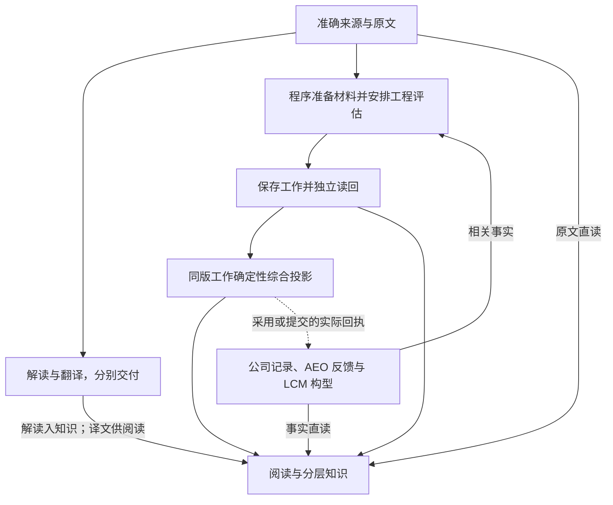
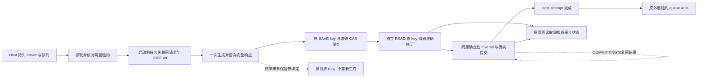
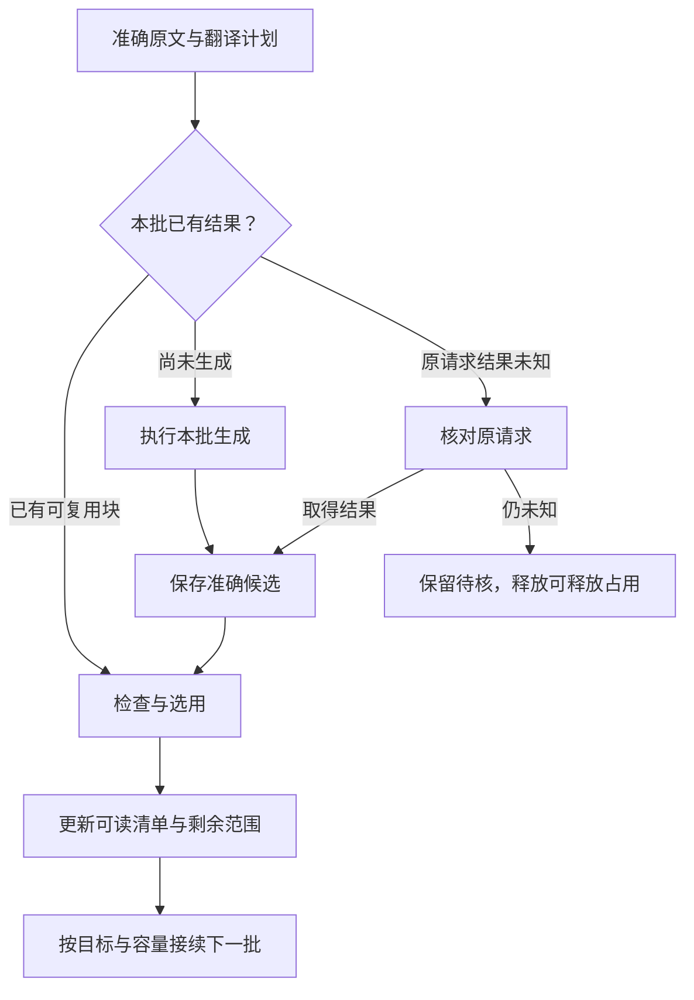

# WiseLink 主线流程图契约

版本：1.9.1 RC1主线接线局部更新 · 日期：2026-10-28 · 业务时区：Asia/Shanghai

## 设计结论

**WiseLink 围绕准确来源和已保存的工程成果工作：能读的立即读，需要分析的按明确问题推进，正式决定与实际落实按原系统事实显示。开发和运行监控共用节点、依赖和完成含义。**

本契约保留当前 13 个能力节点及既有业务对象，收敛共同规则和实际接线。Host 管理业务真值；每类请求使用一套明确的执行与恢复协议，同一请求在任一时刻只有一个有效执行者；任务图从这些记录生成。验证阶段可直接调整不合理的串行和重复执行机制，以一条可保存、可读回、可接续的真实链路证明设计。节点、关系和场景数量是当前目录，不是禁止合理增删的业务约束。

v1.6 已修正证据匹配、接入范围、实施顺序与资源含义；v1.7 补入程序控制评估、准确材料阅读和保存后独立阅读。v1.8 已约束持久任务、消费者宿主和 Codex 进程的责任及恢复接线；v1.9 补齐启动前输入留存；v1.9.1 原阶段作为文档后继更新 Linux/Codex 入口、两个拟定根及首测和长期恢复边界，产品当时冻结0b48366e/542edca3；本次最新技术与业务分层见§6.6。配套交付物是 M2 离线验证阅读器和 M3 业务页面诊断投影；这里 M2/M3 是交付阶段编号，不是产品运行模型。各消费者的本地实现、发布与真实运行按准确证据分别登记，不代表全系统运行监控已经完成。固定提交 b37 的源码核对保留为历史；后续实际接线及 2026-10-23 对话分工见附录 E，当前实施和业务状态以集成记录及 M2 为准。

后文既有实施记录、版本和待办均保留原观察时点；发生冲突时，当前五处接线及实际发布／业务状态以§6.6和同源进度记录为准。

### 阅读顺序

| 使用者 | 先看什么 | 需要时再看 |
| --- | --- | --- |
| 产品与工程负责人 | 第 1 节业务主线、第 5 节页面、第 7 节交付 | 附录 B 的领域规则 |
| 开发者 | 第 2—4 节共同契约、第 6 节接线 | 附录 A 节点、C 边、D 验收 |
| 运行维护者 | 第 4 节恢复、第 5 节任务监控 | 第 6 节责任绑定和附录 E 实施证据 |

主文规定共同含义；专项章节只规定领域差异；节点、边和验收目录提供索引。实现例子中的字段是语义示意，映射到现有对象即可。

## 1. 从工程师需要的结果定义主线

工程师打开系统，应快速回答：**发生什么、影响谁、公司怎么安排、落实到哪、下一步做什么、依据在哪里。** 系统工作分成三条可以独立交付的路径。

| 路径 | 主要产物 | 何时给工程师看 |
| --- | --- | --- |
| 资料与阅读 | 准确原文、定位、本版解读、按需译文 | 相应成果可读即展示 |
| 工程判断 | 适用性结果、持续保存的 JobAid 工作、综合建议、知识积累 | 按实际保存范围展示，并说明尚未覆盖的实质变化 |
| 公司安排与落实 | 已批准评估意见、工程文件及措施、AEO 反馈、LCM 构型 | 原生事实取得后展示，分析使用情况另行说明 |

### 1.1 主线概览



这是业务关系概览。实线表示按问题需要的资料或成果消费，虚线表示现有业务动作的实际回执；连线本身不派发任务。公司与机队节点汇总原系统事实，动作回执只更新其实际对应的公司记录，AEO 反馈和装机事实从各自来源取得。阅读层随时呈现已取得的成果与事实。

**已发布程序控制批次的执行方式（a65/c240现状）。** 程序通过既有授权路径准备准确连续材料、安排明确步骤，模型完成工程分析，程序负责完整响应留存、正常 SAVE、独立 READ、合法初评 Overall 投影及执行收尾。自主调查继续完善，显式程序评估不启用开放式工具循环；旧封存请求和 UNKNOWN 不由新路径接管。图中的材料准备、生成、保存和投影是既有节点的内部步骤，不新增同级业务模块。完整范围与联合验收见[第一批实施计划](coordination/WISELINK_PROGRAM_CONTROLLED_ASSESSMENT_20261025.md)。

**当前第一批优先级：执行器切换与首个新真实事项。** 新执行器接入既有Host能力，按准确授权任务与材料→生成→Host SAVE→独立READ→确定性同版Overall→页面/图→正常结束推进。先让一条新真实事项闭合这条链；c241整包安装、旧UNKNOWN救回和旧链复演不再作为前置。a65/c240仍是已核实线上实现，旧封存请求、UNKNOWN与active claim保留，不据此说明已经更换执行器；当前选择性客户端组合与现场准备见E.40；94c54、925和0b33原验证分别保留在E.38、E.39和E.36。[执行器切换实施说明](coordination/WISELINK_EXECUTOR_TRANSITION_20261025.md)与现有接口包分清本地候选、宿主未验和真实业务缺口。材料、生成、保存及投影仍使用既有业务节点与状态，不新建状态体系。

一份工作保存问题分析与综合正文；Overall 是准确保存工作经实际读回后的确定性阅读投影，过程是实际执行记录的投影。工作阅读不等待 Overall。公司事实、原文、解读和翻译仍可分别交付。图示与契约的改变表示接受了实施方向，不表示代码、部署或真实业务已经完成。

主界面按五组组织：**来源、阅读交付、工程工作、公司与机队事实、知识积累**。点开相关组再显示其能力节点；13 个稳定 nodeId 见附录 A。重试、批次、租约和日志属于节点详情。

**交互入口。** 新 Aily 可从无固定对象的问题开始，经 Host 在权限内跨文档/事项搜索，再展开准确原文、原生事实或已保存工作并引用。工作台内的交互分析由官方 Hosted OpenClaw 承接；普通 CHAT 不改变工程工作，明确更新才进入既有评估和保存链。两种入口消费同一来源与成果，不新增一套业务节点或当前结论。具体数据接线见[对话数据接入方案](WISELINK_DIALOGUE_DATA_ACCESS_PLAN.md)。

### 1.2 业务对象保持准确

文档族组织正式版次；DocumentVersion 标识准确原件；解析修订标识原文结构；WorkItem 承载文件评估；EngineeringMatter 组织工程问题；保存工作、Overall 和 Wiki 各有准确修订。AEO、评估单、单机反馈及 LCM 记录保留原系统身份与时间。

一份文档可独立解读或翻译，也可为多个事项提供不同依据。相似标题、同 ATA 或同设备只能帮助发现关联。事项归属按真实问题及用途建立，执行状态归属于具体措施和对象。

## 2. 共同规则与责任

### 2.1 十项共同规则

| 规则 | 唯一规范含义 | 主要展开位置 |
| --- | --- | --- |
| R01 直接阅读 | 读取已保存内容和监控状态为只读操作；每项成果独立可见 | 第 5 节 |
| R02 原文判断 | 翻译服务于阅读，工程分析使用准确原文和原始记录；全文翻译不是调查前置 | B.1—B.3 |
| R03 独立保存 | 分支分别保存；局部失败保留其他有效成果；结束一次执行与目标完成分别判断 | 3.4、B.2 |
| R04 准确消费 | 请求基线固定，取证引用可在授权问题内增加；成果记录实际使用的准确输入 | 第 3 节 |
| R05 分开表达 | 执行、成果、依据覆盖、正式业务四类事实分别表达 | 5.3 |
| R06 按影响更新 | 匹配已消费引用及已登记待补条件，只更新有关范围；保存只关闭实际覆盖的需求 | 4.1 |
| R07 真实并行 | 数据就绪和资源准入分开；独立工作并行，共享写入由 Host 事务/CAS 控制 | 3.3、4.2 |
| R08 复用与恢复 | 已保存结果先读回；提交或生成未知先核对原请求；封存提交只恢复原准确结果 | 3.4、4.4 |
| R09 责任清楚 | Host 管理业务真值，原系统提供其正式事实，同一请求只有一个当前有效执行与恢复 owner | 2.2、6.2 |
| R10 图文同源 | 图定义、实际消费者和监控使用同一语义；图从真实记录投影 | 第 6 节 |

上述规则由系统承担。原生准确关联和确定性规则足以成立时自动处理；确有歧义、冲突或原业务规定人工动作时，进入现有处理入口。页面只显示影响当前判断或下一步的具体差异。

### 2.2 最小职责

| 责任方 | 持有的事实与动作 |
| --- | --- |
| Host | 身份/来源授权、业务对象与版本、请求范围、成果校验和幂等保存、当前成果选择、正式业务动作准入 |
| 选定的执行组件 | 请求受理后的领取、执行占用、心跳、退避、超时、延后、恢复及结束；具体组件在接线表指定 |
| 执行端 | 在准确请求范围内取证、计算或生成候选，回传结果和执行事实；本地检查点辅助恢复 |
| 程序控制评估中的模型 | 根据程序交付的准确材料生成工程工作；不自行扩展步骤、改变范围、决定保存和结束 |
| TDMS、LCM 等来源系统 | 提供原生文件、批准/工程记录、反馈或构型事实；保留来源状态和修订关系 |
| 工程师与既有业务角色 | 问题与更正、需要人工处理的实际分歧、原业务范围内的采用和正式动作 |
| 页面与运行图 | 读取真实成果、条件和进展，调用已有动作入口；显示责任清楚的下一步 |

来源授权表示允许处理什么；执行租约表示哪个消费者暂时占用哪次执行。两者各自有生命周期。已有双层机制若保留，必须写明各层职责和一次性释放顺序；验证证明可由一个执行组件承担时直接收敛，历史请求保留可核对记录。

### 2.3 首批 CODEX 接线的执行责任

本节先约束实现和验收，再登记实现证据。当前集成源码的活动执行器由 Host 配置选择；部署、配置及真实新事项运行分别核验。新执行器进程不是业务队列，模型完成也不是任务完成。

| 责任层 | 现成对象与职责 | 不可代替的事实 |
| --- | --- | --- |
| Host 持久任务与队列 | WorkItem 自动处理授权及其 intake 请求、ActionAttempt 的封存 task、状态、租约、CAS、幂等成果、Overall 和最终 ACK 准入 | 检查点文件、进程退出或消费者自报不能改变 Host 真值 |
| 消费者宿主与可信程序 | 唤起并监督实际消费者；使用固定 CODEX 路由领取一个新事项；保持两层 fence、持久检查点与 child run 关联；安排生成、SAVE、独立 READ、commit、收尾和 ACK | 宿主重启与目录持久性必须有实际配置或运行证据；脚本存在不证明常驻、调度或卷已成立 |
| Codex 子进程与模型 | 在程序交付的准确输入和已固定执行模型下完成候选；回传准确 run、transport 闭合及完整响应定位 | 子进程不能自定业务 requestId、租约、来源范围、正式采用或结束队列 |

每次业务尝试只有一个有效执行/恢复 owner。Host 新旧入口按固定活动执行器互斥，CODEX 使用独立运行 app、principal 和精确路径授权；新服务名称本身不授予权限。协议中仍合法的 `OPENCLAW` 类型或工具版本键，与实际运行端身份分别解释，不全局改名也不借旧凭据放行。

**首测现场与恢复边界（2026-10-25 历史观察）。** 当时新执行端通过用户指定入口读到Ubuntu22.04.5、Node22.22.1、Python3.10.12和Codex0.164.0；拟定的 `STATE/checkpoints` 与 `STATE/runs` 当时尚未创建或验证。原首次目标是当前实例内一个新事项及一个显式启动并值守的worker，不配置自动重启或cron；长期无人值守、闲置回收和实例替换恢复另列未验。该历史准备状态不替代§6.6的后继安装与业务事实，准确私有路径仅保留在原回执映射。

本地完整响应落盘并fsync后报完成的源码顺序已经存在，12项Linux专项仍未在目标机验证。若上游已生成而尚未可靠留存，或仅存overlay且尚未Host SAVE时实例丢失，当前没有已证实的原标识完整响应重取能力；值守不能消除此窗口。按原请求/原SAVE key查询，未知不重派，不把本地空目录当从未运行。官方可重新激活闲置项目不构成具体目录保留保证；平台凭据仅按method/path限制，WI/intake的对象边界由Host授权与事务守卫实现。

三种 requestId 分别是：外层 **intake requestId** 绑定原获权事项及本次受理；**stage/action requestId** 绑定封存动作 task 与 attempt；**SAVE requestId** 固定一次准确正文/CAS 命令的幂等身份。三者不得混用，attemptId 也不是 requestId。两层 lease 分别是外层事项授权领取的 owner/token/generation/期限，以及内层 ActionAttempt 的 token/generation/期限；按实际操作校验有效绑定，模型不得写入或覆盖它们。

启动子进程前，可信程序必须持久关联 intake、stage、attempt、执行器、选定模型、准确输入/argsHash、检查点及预定 child run。已有绑定只恢复原 runner/run；已启动但完整响应未知时保持 UNKNOWN，不改 key、不新启模型、不清检查点。完整原响应应与 adapter 请求、实际 prompt、bridge payload 和 child run 对应；仅最终文本或 metadata audit 不等于完整上游响应。现有存储中完成即可，不另建通用调度或日志平台。

消费者默认每次最多 4 项串行、15 分钟是本次循环的任务数/边界预算，不能推导为 4 并发或运行中的强杀截止；ActionAttempt 四槽的实际隔离维度是 tenant/request_origin，不能写成全系统 4 并发。索引活动谓词以准确现库定义核验；migration 与生成 schema 的差异本身不是线上故障证据。

### 2.4 翻译恢复与旧内容处置边界

本节的三个新增文档翻译动作属于独立 P1 交付；本首测核心未合入，不出现在本树 SDK 工具输入中，也不是初评交接的前置条件。

文档翻译沿用既有 `document_translation/WORKSPACE` 入口。查询原 generation 与 SAVE 回执属于读取：即使原 lease 已过期，也不能顺带 expire、CLAIM、attach、重写块或触发模型。已经保存只返回准确原 receipt；未知原请求保持待核。`REGISTERED`、TTL 已过或首次 NEXT 存在，均不证明候选已完成或可以再次 SAVE。

未保存的跨 lease 恢复仅消费 Host 在原有效 fence 下持久封存的完整候选。封存绑定 tenant、actor、可信 executor principal、attempt、workspace、task/input、原 source 与目标 block 版本及 generation；恢复不接收替换候选。Host 按一致锁序重新校验权限、输入和版本，CAS 接续一次保存；旧执行者迟到使用原 fence 必须被拒。封存前退出仅有本地模型回执时仍待核，客户端不能把自己的“完成”声明等同于 Host 已封存。实现阶段、客户端接线、离线验证及实际恢复分别登记。

2026-10-25 用户明确：旧内容不必成为新版兼容前提，可以清理或按新版重新生成，但必须安排处置。旧接口导出、演示与历史说明标明适用版本和替代物；当前实施只维护一份契约和图。旧业务成果按“可清理、按新版重生成、保留取证”列出具体对象与依赖；新生成走正常新请求，不迁移原请求身份。原 ATT5 等 UNKNOWN、在途和已提交未确认记录保留取证，不自动重放或清除。此规则不把本地候选当已部署，也不把清理建议当已执行清理。

## 3. 一次请求的最小可执行契约

### 3.1 身份与观察范围

每次操作关联：**nodeId、真实 subject、现有 requestId、目标范围、请求基线、执行/恢复 owner、输出引用**。attempt、batch 和 lease/fence 是下钻信息。

运行实例观察键采用现有身份组合，例如“nodeId＋subject＋requestId”；精确来源、成果和范围仍以实际引用表达。相同节点与对象可以同时存在历史成果、进行中请求和待核原请求。节点摘要保留这些请求的数量与入口，不能只取最后一条记录覆盖其他状态。暂停、恢复和取消均绑定准确请求/尝试。

不需要为观察范围新增通用 workflow 实体。节点图保持稳定，执行实例在节点下聚合。

### 3.2 固定基线，允许正常取证

| 集合 | 内容 | 运行中的处理 |
| --- | --- | --- |
| 请求基线 | 问题/目标范围、选定源文件版次、目标事实范围、已有工作或综合基线 | 受理后固定；来源正式改版、目标实质扩大形成后继 |
| 本轮取证引用 | 调查过程中在现有范围和权限内发现的新参考、原始记录及定位 | 可以追加；记录准确版本、实际读取和用途，保存时纳入实际消费集合 |
| 后继需求 | 替换基线、新目标、明确更正、后来满足的待补条件 | 归入相关对象，保留原因和范围，由后继工作处理 |

发现一份新的相关参考不必重启整轮调查。把已选源文件换成新版、把一个问题扩大为另一项调查，则须明确形成新的范围。首版采用固定基线加后继即可；无需先实现运行中任意改范围的协议。

读取、选入、实际用于判断、最终保存覆盖是四种不同事实。保存成果应能追溯实际消费的输入集合；缺失记录如实显示，不能从上下游都成功推断已经消费。

消费引用由实际取数、组装该次分析输入的路径记录，与原结果一同保存；SAVE 时不能从“当前最新资料”回填一组未经本次处理的引用。仅登记或预取不计为覆盖。引用关系可证明实际提供的输入，内容验收还需核对相关条件是否在输出中正确处理。

程序装配将存储条目组织为连续条款、段落与表格，保留跨页条件、否定、例外、期限、表头、单位和脚注及原始条目映射。接口分批和初始内联条数不代表工程阅读复杂度。实际输入须由留存的材料包/准确序列化输入，或不可变来源与准确装配版本重建；只有目录或字节数不足以证明正文组成。超过容量时明确限制或采用程序安排的有限分段，不静默截断后宣称整份已完成。

### 3.3 就绪与准入

Host 的既有请求准备或领域服务，按本次操作确定三类条件：**必需输入、可选输入、允许缺失并带明确限制的输入**。这可以是持久字段，也可以由准确请求及固定规则重算；执行与监控共用同一个判断。

```text
业务就绪 = 本次操作的必需输入满足，允许的限制已经明确
可以开始 = 业务就绪，授权有效，实际执行资源允许准入
判断结果 = 是否就绪 + 具体阻塞项 + 本次允许的限制
```

准入不要求先长期持有对象写锁或数据库事务。请求使用准确基线执行，提交时由 Host 做短事务和 CAS；基线已变时进入明确的冲突或后继处理。等待资源与正在执行分别观察，不通过预先占住一种资源再长期等待另一种资源制造多层排队。

例如，“提取文件适用条件”需要准确条款；“判断指定机队是否适用”还需要对应目标事实。允许逐机给出已判定与未知范围时，应在请求目标中说明；模型不能为了继续而把必需事实改成可选。

等待原因只分成工程师或维护者可处理的几类：**缺输入、等资源、按计划延后、明确暂停、核对原结果**。翻译正在运行不是 JobAid 必然缺输入；一份软件资料缺少构型不阻止其他原文问题保存。

### 3.4 保存、提交与目标完成

| 边界 | 成立条件 | 结果含义 |
| --- | --- | --- |
| 候选已产生 | 取得可核对的输出及引用 | 仍需通过相应成果校验和保存 |
| 提交已封存 | 原请求的准确提交 payload 与必要引用已持久固定，如现有 COMMITTING | 后续只恢复这份结果或核对其提交；修改内容形成关联后继 |
| 成果已保存 | Host 幂等保存成立，取得准确成果引用并能独立读回 | 已形成可复用业务成果，执行可能仍待收尾 |
| 成果可读 | 对应节点的选用/检查条件成立 | 页面可显示相应范围；保存数与可读数可以不同 |
| 请求目标完成 | 本次目标范围达到该操作的成功判据 | 不能仅由“worker 退出”或“原因已解释”推导 |
| 执行占用结束 | 执行 owner 已按协议释放或结束此次占用 | 原请求可能成功、部分、失败、取消或仍待核 |

“本次可以停止工作”和“业务目标成功”分别映射到原协议。部分结果可保存；明确失败有准确原因；未知结果保留待核。无需把所有既有服务改成同一套状态枚举。

尚未封存且明确在写入前被拒绝的候选，可按原协议纠正后提交；封存以后不能用修改 payload、普通归还后重新生成来冒充恢复。查询一次结束可以释放此次 worker 占用，原封存/待核请求仍由指定 owner 接续。

程序评估已取得完整响应而保存失败时，优先从原检查点恢复同一响应的保存；保存确认丢失时核对原幂等身份；工作已保存而 Overall 失败时仅恢复投影。初评不得借用 Review 专用入口或制造复核记录。确定性综合关联实际 READ 的工作修订，按问题合并保存时综合覆盖必须与合并后问题一致，局部综合不能覆盖全事项。

运行图至少分别显示“已生成，尚未保存”“工作已保存，综合待更新”“成果已可读，执行仍在收尾”“原请求结果待核”；仅有真实核对动作时才显示正在核对。自主调查未启用以本次封存执行方式为依据，不能对旧请求猜测。模型生成中没有真实分步事件时只显示正在综合分析。成果与依据下钻始终读取准确版本，刷新与切换不重新生成。

### 3.5 当前事实与当前分析

公司新批准意见、工作新修订或目标变化取得后可以立即显示。当前综合仍显示它实际使用的输入，例如“综合采用工作 3；工作 4 的构型条件尚待纳入”。

Host 以准确基线、覆盖及并发规则选择当前成果。新结果保存后再切换可读指针；较晚到达的旧基线结果可以按原协议保留为历史，不能仅凭保存时间更晚覆盖较新有效判断。某项变化经核对无影响时保存该结论，原综合仍保留原来的实际消费引用。

### 3.6 首个新事项的真实闭环及反例



| 边界 | 准确完成证据 | 必须拒绝或保持未验的反例 |
| --- | --- | --- |
| 输入与一次生成 | 正文/准确版本、adapter 输入、实际 prompt/payload、同 request/attempt 的 child run 和完整响应持久关联 | 只有目录、最终文本、模型名或退出码；已 started/UNKNOWN 后换 run 重新生成 |
| SAVE | 原稳定 SAVE requestId、正文与 expected revision 通过 Host 实际事务，返回准确 workRevisionRef | 换 key 重试、借旧 owner、缺实际来源授权、只有模型工具调用意图 |
| 独立 READ | 按原 SAVE key 和有效 fence 独立读取同 attempt 的准确完整修订，保存 READ observation | SAVE 响应当 READ、读 latest/旧基线、混用 intake 与 SAVE key |
| 确定性 Overall | 消费这次 READ 的准确工作，实际 commit/CAS 与 sourceAssessment 绑定成立，不再生成模型 | 仅纯函数投影或合成回执；COMMITTING 后改 payload/重新生成 |
| attempt 结束 | Host 实际终态及投影完成回执；UNKNOWN 与明确失败分开 | 消费者退出、进度条或文件归档当成功 |
| queue ACK | 同一外层 owner/token/generation 的 ACK 获 Host 确认，且规定业务阶段已完整完成 | attempt 成功直接推为 ACK 成功；迟到旧租约写入/ACK、强行 BLOCK UNKNOWN |
| 原阅读面 | 原用户权限内读取同版 work/Overall/来源与实际执行状态 | 本地 HTML 或接口 fixture 当生产页面、正式采用或工程内容验收 |

这些步骤映射到既有 `assessment.research`、`assessment.overall`、阅读节点及 `research.overall`、`save.finish` 接线，不新增业务节点或状态枚举。开发变更必须同时指出对应规则、实际代码消费者、正反例和证据级别；未取得真实网关/数据库/页面回执的步骤继续未验。接口差异、路径和配置记录集中于[现有 Host↔Codex 接口包](coordination/host-codex-interface-20261025/README.md)，不把另一端源码导出或离线 schema 数量当成线上合同冲突。

## 4. 更新、并行与恢复

### 4.1 更新采用一套规则

变化先匹配两类关系：**实际消费过的准确引用**，以及**已登记的待补范围/条件**。后者覆盖以前不存在的构型事实、新增目标成员和后来补齐的资料。未命中相关用途的变化只更新来源或显示。

| 变化类型 | 默认动作 | 何时需要工程分析 |
| --- | --- | --- |
| 普通 AEO 反馈、计数、索引、位置或同步时间更新 | 确定性刷新事实/统计 | 出现与已有判断有关的实际异常或反证 |
| 新批准意见、措施范围或共同前提改变 | 标记相关差额；已有工作足够时直接更新综合 | 既有调查不足以解释新条件 |
| 正式资料改版、关键原文更正、构型条件变化 | 定位受影响问题和判断 | 更新相关 JobAid，再更新实际受影响的综合/Wiki |
| 新参考在本轮问题范围内被发现 | 登记准确取证引用并继续 | 属于当前调查本身，无需另建整轮任务 |
| 待补条件满足、目标成员新增 | 唤起已登记的有关后继需求 | 仅处理受影响范围 |
| 无实质变化或变化与该结论无关 | 记录确定性比较或有依据的无影响核对 | 不为同步次数调用模型 |

后继需求在既有存储中持久保留并可补扫，触发通知只是唤醒信号。同一范围的连续变化合并；保存只关闭实际覆盖的需求，更新期间新到变化继续保留。已知错误或失效依据应立即在有关阅读处明确标识，修订生成可以随后完成。

### 4.2 并行与资源

解读、翻译和输入足够的调查可以并行；适用性只约束真正依赖其结果的问题；Overall 可以基于已经保存的工作推进，调查继续形成后继。Wiki 消费已保存成员。所有共享指针及业务状态写入由 Host 事务、版本和 CAS 校验。

按真实瓶颈分别限制执行 worker、模型调用和数据库连接。只在准备实际执行时领取；明确不自动执行的预算/暂停任务先排除。已领取后发现应延后，使用原 token/generation 的正常延后或归还入口，保留原因与下次可执行条件，并完成相关占用释放。释放前由 owner 区分普通未开始任务、已准备任务、封存提交与外部结果待核，只释放协议允许释放的占用，保留原请求及恢复绑定；已准备任务不能因外层换代留下不可接续的旧绑定。

本地检查点记录辅助信息，不替代 Host/执行 owner 的生命周期。清除本地 active-claim、归档领取文件或停止进程，均须与权威状态的真实转换对应。

资源按六种用途观察；只有确认存在独立约束或实际争用时，才增加相应准入控制：

| 资源 | 管理范围 | 占用与释放 |
| --- | --- | --- |
| 逻辑任务执行位 | 正在推进的一次请求/尝试 | 缺输入、明确暂停、等待未来时间不长期占用；执行 owner 管理 |
| worker/handler | 实际进程或并发处理能力 | 可以多个并行 worker，统一协议和责任；唯一 owner 不等于单 worker |
| 模型并发/速率 | 实际 provider/profile 的调用数、RPM/TPM 等 | 调用前取得额度；原调用结果未知时保留可能仍在执行的占用信息 |
| 提交与恢复资源 | 封存结果保存、读回、补 ACK/finish、原结果核对 | 使用有界的短恢复步骤，复用原绑定；不重新占模型生成额度 |
| 数据库连接/事务 | 读取、领取、保存等短操作 | 外部模型等待期间不持有长事务；按实际连接/锁等待调优 |
| 对象写入协调 | 同一工作修订或当前指针等真实写入冲突 | 提交时做 CAS/短协调；同对象的无冲突分支可并行 |

以上是逻辑资源分类，不要求六套额度、服务或队列。首轮复用已有执行池、实际模型限额、数据库连接池及 Host 写入控制；逻辑任务位若只是重复 worker 限制，不长期保留双重排队。确认调用结束后释放并发占用；请求数/token 速率预算按实际 provider 的时间窗口或配额规则结算。原调用未知时，按原调用查询、可确认超时或明确策略处理，不能直接当作零占用；查询接口自身的限额也应遵守。

COMMITTING 保留原准确结果与恢复 fence，目标上与模型生成容量分开。只有准确结果已持久封存、原调用状态明确、恢复能独占接续且真实 worker 可以复用时，才调整容量记账。同步核对常量、数据库约束、领取、恢复及监控；不能仅改状态名称或移出槽位就宣称释放了真实资源。优先补齐已有提交恢复路径，不另建平行保存真源。

本地 owner 锁只保护实际共享检查点/本地资源。解除单 owner 锁前，核对领取指针、检查点、预算和会话是否按请求隔离；不同请求可以由不同 worker 执行。运行数据应分别记录任务就绪等待、worker 占用、provider 容量及未知数、恢复积压、数据库连接等待；没有读到的数据显示未取得，不用历史默认数补齐。


### 4.3 四类时间各有含义

| 时间 | 起点与用途 | 对应处理 |
| --- | --- | --- |
| 排队有效期 | 从受理起，限定任务在等待中仍值得执行的时间 | 过期后重新判断输入和需要，不能伪装已经执行失败 |
| 执行超时 | 从该次实际开始执行起，限定运行资源占用；核对未知请求有独立有界步骤 | 超时先确定原结果与保存状态，再决定恢复或终止 |
| 心跳/租约 | 从领取或续租起，检测消费者是否仍持有执行权 | 失联后由指定 owner 接续；旧 fence 无权迟到写入 |
| 业务绝对截止 | 来自实际业务期限，独立于排队和重试 | 不能因续租自动延后；若当前无法按期完成，显示具体事项和时间 |

人工准备、授权等待和明确暂停如何计入排队有效期，由该任务的既有策略规定；它们不冒充已开始执行。重试必须有总尝试/累计时间或业务截止约束。用户总等待从原请求受理计算，不因重领或重试清零。调整时间语义时同步核对准备、worker、续租和过期扫描的实际判断入口。各时限依据测量配置，本契约不固化历史 30/60 分钟默认值。

### 4.4 恢复矩阵

| 观察到的事实 | 唯一恢复入口应做什么 | 页面如何表达 |
| --- | --- | --- |
| 明确未发出外部请求、尚无结果 | 按准入条件重试或延后 | 等待/延后及原因 |
| 模型请求结果未知 | 按原调用身份查询或核对；有界退避，保留待核 | 正在核对原结果 |
| begin已发出，本地started无result；Host却确认准确原请求首次执行前FAILED | 原owner重核tenant/actor/WI/DVI/operation/request及输入；仅Host可证原initial-request为显式准备FAILED、claim0且无执行/结果/提交证据时，另记权威失败对账及外层BLOCK intent/回执，经既有reclaim/BLOCK和队列归档收尾。保留begin started/UNKNOWN原记录，不补成功或失败result；绑定不符或有执行证据仍待核，不重放begin | 原请求显示准备失败，Native/授权收尾分别待核；旧成果独立可读。SAVE0不套用已保存或封存恢复，BLOCK也不表示业务成功 |
| 候选明确在写入前被拒绝 | 保留具体原因；在未封存边界内纠正 | 保存被拒绝及可处理原因 |
| 提交已封存 | 只恢复原准确 payload/回执；查已保存成果并补终态 | 提交处理中/核对提交 |
| 保存响应丢失 | 按原请求与幂等标识读取实际保存记录 | 保存已核实；按节点检查/选用条件显示可读状态 |
| 保存成功，ACK/finish 丢失 | 复用准确成果补收尾 | 成果已保存、执行待收尾；可读状态独立显示 |
| 租约失效、旧 worker 返回 | Host 拒绝过期 fence 写入；当前 owner 核对原结果后接续 | 执行已转交，保留原请求历史 |
| CAS 冲突或基线已变 | 核对已成立的当前结果；需要新内容时建立关联后继 | 显示已采用结果及剩余差额 |
| 翻译块已保存但待检查/未选用 | 检查和选用原块，只补不合格范围 | 已保存与可读分别计数 |
| 投影或索引暂时失败 | 从业务记录重建投影；保持仍获权的已有正文 | 内容截至时间、刷新状态 |
| 暂停、预算受限、正常延后 | 持久记录原因/恢复条件，释放允许释放的本次占用；条件满足再准入 | 暂停或延后及具体条件 |
| 取消临近提交 | 核对取消是否实际生效及已成立结果；返回准确结果 | 已取消或已保存，按事实显示 |
| 权限撤回、账号/对象切换 | 撤权时停止不再获准的读取、生成和保存，由 owner 按协议收尾或隔离；账号/对象切换时重新绑定读取范围，使不再允许显示的缓存失效 | 已有成果按当前权限显示 |

原请求由接线表指定的一个 owner 负责恢复，其他端只调用它。来源授权可复用，执行租约按原协议取得；需要“先精确领取再读取”的服务路径由该入口统一处理，避免操作脚本形成前置条件环路。

核对原结果设定查询能力、重试间隔和结束条件。供应方无法查询时，先使用现有回执、封存候选和业务保存记录；仍无法判断则保留明确未决。根据已授权策略或具体操作决定是否发出新的关联请求，避免无限自动等待或盲目重复。清理/连接关闭失败单列，不能覆盖原业务成功或真实错误。

### 4.5 在途交接与回退

验证阶段可以淘汰重复机制，不必永久双轨。切换或回退时先停止相关范围的新派发，再按真实副作用处理：未准备且无调用/结果的请求可明确交接；已准备请求核对原输入和 generation 绑定；已调用或未知请求保留原调用身份；已封存及已存待确认请求继续恢复原结果。同一请求只由一个入口取得有效恢复权。

回退代码不等于回退已经发出的调用或已经保存的业务事实。旧消费者重新启用前，确认其认识当前请求、绑定和保存格式；不删除待核结果、重置请求起点或重建同义任务来恢复表面可运行。

旧版数据处置：每次结构或语义升级明确受影响数据及负责消费者，选择迁移、按新版重生成或清理，并处理旧引用、当前指针、索引、缓存和下游，按准确范围读回。不要求永久双读或保留兼容层。重生成沿已有获权来源、新版语义及正常保存/采用边界，正式原生事实不可由模型替造。UNKNOWN、COMMITTING或其他结果未决请求先核原结果与副作用，再判断可处置范围；未来允许清理的方向不构成本次全库清理授权。

## 5. 页面与运行监控

### 5.1 工程事项首屏：三个区域

| 区域 | 默认展示 | 展开内容 |
| --- | --- | --- |
| 当前判断与范围 | 事项名称、当前工程重点、适用性模块结论、影响对象、决定性条件 | 适用性理由、例外及逐对象结果 |
| 公司安排与落实 | 当前已批准意见、相关工程文件/措施、逐份 AEO 进展、最近业务期限；相邻展示系统综合建议 | 多专业原意见、措施范围、单机反馈、具体差异及依据 |
| 变化与下一步 | 尚未纳入的实质变化、待核对象、下一项可执行工作 | 准确请求、保存工作、原文定位与历史 |

批准意见和系统建议用清楚标题区分，默认显示对当前工作最重要的内容。不常驻泛化的“尚未核实”提示；仍影响当前判断的具体未知、缺项和差额持续显示，有差额时写成具体一句话，例如“新增批准意见尚未纳入本次建议”。

技术进展、公司评估与措施落实分别按实际来源显示，例如已有 FTD/TFU、已发布 SB/SL、公司工程文件已颁发、某份 AEO 已反馈完成。它们不是互斥的单一事项状态；每个标签关联准确文件、对象或措施，只有真实来源记录足以成立时显示。

事项正文按需要使用背景、原理/分析、临时措施、最终措施、里程碑等段落。FTD 结构用于组织技术说明，页面不要求每项填满固定模板。文件页则以指定文件编号、标题和正式版次为首，展示该版解读，并连接事项当前情况。文件历史页保持历史版本含义。

### 5.2 阅读与任务各有默认视图

工程师先看到成果与具体下一步。任务列表默认显示：**对象/目标、正在做什么、已有成果、等待原因、下一步、最近有效进展**。按需进入“流程”查看相关节点和实际消费边；已存在的原文、双语、JobAid、Wiki、LCM 页面直接复用。全系统列表的每条记录带准确对象与请求/尝试身份；点击后进入单事项诊断。有限 latestAttempt 观察不能作为全系统请求数。

运行节点可同时显示“1 个进行中、1 个待核、已有可读成果”。事实节点显示截至时间、覆盖和记录状态。读模型没有提供某类数据时写“本视图未读取”或不展示无关空项；只有已核实系统未接入时才写“未接入”。空数组是否代表零记录，取决于返回范围是否完整；有限或未提供集合不得汇总为零任务。不存在真实请求时不虚构排队或执行条。

### 5.3 四类状态并列，不相乘成巨型状态机

| 维度 | 要回答的问题 | 显示例子 |
| --- | --- | --- |
| 执行 | 这次请求/尝试在做什么？ | 等输入、排队、运行、核对原结果、已结束 |
| 成果 | 什么已经持久可读？ | 无成果、部分可读、可读、待检查 |
| 依据覆盖 | 当前成果覆盖哪些输入与目标？ | 已覆盖、部分未知、有相关新增待纳入、已核无影响 |
| 正式业务 | 原业务状态是什么？ | 原评估已批准、工程文件已颁发、AEO 某项已反馈 |

例如“综合可读＋更新运行中”成立；“译文部分可读＋本次执行结束”成立；“公司已批准＋系统建议尚待纳入”也成立。整体图不汇总一个虚假的总完成百分比。翻译覆盖和 AEO 完成数量分别使用自身准确分母。

### 5.4 显示最少但足够的信息

默认只呈现影响判断的范围、差异与动作。精确 requestId、fence、解析修订、原始错误和 provider 回执放在维护详情。错误信息保留可定位的安全原因；任务完成次数不能代替有效进展。

页面读取保持有界：首屏取当前成果摘要、准确引用、必要范围与任务摘要；正文、长日志、历史及大矩阵按需读取。身份、对象和权限作为缓存边界。暂时读取失败可以继续展示仍获权的正文及观察时间；撤权或账号/对象切换按新权限处理。

读取时间、来源事实截至时间和最近有效进展分别保留；页面重新渲染或轮询成功不推进来源事实时间。刷新中、读取失败或保留旧快照要准确表达。父级读取层负责对象切换、撤权和迟到回包，组件负责同范围刷新时保留阅读、焦点及输入连续性。环境资源指标标明环境范围，不当作当前单一事项占用。

## 6. 让图真正约束开发，并支撑运行

### 6.1 三层共用一套含义

| 层次 | 维护什么 | 落地方式 |
| --- | --- | --- |
| 静态契约 | 稳定 nodeId、edgeId、输入/产物、成功条件、规则编号 | 代码仓库中的普通类型、常量和本文；无需另造配置语言 |
| 实际消费者与业务记录 | 准确请求、输入、保存、采用及原生事实 | 在现有服务落实就绪、保存、覆盖和恢复规则 |
| 运行投影 | 真实请求、成果、消费边、阻塞原因、观察时间 | 从权威记录适配生成，供任务列表与图共同读取 |

能够共享的就绪/覆盖判断用普通函数共享。跨进程不能直接共享时，通过同一输入输出定义及真实消费者的定向验收保持一致。图不扫描静态箭头自动派发任务；关系变化通过原执行入口受理。

五类边保留不同含义：**消费、条件依赖、更新触发、读取投影、显式操作**。条件边是否激活由本次操作决定；更新边先形成需求；正式操作经原入口成立。完整模板见附录 C。

### 6.2 每条关键链路填一行实际接线

| 接线项 | 必须写明的内容 |
| --- | --- |
| 责任 | 对应 nodeId/edgeId；实际消费者；唯一执行与恢复 owner |
| 权威记录 | 请求/attempt 所在记录；准确输入引用；成果与当前指针所在记录 |
| 判定 | 本次目标、必需输入/允许限制、成功判据、提交封存边界；真实消费者的判断入口，以及投影复用方式或对应一致性测试 |
| 读回与动作 | 真实读取入口；已有开始/延后/恢复/结束入口；操作绑定的准确身份 |
| 证据 | 源码提交、测试环境、部署指纹如有、实际输入/输出、读回结果 |

至少先接三条：JobAid 保存→Overall 实际消费；翻译块保存→检查/选用→阅读；业务保存→执行收尾。TDMS 原件路径加入原生附件→FileService→DocumentVersion→解析→消费者的绑定。

实现验证按“接线、测试、部署、真实运行”四列独立呈现。证据保留准确版本、适用范围与原始报告；源码审阅按被审代码和入口判断，明确的 unit/contract 测试可以不依赖运行环境，部署与真实运行必须绑定相应环境。旧版本证据保留为历史，缺证据、明确失败和本次范围外分别表达。已部署不推导测试通过，旧版运行成功不推导当前版本完成。计数按明确选择的场景/链路计算，开发验证不合成总完成百分比。准确消费关系补在真实消费路径中，工程师页面按实际成果显示。

### 6.3 维护约定

改变依赖、输入或完成条件时，同时更新相应实际消费者、投影及受影响场景。普通实现重构且语义不变时保留 nodeId/edgeId；图版本沿仓库版本管理。运行图不单独持有任务状态或自动修复循环。

### 6.4 Markdown、静态验证页与运行图

Markdown 维护规则正文和稳定 ID。轻量规范索引读取节点/边/场景及关联，接线记录维护真实入口，测试/部署/运行结果复用已有回执。静态 HTML 从这些材料生成或导入快照，用于筛选关键链路、定位缺口和查看证据；HTML 不另存手工“已完成”状态。

现有M2的12条关键binding映射11个节点、6条关系；`dialogue.bound-object-chat` 登记已绑定普通来源对象的保存工作读取与回答消费，`dialogue.document-version-chat` 单独登记无WorkItem独立DVI的原文问答读取。新增绑定只使用既有 `source.original` / `surface.reading` 和 `artifact.reading`，不把局部运行图的消息/执行节点加入主线业务目录。新 Aily 的跨文档入口继续独立保持未接通。这些数仅表示已登记的映射范围，不是13节点/47关系的开发完成率。未登记来源或关系先定位现有生产者、权威保存行、实际消费者及原证据，再补关键接线；不能据登记缺项重做已有保存、恢复或整张关系目录。

静态验证页显示契约版本、目标源码、目标环境、原始观察/生成时间和离线快照标识。导入时间不替代观察时间。未确定目标代码时不判断“当前已验证”；环境未定时仍可查看准确源码范围的审阅或明确环境独立的测试，但不能推导部署或运行通过。实际运行证据需包含准确对象、请求、输入、成果及独立读回。

证据关联带明确类型和范围。bindingId 与 edgeId 可以同名，不能因此共享通过状态；同一 V 编号也不代表另一条接线已验证。契约和源码身份缺失不能相等成有效匹配。每项证据仅归入其实际支持的链路、场景及证据类型，环境要求按前述类型区分。

原文件 SHA 用于追溯文档快照，不独立决定每项历史测试是否需要重做。纯文案或无关范围改动按受影响规则选择重验；未受影响的证据可另附明确适用说明，不能改写原执行版本或冒称已在新版本运行。配套阅读器展示精确匹配及历史记录，不承担自动证据继承或发布放行；已确认更正/撤回/取代的证据关系由原记录维护，未取得该关系时保留分歧，不能靠导入顺序或最新时间消除失败。

后续接线图沿用2026-10-24用户指定的本地主线进展样式：上方按来源、文档阅读、工程工作、公司与机队事实、成果使用五组展示13个可点击节点；连线按真实契约节点方向，支持所选范围与全部明确关系。节点/关系详情关联同一P0—P6的已交付、缺口、下一步、负责范围和完成条件，下方保留严格版本/环境核对与原证据。样式由现有generator和原生组件自动生成，数据继续使用当前snapshot/bindings/evidence；历史样式文件中的旧进度不覆盖当前记录，映射不等于开发或业务完成率。

运行图与静态页共用节点/边含义和必要的展示逻辑，分别接收运行投影与验证快照；不要求为复用离线原型固定采用第二套前端渲染体系。运行图嵌入现有工作区内容区，保留现有主题、导航、身份和读取机制；优先接 WorkItem 的工作/综合准确关系，再用独立 adapter 接 Matter 和其他范围。父容器读取一次供正文、列表和图共同使用，图组件不创建第二轮询循环。现有读模型仅给 latestAttempt 时明确覆盖有限，不能推造全部请求集合。

运行页面提供流程、请求、资源视图；接线与验证面向实施维护，按现有权限决定是否显示。节点展开、筛选和导入快照只有读取/本地呈现作用。查看成果和刷新交回原有入口；新增恢复动作必须绑定原请求及服务端允许动作。

### 6.5 故障修复与关闭矩阵

本矩阵把§3/4接到真实消费者、正反验收及关闭条件，分别记录**本地修复、技术交付、业务实测**。复用既有R/V/binding/P；V仅是规则背景，不自动证明本次变体已覆盖。独立小批只核必要依赖，不等待47条关系全登记，不增加状态平台或发布gate。

| 故障／当前差额 | 契约责任与既有定位 | 真实消费者／修复落点 | 必要正向与反向验收 | 关闭条件 |
| --- | --- | --- | --- | --- |
| Hosted JSON `?`兼容；95f随70交付，新AD已越过准备，其他入口按范围验 | R04/R09；V46/V30背景；`research.overall`、`company.approved-opinion`；P0 | roots投影及marker；`TdmsProductionRuntimeReader.discover/admitReviewInTransaction`、`TdmsRuntimeSession.resolveSelections`、Review metadata/browser verifier；另含`CanonicalJobAidProblemService.admitReviewSources`的missing-verifier探针 | 正：相同Hosted通道的实际投影/marker查询通过，获准后正常AD越过准备；反：null/object marker及saved Native证据仍拒绝缺verifier，普通无marker允许，撤权/缺lineage仍拒绝 | PG只证语义/边界，29/32 A/B只证该Hosted查询差异；本次新AD已实际准备/READ，missing-verifier探针不因此冒称已Hosted实测。其他消费者按必要范围验，技术修复与业务闭环分别关闭；有限静态扫描不证明所有SQL通道 |
| 初次准备FAILED与Native started/no-result并存；Host70/c238/C136已切换，本次明确准备失败占用已实测收尾 | R03/R08/R09；§4.4精确行、V46/V52相邻原则；`save.finish`、`research.overall`；P6/P0 | `ActionAttemptLifecycleService.prepareInitialRequest`及失败谓词；Native driver/queue；Host `blockWorkItem`及既有reclaim | 正：精确Host执行前失败另记外层BLOCK intent/回执，正常reclaim/BLOCK及归档；保留begin两个namespace原记录，不补result、不改UNKNOWN。反：错绑定、claim>0、result/COMMITTING或真实模型未知不得走捷径；其他UUID终态不被误拦截 | 为本次组合定向回归，不借V08/V10/V47已存/封存案例覆盖SAVE0。失败对账、外层占用转换和归档分别有回执，无重复begin/模型/SAVE；不靠TTL/清文件证明完成，BLOCK不表示业务成功 |
| ATT4第14轮Gateway HTTP400；Host正常deadline收尾已实测，原UNKNOWN保留 | R03/R08/R09；§4.4模型结果未知；`save.finish`、`research.overall`；P6/P0 | `request-hosted-gateway`分类、`run-jobaid-problem-assessment`及队列attention；Host准确attempt/保存与既有期限恢复入口 | 正：保留原round/result、原请求与Host状态，按权威租约/截止核对及正常终态收尾；反：reasoning-only日志不替代原始finish_reason/usage，不能据此确认或排除长度截断，不能把本地旧claim时钟或只读GET当权威过期判定；不走准备前FAILED/claim0捷径 | 73/75/77保留第14轮HTTP400与原UNKNOWN；82/84/91另证Host按deadline变TIMED_OUT、gen7正常BLOCK及准确归档/active-claim JSON null、次tick IDLE。执行占用已闭合，上游原始结束原因仍未知；不自动重放模型，BLOCK不表示业务完成 |
| Native已attention停止而Host/页面仍显示运行；可用性修订方向，尚未实现 | R03/R08/R09；§5.1—5.4；`save.finish`、`document.assessment-reading`；P0/P6 | Host准确请求读模型与既有任务/阅读页投影；关联同一Native attention及原请求身份 | 正：并列显示Native已停止待核、Host权威状态/期限与已有成果，给出准确后续动作；反：不把Native UNKNOWN伪成Host FAILED，不将只读GET改成写终态，不要求重复登录或重复运行来刷新状态 | 当前73/75证明两端不同阶段状态，79在14:31:58.248Z原AD页只读AX仍见读取13/保存0与当前运行/最近请求正在执行；尚无该投影修订交付/实证。它不属于b7 PAGE包；用户现已转向先核原生能力，后续取舍待统一判断，不将本行直接作为新补丁/发布准备 |
| 同一请求跨UI/Host/Native身份与范围 | R04/R08/R09；V11/V26/V52背景；`document.assessment-reading`、`save.finish`；P0/P6 | 正常UI continuation→`CanonicalInitialAnalysisContinuationService.request/readRequest`→ATT/fence→Native checkpoint；session/来源授权重核 | 正：同身份同请求恢复命中原ATT/结果；反：改body、actor、对象、版本或旧fence不能串用。tab内存丢失先核原结果；仅经正常入口确认原终态/准入并建立明确关联后继，保留旧UNKNOWN，不凭无ATT/SAVE换UUID | UI、Host、Native的原身份/输入/读回对应，无重复保存；权限与旧成果保留。内存、入队或单端SHA不替代跨端核对 |
| 原文PAGE按完整locator误分组；b7/b8已交付并有限实测扩展，完整性/保存另验 | R02/R04；V12/V14背景；`document.assessment-reading`、`research.overall`；P0/P2 | `expandJobAidSourceSelection`与两个既有`CanonicalJobAidProblemService.readSources`调用点；真实原文reader的locator | 正：以已核DVI/parseRun/真实pageStart展开同页正文、条件与脚注，返回和journal引用集合一致；反：错版/parse/ref、坏JSON/页号拒绝PAGE，无关坏条目不扩入，EXACT顺序/克隆及撤权/lease fence保持 | b7最终工作树70/70定向测试、tsc/lint和独立审查通过，准确clean b7标准完整build03通过；本地fixture不等于Hosted/PG实证。准确b7/b8已交付；ATT5前5轮20个PAGE seeds实际返回87不同原文/额外67，1—4轮Native cache与Host refs逐项相等，第5轮仅数量。缺完整未过滤catalog，不能证明全页/全部脚注完整；SAVE/Overall与语义另验，不据PAGE修复宣称解决Gateway UNKNOWN |
| 准确原文→JobAid SAVE→Overall→阅读/变更传播；机制已有，当前AD整链待验 | R02/R03/R04/R06；V12/V14/V15/V16/V48/V51背景；`research.overall`、`document.assessment-reading`、`wiki.saved-reading`；P0，沿P1/P5原owner | `CanonicalJobAidProblemService.buildInput/readSources/saveWork/commitOverall`、保存repository；Overall previousWork/workRef；reader/SourceRef及已有后继/Wiki消费者 | 正：同版原文实际delivered/READ、SAVE正文、新workRef及阅读对应，有关变化推进命中后继；反：无关/重复变化不重生成，旧版晚到不盖新，失败不丢旧SAVE | 获准真实最小链路和有关后继有保存/读回，正文处理真实新条件；ID、模型完成或ACK/BLOCK不替代语义，未覆盖差额保留 |
| 已保存质量/SEM真实消费；机制已有，内容待验 | R02/R04/R05；V04/V05/V12/V30背景；`translation.reading`、`research.overall`；P2，SEM沿P1原owner | V2 batch/check/select/reading、`checkTranslationBlockV2`；`jobaid-method-pack`/`assertJobAidSemanticContent`及Overall真实输入/正文 | 正：准确存量更正和新检查包含已选块，表格/否定/术语与新选用阅读一致；SEM方法、后果/暴露依据进入真实输入/正文。反：普通继续跳过已选块不算修复，不直接清BLOCK；缺依据保留未知 | 更正/检查/选用/阅读与SEM正文分别验收；本地测试通过、覆盖率或入口可用不能关闭内容问题。不新增逐块人工确认前置 |
| P4受控LCM快照→单机原值/同父读取集诊断；仅允装与准确空白已有限对照 | R04/R05/R09；V31/V37/V38/V41背景；`configuration.reading`；P4 | 既有LCM原生矩阵/单机reader、同父读取集诊断与原表内导航 | 正：受控样本原值1、仅允装2及准确空白均保留原语义/源位置，时间与未知项分开，既有同父诊断/定位保持；反：空白不写成NO_RECORD或未装，列筛选不当授权测试，快照不推实时实施/完整机队；未知非空本例未见，V31/V37/V41变体未全 | 本例原值语义/有限读取及原诊断定位成立；广义接线仍inconclusive，真实工程消费者/实时构型未闭环。按真实来源可得范围和必要消费者推进，既有未知/NO_RECORD/撤权fixture不记新runtime，不为凑第四值盲搜或扩绿 |
| 正式预览与实际对象差异；Host70/c238技术切换，0082/83仅dev | R05/R09/R10；V30/V28背景；P0/P6及受影响既有binding | 完整官方API、release准确提交/双端指纹；本批必要catalog/函数/策略/约束/trigger及Host/Native消费者 | 正：准确批次所需版本、对象、顺序实际读回；反：shortcut/空diff不证全等，遗漏只阻断依赖它的批次，未获准对象不顺带迁入，旧policy成功不证本批覆盖 | 必要版本/对象实际成立才关闭技术交付，业务另验；保留正确dev，不以no-op/删建刷新，无DDL依赖小修不被大包阻塞 |

P0按SQL、身份和实际交付行推进；P6按§4.4精确行核失败对账及正常收尾；P2按存量质量/SEM行核真实内容。Host70/c238切换及原明确准备失败占用收尾已实测；ATT4第14轮Gateway结果不完整，原UNKNOWN保留且Host已按deadline正常收尾；PAGE准确b7/b8已技术交付；原ATT5已按期限TIMED_OUT，Host外层gen9 BLOCKED/清租约，SAVE0且无Overall当前指针。该Host收尾不证明Native进程/检查点/调度或UNKNOWN已清，不再等待原ATT5继续产出，真实保存业务链未闭合。这些阶段与获准真实最小链路分别登记。13/47/54/10目录与12bindings不扩张；本次正反回归和线上具体断点分别按实际回执登记，既有V不自动覆盖所有UNKNOWN变体。

用户后续方向已调整：停止继续扩写自制业务agent loop、续接/恢复框架及相关新补丁发布准备；先核当前Hosted OpenClaw原生agent run、客户端工具协议与Host受控工具的真实注册/能力/权限边界。原生Gateway执行、官方形状客户端tools/tool_calls及应用意图/换段可以并存，不能仅凭URL或客户端64轮上限认定绕过原生或必缺插件。当前ATT5只观察原请求状态和已存副作用并保留，不强停、清档、另起/重试或切执行器；既有Host身份、来源、版本、读取journal、双fence、SAVE幂等/CAS、准确workRef/Overall及正式采用边界保持。后续编排取舍须待原生可行性判断，不保证替换或缩减loop能治愈M3 UNKNOWN；原b7/b8已交付事实不撤销。

### 6.6 RC1 主线五处接线与检查单

本节在已接受的本地 v1.9.1 上，选择性吸收可读 v1.10 的 RC1／独立 READ 边界及原图作者增量11的统一含义；不声称已接收更晚完整 Library 图稿。保留 Host 业务权威、INITIAL／Review／CHAT-UPDATE 和普通／isolated 分支；活跃任务内由 Codex 处理工具反馈，final 后不暗起修补模型。源码接线、技术发布、真实运行与工程结论分别核实。

1. **`request.action` → `program.initial-assessment`。** 资料库 `DocumentAssessmentWorkspace` 的刷新为只读；`JobAidProblemWorkspace` 消费 Host 的 `continuationOperations`，`InitialAnalysisContinueButton` 由用户显式提交新 EVALUATE。Host 继续核准确事项／原 intake／文档版本及当前授权。新 SB 两项存储绑定已唯一匹配，但页面的 fresh 准入、按钮和模型选择尚未证实，stage／model／consumer 均为 0。`CANONICAL_CODEX_REQUEST_SCOPE_MISMATCH` 可能由本次 `readOriginalAdmission` 重算，不一概解释为旧错误。恢复正式浏览器后在同一对象正常刷新并读允许操作；不直接 NEXT 或重放旧请求。
2. **`original.research` → `program.initial-assessment`。** Host 在可信任务中封存完整 RC1 definition、selection 与 acceptance；11f2 在原 full 与控制字段边界内派生模型可见 view、候选 shape 和反馈，固定版本／原内容摘要准入不变。设计来源或目录可见不等于实际获权原文 READ。11f2 的 97 项离线通过和 272 条目准确安装不代表真实 GLM 已消费同源定义。
3. **`research.overall`。** 原工作 SAVE 后按原 key、准确 workRef 与 revision 独立 READ，再由原 Overall 消费该修订；INITIAL、Review 和 CHAT-UPDATE 的合法分支保持。b993 至 58b 已接受 Review 共享无写诊断、运输、保存／READ 与后继 Overall 接线，不再把接口缺失写成当前源码缺项；新 SB 的真实 SAVE、READ 与同版 Overall 仍未取得。
4. **`save.finish` 是既有 binding，不是新 edge。** SAVE、独立 exact READ、同版 Overall、原外层 ACK 和可读成果分别有各自证据。COMMITTING／UNKNOWN 先查原结果，READ 不确定不重 SAVE；已保存成果可先读，不等待 Overall 或 ACK。g17 原字节归档及指针释放是历史维护，不是业务 ACK 或工程成功。
5. **`document.assessment-reading` 绑定 `artifact.reading`。** UI v3 的 25 文件已集成入 eed／58b：内置定义只读，selected task 使用封存定义，Review 回合与 current／exact 历史工作显示逐项结果、正文位置、依据及原 runtime 进度。13 套 148 唯一测试为分层覆盖，PG1 为沿用的 v2 实测；这不是用户真实阅读。新成果形成后由正常用户页读取同一工作修订与 Overall，浏览器缺席时保留未验证。

检查单的 `definitionVersion`、原 `definitionContentHash`、selection 和 acceptance 随任务封存、随工作保存并按准确修订读取；不能把 full／租户／lease 等控制字段放入模型或页面，也不能用当前内置版回填旧任务。未保存、NOT_BOUND、INVALID、UNSUPPORTED 和 NOT_MACHINE_ASSESSED 不表示通过。当前管理入口仅供内置定义只读；在线编辑、完整不可变新版保存与启用仍是 `CHECKLIST_ONLINE_MANAGEMENT_PREPARATION`，及匹配的 Host／Native 新版本准入后置，不作为当前首条业务前置。原 RC1 内容摘要为 `sha256:c5fc3dacfb8195ff16f29180332805a64263849a45c28203e67c1ea19f92d479`，不是删字段投影重算值。

本地 g17、旧 UNKNOWN、原请求与已存成果保持。官方 release 已 finished／准确 58b，但实际双端运行指纹和页面尚未读回；最近一次实际双端指纹为旧 eed 的历史观察。现有人类 P0 是新 SB 的正常同源真实链，人类 P1 先完成同源进度／结果的真实阅读与验证，再推进在线检查单管理；它们与下方原 P0—P7 工作包 ID 是两套不同含义，不重命名包或按证据数量算完成率。

## 7. 实施顺序、首验收与性能

### 7.1 三批交付

| 批次 | 交付内容 | 完成判据 |
| --- | --- | --- |
| 第一批：成果与执行可闭环 | 准确来源、请求准备、保存读回、实际消费、延后释放、未知核对与封存恢复；同步做薄任务投影 | 原请求可正常推进/结束，成果独立读回，重复和迟到不产生错误业务结果 |
| 第二批：统一工程阅读 | 事项/文件首屏、实际消费连线、具体下一步；接一个真实 TDMS 事项的批准意见、措施与反馈；LCM 复用既定矩阵/单机页 | 同一成果跨入口一致，范围/批准/执行语义准确，综合真正使用有关事实 |
| 第三批：增量与实测提速 | 资料改版、批准变化、普通反馈三路更新；按瓶颈增加并行，完善 Wiki 与领域专项 | 有关变化不漏、无关变化不重算，重启/重复/恢复和性能数据符合实际目标 |

会导致任务卡住、占用不释放或已有成果重复生成的恢复缺陷放在第一批；可独立优化的排版与后续容量提升不阻塞它。已完成的能力按较新回执复用，先读原结果再补缺口。隔离验证后可明确切换执行 owner，不要求永久保留重复机制；在途及未知请求交接时保留原身份、封存结果和准确保存修订。

### 7.2 首验收的六类证明

| 组 | 关键证明 | 对应场景 |
| --- | --- | --- |
| 准确来源 | 原件与版本可追溯；TDMS 记录同步和 PDF 取得分别可核 | V01、V43—V44 |
| 独立交付 | 翻译与输入足够的原文调查并行；已存块可检查和接续 | V02、V04—V07、V49 |
| 保存与恢复 | 保存/ACK 丢失可读回；封存恢复原结果；迟到 fence 不覆盖 | V08—V11、V47 |
| 精确消费 | 新工作不冒充已纳入；正常取证继续；迟到旧基线不替代当前 | V12—V16、V45—V46、V48、V50—V51 |
| 只读监控 | 多请求不互相覆盖，读取无副作用，权限和证据层级正确 | V26、V28、V30、V52 |
| 正式事实 | 批准、多专业条件、AEO 措施/反馈与 LCM 观察分别成立 | V21、V23—V24、V36、V53—V54 |

这是首条业务闭环的场景选择，不要求一次做完所有专项。若真实 TDMS、LCM 或正式动作尚未接入，相应链路保留未验证状态；可用已有准确来源先证明基础链路。附录 D 是完整覆盖目录，按本次受影响范围选取。

### 7.3 用实际时间定位效率

从第一批记录受理、就绪、开始、首次有效保存、首次可读、终态时间；分开统计排队、外部调用、Host 保存与投影等待。页面测量冷首次、热切换、缓存失效、网络等待和可交互时间。历史数据没有相应时间戳时保留缺项。

优先改善等待占比高的环节：首屏已有正文直接显示；缺资料不占 worker；大型翻译按已有批次让出公平执行机会；普通统计不调模型；重复请求复用结果；Wiki 合并变化并避免无价值的层层生成。并发取决于实际 worker、模型额度和数据库连接，不用 Host 实例数推算。

100 毫秒、300 毫秒或 1 秒等数字只能作为待实测的体验目标。先取得代表性样本的延迟分布、有效保存耗时、待核数量/龄期、重复业务结果、恢复成功情况和模型调用数量，再决定优化幅度。样本较少时保留逐请求时间，不用少量样本推断稳定的 P95 或扩容收益。

### 7.4 成果内容与改造收益

准确引用是必要条件，工程内容仍需证明实际吸收了输入。选择一项会改变适用条件或公司措施的新依据，比较更新前后的对象、例外、结论和下一步，并独立读回新结果；不能仅因输入引用号更新就判定消费正确。翻译核对数值、单位、件号和表格关系，反馈统计核对执行要求、范围、去重与修订关系。

改造收益以首份有用成果可读时间、新依据到实际采用时间、人工恢复次数、重复调用/结果、未知及提交积压年龄、每份有效成果消耗和维护成本衡量。监控主要缩短发现与定位时间；提高并发需同时证明真实交付改善，其他资源和恢复积压没有恶化。原生与开源组件隔离验证可以并行开展，不成为原成果链的前置，也不据安装成功迁移在途请求。

## 附录 A. 能力节点目录

共同规则适用于所有节点。当前目录有 13 个节点，允许随明确业务语义合理增删；ID 在含义不变时保持稳定。表内只列节点特有的输入、产物和目标成功判据；本次执行怎样结束见 3.4。

| nodeId | 性质与范围 | 主要输入 → 产物 | 成功判据 |
| --- | --- | --- | --- |
| source.register | 处理；来源/文件族/原生记录 | 原生身份、版本、取得范围 → 准确来源绑定与获取回执 | 目标内容取得并绑定；未取得范围明确 |
| source.original | 处理；DocumentVersion＋解析修订 | 准确原件 → 原文、结构、SourceRef/selector | 本次所需原文范围可定位、可读取 |
| document.reading | 处理；文档版本＋解读范围 | 准确原文 → 本版主旨、条件、变化与依据 | 目标解读保存且可读 |
| document.translation | 处理；文档版本＋翻译计划 | 原文与目标语言 → 块修订、检查结果、选用清单 | 目标范围按计划处理，可读与剩余限制准确 |
| assessment.applicability | 处理；文件条件＋目标范围 | 条款、目标/构型事实 → 适用、非适用、条件性结果或未知 | 本次判定范围保存，逐项理由和未决条件准确 |
| assessment.research | 处理；WorkItem/Matter＋问题范围 | 原文、方法、取证、事实 → 连贯工程工作 | 有依据的工作保存，覆盖与未决问题清楚 |
| assessment.overall | 处理；准确工作＋综合范围 | 保存工作及有关事实 → 综合建议与真实输入集合 | 目标综合保存可读，前提/冲突/措施/未知一致 |
| business.company_records | 事实；原评估/工程文件版本 | TDMS 原生记录 → 已批准意见、条件、工程文件与措施 | 指定事实准确取得可读，专业/版本/批准边界保留 |
| business.aeo_execution | 事实；AEO 版本＋原生执行要求/单机 | AEO 范围和反馈 → 分项状态及统计 | 原生范围、重复/修订/冲突、截至时间均可核 |
| business.software_configuration | 来源事实；LCM 记录/范围/时点 | 准确 LCM 观察与有关要求 → 单机/矩阵及有关对比 | 原生语义、身份、覆盖与时间保留 |
| knowledge.wiki | 处理；文档/事项、ATA4、ATA2、机型 | 准确成员及根来源 → 复用阅读/需要的跨材料综合 | 目标范围可读，实际成员和限制可追溯 |
| business.adoption | 显式业务动作；候选＋原业务目标 | 准确候选及原前置 → 原系统动作回执/正式记录 | 相应原业务结果可核；提交与批准分别记录 |
| surface.reading | 读取视图；获权对象/版本/时点 | 保存成果、事实、执行投影 → 工程阅读与任务显示 | 内容与关系准确、只读、按权限返回 |

## 附录 B. 专项规则

### B.1 来源、TDMS PDF 与文件解读

TDMS 是工程文件 PDF 原文的重要主线入口，与批准记录、AEO 和反馈的事实同步分别接入。选定准确文件/附件后，保留原生记录、附件版本、正式版次/有效性、取得回执及原件引用，进入 FileService/DocumentVersion 和原文解析，再由解读、翻译、适用性和调查消费。

文件元数据、下载链接或批准记录可读，不等于 PDF 已取得。PDF 不可读、版本不符或仅部分范围取得时，只限制相应消费者；已有评估、批准或 AEO 反馈不是取得原件的前置。

正式改版、同版受控更正、解析修复和来源位置移动分别处理。解析修订不冒充发布方改版，上传时间不决定当前有效版本。解读绑定指定版本和原文范围，概括文件主旨、决定性条件、变化与下一步，并可跳到原文。直接文档工作无需创建假 WorkItem。

### B.2 翻译：计划、局部保存、检查和接续

| 对象 | 用途 |
| --- | --- |
| SourceUnit | 原件中可定位的源单元，保留图表、公式、脚注等关系 |
| 语义块 | 适合连贯翻译的内容范围；不是任意页数或字符切片 |
| 批次 | 一次可执行的有限生成/检查范围 |
| 工作区 | 保存计划、上下文修订、候选、检查、覆盖与未决请求 |
| manifest/选用清单 | 选择当前可读的准确块修订，引用对应原文与检查结果 |



区分业务翻译请求、批次生成请求和一次执行/核对占用。一次核对结束不自动结束原生成请求；目标完成由工作区计划、选用清单和覆盖判断。

检查优先使用结构、数字、单位、引用和遗漏等确定性验证，结合生成过程内检查及必要的针对性复核。它不意味着每块强制第二次模型调用或逐块人工批准。块已保存但待检查时先检查；一个块失败只处理有关范围。

文字字符覆盖、源单元覆盖、图表处理和可读块数分别表达。文字 100% 不代表全部源内容处理完。排除项和无法处理项保留原因：可以“本次目标范围已处理，保留明确限制”，不能把未处理内容算成已翻译。计划拆分变化只影响真实依赖它的块；不依赖的有效块复用。

### B.3 适用性、JobAid 与 Overall

适用性模块提供文件条件与目标匹配结论、依据和例外。文件条件足够可先保存；缺目标事实时相应目标保持未知。不同事项涉及范围、适用性确认范围和 AEO 执行范围分别表达，差异对象可以查清。

JobAid 围绕工程问题调查原文、机理、目标事实、公司安排、相关参考和反证，保存连贯分析、采取方法、措施建议、适用条件及未决问题。问题数量、固定 token 配额或形式上的“全部问答结束”不替代实际工程充分性。普通更正通过明确问题和准确基线继续工作，不要求绕过原入口编辑历史结论。

未决问题保留稳定引用、影响范围和等待条件；条件到达后在原事项继续。原对象已有责任人/期限就复用。执行结束不自动关闭未决工程问题。

Overall 使用准确已保存工作及其需要的适用性、批准意见、原文和构型事实，检查共同前提、冲突、措施和限制。已保存工作足以确定性投影时直接复用；确需跨问题综合时再生成。新事实与公司现有安排的差异必须进入实际分析和保存，不能只加页面卡片。

新增工作影响已有综合时按 3.5 和 4.1 处理。更新一个适用条件，要核对受影响的结论、待核项、措施和综合一致性；增量减少重算范围，同时保留有关联判断的核对。

### B.4 分层 Wiki

文档和事项入口复用已有解读/工程工作正文。ATA4、ATA2、机型层组织跨材料知识；只有归属依据足够时纳入对应成员。只有 ATA2 的资料直接归 ATA2，归属未知的资料仍可独立阅读。机型族/子型号关系按真实语义保存，导航层级可以更简洁。

父层消费确切已保存子层和根来源；同一根来源经解读、工作和综合多次出现时保留不同用途，但不重复当作独立证据。层级是阅读范围，不要求每次变化依次做三级模型综合：子层已足够展示时直接投影，有跨材料整合价值且范围发生实质变化时再生成。

同一范围的更新合并并设最大等待条件。父层已有正文可读，受影响范围单列；缺一项依赖可以按请求允许的范围保存部分结果，同一缺项不反复触发相同生成。产物含义未变化时停止无价值的向上传播。持久需求和补扫保证唤醒丢失仍可接续。

### B.5 公司意见、正式动作与 AEO 落实

**公司批准意见。** 用户已明确公司意见来自已批准评估单意见及关联工程文件，并于 2026-10-23 确认评估单自身的 `Estimated` 就是当前批准/有效状态。Host 按准确留存的 `ENGINEER_ASSESSMENT` 原生状态映射；复用既有 `isEstimatedState`，只有 `rawName=Estimated` 且 `rawCode` 为 `Estimated` 或未暴露时成立，不增加第三方有效性证明。依据引用指向该评估单的真实 `sourceRevisionRef`，不另造有效性证书或关系记录。Host 继续核对准确 source、owner、version、actor、before/after 与正文资格，保存、CAS 和正式采用仍走原入口。

保留评估单、专业意见的原生身份、准确版本、专业范围、条件及修订关系。缺状态、`Estimating` 或冲突 rawCode 保持未知；稳定版本、处理单状态、同 ATA 或标题均不推导批准。草稿意见不进入批准意见库，也不覆盖旧批准意见。同一处理单下多份评估单可同时有效，不能只取最后一份；处理单改版与关联评估单同步核对版本关系。明确的撤销或取代按准确原生关系处理，未结构化解码的关系如实保留缺项。总体状态不能代替各专业内容；只有总状态而无明细时显示已取得范围。意见有条件或冲突时保留具体条件和对象，附件保存准确版本并关联原评估记录。

**公司工程文件。** 关联准确颁发版本、措施、对象、期限和被替代关系。已有正式文件独立进入事实区；系统建议紧邻显示与公司安排的关系。新草稿不替换有效批准版本，某专业批准不代表其他专业都已批准。

**正式动作。** business.adoption 复用既有采用/审批入口及原有角色规则。阅读候选不产生正式动作；提交成功与批准/颁发成立按原系统回执分别记录。原正式流程要求的前置照常适用，不增加技术性审批步骤。

**AEO 反馈。** 按本项目单机一次性 AEO 业务口径，以准确 AEO 版本、原生执行要求和目标单机集合统计。来源区分措施、步骤或部分落实时保留该颗粒度；不能因单机出现一条反馈就认定全部要求完成。来源只提供整份反馈时明确粒度，按原完成定义汇总。执行日期、反馈日期和同步时间分别保存；已有业务期限/到期状态直接呈现。若其他措施确有重复执行要求，按其原生类型与执行实例另行表达，不将所有 AEO 默认扩展成重复任务。

缺反馈、明确未完成、完成、冲突分别表达。更正、作废、取代关系用于决定有效反馈，不按最后导入时间强行覆盖冲突。AEO 改版后，只有明确的版本适用/替代关系允许复用旧反馈，否则保留差异待核。分母不明时显示已知数量和缺项；先逐份 AEO、逐项要求统计，不合成未经定义的事项总完成率。

评估记录的 Estimated 与单机执行反馈的完成字段分别按来源语义映射。LCM 观察符合目标不能代替 AEO 反馈；AEO 已完成也不自动证明长期效果已验证。普通反馈确定性刷新统计；异常或反证按实际用途进入有关调查。

### B.6 LCM 软件构型与机队显示

LCM 独立接入，提供自身范围内的构型观察。与文件要求、AEO 和反馈建立类型明确的关联，供确定性对比及相关适用性/调查消费。

当前实装及软件变化使用 LCM 的准确观察；AEO 提供允许、计划和执行要求及反馈关系。解析 AEO 文本不自动产生实际装机变化事实。

| 语义 | 对应事实 | 使用方式 |
| --- | --- | --- |
| 允许 | 来源确认可以使用的构型/件号 | 与实际装机和附带条件核对 |
| 要求 | 准确工程文件条款要求的目标构型 | 按对象和生效范围核对 |
| 计划 | AEO/工程措施安排达到的构型 | 保留计划及期限 |
| 观察 | LCM 某时点实际记录的装机情况 | 展示准确观察及覆盖 |
| 反馈 | TDMS 原生单机/措施执行陈述 | 用于原生反馈/完成状态统计，按来源区分声明与确认 |
| 确认落实 | 原系统确认程序形成的准确落实状态及依据 | 原来源区分反馈和落实确认时保留其原生状态 |

关联已核对只表示关系成立，落实确认按原系统事实保留。原生明确关联与确定性规则足以成立时自动复用；歧义关联待核，无需增加人工确认程序。

**显示保持两种：单机表和软件构型矩阵。** 按 LCM 正式软件名称归组，结合来源标识消歧；不能用相似名称跨软件合并。折叠单元格展示有来源依据的实际装机 PN；同机多位置存在不同 PN、冲突或装机语义未知时显示多项/差异/未知标识。展开后按 PN 行及各单机状态显示，能够查看准确位置与原记录。排序限于同一软件组，数量按飞机去重；多安装位置可下钻，不多算飞机。复用既定字典/代码压缩和按需读取，保持矩阵切换快速。

不另建构型全景或快照差异产品页。必要的前后比较属于后台影响核对，结果只在有关单机、软件、AEO 或问题处显示。

领域证据保留以下最小条件：

- 原生来源实例、记录/快照、sheet/行列或其他准确定位；保留原值、解释规则及其依据。
- 单机稳定身份与历史机号、设备/安装位置、LCM 正式软件名称和原生软件标识、PN/版本及必要兼容条件。
- 观察/生效时间、采集时间、导入时间和精度分别保留；晚导入旧快照不覆盖较新事实。
- 来源对“列示、允许且装机、仅允许、空白、未知”的含义按已核实规则解释；未出现或部分导出不表示未装/卸载。
- 覆盖范围、权威性、完整性和验证情况按来源证据记录。当前本地导入的限制不成为未来正式连接器永远受限的规则，导入成功也不自动提高证据等级。
- 文件/AEO 条款、目标范围、位置和时间用于关联；关联可多对多，明确允许、要求、计划或对比用途。

机队统计给出所选目标范围、实际覆盖和观察时点；分布数量与覆盖数量分别显示。装机观察与 AEO 反馈交叉核对时使用可比位置和时间：反馈后仍只有旧观察不能证明失败；反馈完成但较晚可比观察不符，保留具体差异；完成后更换/回退不抹掉落实历史。

同一可比范围出现冲突时保留证据及未解部分；不能以导入顺序当作更正关系。只有实际消费关系或已登记待补条件命中的变化才推进后继判断，其余更新事实视图。WiseLink 的对比不自动改写 LCM 或 TDMS 原始记录。

## 附录 C. 关系注册表

以下保留 v1.3 的 edgeId，作为静态关系模板。每条实际边展开为具体生产者、消费者和业务对象；精确版本放在运行观察中。复合起点、箭头链和“实际消费者”均展开，不能作为一个多头执行步骤。

表中的“需要时/实际使用时”由 3.3 的本次输入要求落实；变化匹配包括 4.1 的已消费引用和已登记待补条件。表内读回为目标语义，具体服务和 owner 按 6.2 接线。普通业务刷新、直接阅读与显式动作按关系类型分别处理。

### C.1 输入与工程成果

| edgeId | 关系类型 | 起点 → 终点 | 成果与精确绑定 | 激活/就绪条件 | 上游变化影响 | 消费关系读回 |
| --- | --- | --- | --- | --- | --- | --- |
| source.intake | 消费 | input.sources → source.register | 原生来源身份、获取范围与获权内容 | 明确请求或已启用来源策略 | 按实际身份/版本受理，不按发现次数重复创建 | 获取记录、登记结果及未取得范围 |
| tdms.intake | 消费 | input.tdms_documents → source.register | TDMS 文件/记录及附件身份、版次/有效性、获权 PDF 原件 | 明确请求或已启用且获授权的来源策略；取件失败保留缺项 | 正式改版/受控更正进入实际文档消费者，重复获取不制造新版 | 原生来源 → 原件/FileService → DocumentVersion 的绑定及获取回执 |
| source.original | 消费 | source.register → source.original | DocumentVersion、原件引用/原生结构 | 已获权且所需源内容可读 | 仅有关原文版本重新处理 | 解析产物中的来源绑定 |
| original.reading | 消费 | source.original → document.reading | parseRun、semanticRevision、原文范围 | 本轮解读所需范围可读 | 更新受影响解读 | 解读输入引用、覆盖及正文来源 |
| original.translation | 消费 | source.original → document.translation | 原文绑定、计划范围、目标语言 | 可形成语义块计划；已知缺失显式记录 | 定位受影响块，复用其余 | 工作区计划、块依赖与 manifest |
| original.applicability | 消费 | source.original → assessment.applicability | 文件范围和条件的 SourceRef | 相应条款可读 | 重新核对相关范围 | 适用性结果的文件依据 |
| target.applicability | 条件依赖 | input.target_facts → assessment.applicability | 目标集合、事实版本和有效时间 | 做目标匹配时必需；仅文件范围提取可不要求 | 目标/条件改变进入专业重算 | 结果的目标事实快照与缺项 |
| configuration.applicability | 条件依赖 | business.software_configuration → assessment.applicability | 准确单机/位置/软件观察、时间与证据限制 | 文件适用条件实际涉及有关软件构型 | 更新受影响目标的匹配与未知条件 | 结果所用快照/记录、原生定位和条件匹配 |
| original.research | 消费 | source.original → assessment.research | 本轮原文范围、正式版次与有效性说明 | 原文足以支持本轮问题 | 核对实际受影响问题 | 工作的实际读取与使用引用 |
| reference.research | 条件依赖 | input.references → assessment.research | 方法、参考、既有工作及根来源 | 本问题需要且已获权；不要求全库齐备 | 按用途与影响续接 | 工作中的参考用途、读取与根来源 |
| engineer.research | 条件依赖 | input.engineer → assessment.research | 明确问题/更正、目标工作与来源 | 受理为有范围的真实请求 | 后继工作处理有关内容 | 请求、基线及更正结果 |
| target.research | 条件依赖 | input.target_facts → assessment.research | 与本轮判断有关的目标事实 | 涉及目标条件时激活 | 重算有关判断，保留其他工作 | 工作输入及有关问题的使用记录 |
| configuration.research | 条件依赖 | business.software_configuration → assessment.research | 问题所需的软件观察、要求关联与差异证据 | 调查涉及软件变化、兼容性或构型异常 | 只影响相关问题；不把原生变化自动认定故障 | 工作实际使用的构型引用及限制 |
| applicability.research | 条件依赖 | assessment.applicability → assessment.research | 准确结果/证据版本与适用范围 | 判断依赖其结论时需要；未知可限制局部 | 影响相关问题；正式证据采用遵循专业链 | 工作所用结果及未解决条件 |
| company.applicability | 条件依赖 | business.company_records → assessment.applicability | 有效范围/构型等有关原生事实 | 实际用于目标匹配时激活 | 更新受影响匹配 | 适用性结果中的原生事实引用 |
| company.research | 条件依赖 | business.company_records → assessment.research | 批准意见、工程文件、条件及历史版本 | 与本轮问题相关且可读 | 补充/更正相关调查 | 工作的依据用途及原生版本 |
| feedback.research | 条件依赖 | business.aeo_execution → assessment.research | 准确 AEO 版本、执行要求、单机反馈修订与时间 | 调查实际涉及反馈异常、实施效果、反证或已登记待补条件时激活 | 普通计数变化默认只刷新统计；命中待补条件按 4.1 判断后继，能确定性处理时不调用模型 | 工作实际取得的反馈/要求引用、用途及有关内容处理 |
| research.overall | 消费 | assessment.research → assessment.overall | 准确 workRef、工作修订、问题覆盖 | 本轮综合所需工作已保存，不等全未来范围结束 | 标示新工作及影响，必要时更新 | Overall 的实际输入工作引用 |
| applicability.overall | 条件依赖 | assessment.applicability → assessment.overall | 本次采用的结果版本 | 综合使用其目标判断时激活 | 相关共同前提重新核对 | Overall 输入与适用性限制 |
| company.overall | 条件依赖 | business.company_records → assessment.overall | 本次采用的批准记录/工程文件版本 | 实际用于综合时激活 | 标示待纳入变化，核对影响 | Overall 中原生依据及用途 |
| feedback.overall | 条件依赖 | business.aeo_execution → assessment.overall | 综合实际需要的 AEO 要求、单机反馈与准确范围 | 已有调查足够且本次综合确需处理实施事实时激活 | 普通计数变化默认只刷新统计；相关异常或待补条件满足按 4.1 处理，能直接投影时不调用模型 | Overall 实际使用的反馈引用、范围及结论处理 |
| configuration.overall | 条件依赖 | business.software_configuration → assessment.overall | 综合实际使用的准确构型/对比范围及依据 | 综合需要直接核对软件共同前提时激活 | 标示相关变化与待核范围；不因每次导入重跑 | Overall 输入的构型引用与用途 |
| context.overall | 条件依赖 | source.original / input.target_facts / input.references → assessment.overall | 已选择的共同原文、事实与参考绑定 | 综合确需使用时激活 | 只改变有关前提和范围 | 综合的完整输入集合与来源 |

### C.2 正式业务、知识与阅读

| edgeId | 关系类型 | 起点 → 终点 | 成果与精确绑定 | 激活/就绪条件 | 上游变化影响 | 消费关系读回 |
| --- | --- | --- | --- | --- | --- | --- |
| request.action | 显式操作 | input.engineer / surface.reading → 所选处理节点或 business.adoption | 明确动作、目标对象/版本及目标范围 | 仅显式操作经原入口校验后激活，普通读取不激活 | 基线变化按原入口重新判断 | 原业务请求、受理或拒绝回执 |
| business.company | 消费 | input.business_records → source.register → business.company_records | 原生批准/文件身份与版本 | 获权同步对应记录 | 对应事实更新，不改写历史 | 同步记录与原系统读回 |
| business.feedback | 消费 | input.business_records → source.register → business.aeo_execution | AEO、单机与反馈版本 | 身份/作用域匹配 | 更新准确落实统计 | 反馈清单、来源、截至时间 |
| lcm.configuration | 消费 | input.lcm_configuration → source.register → business.software_configuration | 来源实例、准确快照/记录、收集范围、原生语义与时间 | 获权取得并完成本轮范围登记；未核实内容保留限制 | 更新有关观察及对比，不覆盖来源历史 | 导入/同步回执、原件/行列定位、覆盖与证据质量 |
| target.configuration | 条件依赖 | input.target_facts → business.software_configuration | 单机稳定身份、机队成员范围及有关设备/硬件 | 做跨来源关联或机队投影时按需使用 | 重新核对有关身份、兼容条件和统计分母 | 选定目标集合及映射依据，不改写原始 LCM 行 |
| company.configuration | 条件依赖 | business.company_records → business.software_configuration | 工程文件/AEO 的准确软件条款、修订、有效性与目标范围 | 核对允许/要求/计划与构型观察的关系时激活 | 更新有关要求关联与差异，不制造新装机事实 | 类型明确的关系、条款来源及关联确认状态 |
| configuration.aeo | 条件依赖 | business.software_configuration → business.aeo_execution | 准确单机/位置的软件观察及 AEO 关联依据 | 对该 AEO 软件措施进行交叉核对时激活 | 更新对比/差异；正式落实状态按原系统保留 | AEO/反馈/LCM 各自版本、时间及核对结果 |
| company.aeo | 消费 | business.company_records → business.aeo_execution | 生效 AEO 及目标范围/修订 | 汇总该 AEO 时需要；范围缺失显示未知 | 重核分母和反馈归属，历史不混算 | 统计采用的 AEO 与目标集合 |
| candidate.adoption | 条件依赖 | assessment.research / assessment.overall → business.adoption | 动作所需的确切候选、来源和业务版本 | 明确授权动作及原有前置满足 | 已变更则按原业务规则重新核对 | 业务动作请求、回执、正式结果 |
| adoption.company | 读取投影 | business.adoption → business.company_records | 原系统真实批准/发布结果 | 对应动作确已成立并可核验 | 更新正式事实，不由提交成功推断批准 | 外部记录标识、版本及正式状态 |
| reading.wiki | 消费 | document.reading → knowledge.wiki | 准确解读、原文根来源、归属 | 已保存且选入获权范围 | 更新相关 Wiki，必要时登记事项影响 | Wiki 成员版本与实际覆盖 |
| research.wiki | 消费 | assessment.research → knowledge.wiki | 准确已保存工作、覆盖、根来源和限制 | 已保存并归入该范围，按允许范围独立交付 | 相关章节更新，不重写源工作 | 成员 workRef 与正文覆盖 |
| overall.wiki | 消费 | assessment.overall → knowledge.wiki | 确切综合及其输入闭包 | 被选为成员或工作阅读的一部分 | 相关段落更新；同源不重复计权 | 实际成员/工作阅读引用 |
| wiki.parent | 消费 | knowledge.wiki → knowledge.wiki | 确切已保存子层修订及根来源 | 实际父子归属成立、可读范围满足 | 只更新有关父层；不反向自动循环 | 父层成员版本及子层覆盖 |
| artifact.reading | 读取投影 | 各有可读成果的节点 → surface.reading | 准确成果/事实引用、范围、限制 | 当前有权且成果可读，不等待其他分支 | 更新选定版本/变化提示，不启动生成 | 页面返回的各项准确引用 |
| execution.reading | 读取投影 | control.execution → surface.reading | 原请求、尝试、业务进展和观察时间 | 有权观察该对象 | 只更新运行显示 | 节点详情和执行时间线 |

### C.3 变化与后继需求

| edgeId | 关系类型 | 变化起点 → 处理目标 | 激活判据 | 必须保留的读回 |
| --- | --- | --- | --- | --- |
| change.source | 更新触发 | source.register / source.original → 实际消费者 | 正式改版、有效性或实际使用范围改变 | 原/新来源绑定、受影响范围、核对结论 |
| change.correction | 更新触发 | input.engineer → assessment.research / document.reading / document.translation | 已受理的明确更正及准确对象 | 请求、目标版本、改动/无实质变化结果 |
| change.target | 更新触发 | input.target_facts → assessment.applicability → 相关调查/综合 | 有关事实或已采用证据改变 | 事实版本、专业重算及后续覆盖 |
| change.configuration | 更新触发 | business.software_configuration → assessment.applicability / assessment.research / assessment.overall | 软件事实、有效性或关联变化确实影响该消费者的目标条件/问题 | 新旧构型引用、时间、影响范围及消费覆盖；经有关工作/综合再更新 Wiki |
| change.work | 更新触发 | assessment.research → assessment.overall / knowledge.wiki | 新工作与下游范围有关 | 已消费工作、新工作、影响判断和未覆盖差额 |
| change.business | 更新触发 | business.company_records / business.aeo_execution → 相关工程问题 | 批准条件变化或反馈含实际异常/反证 | 原生变化、用途与明确受影响问题 |
| change.policy | 更新触发 | input.policy → 对应处理节点 | 已启用策略、有效授权、真实条件满足 | 策略、触发事实、受理范围与原请求 |
| change.access | 更新触发 | control.authorization → 所有受影响成果和执行 | 权限撤回、来源撤回或已确认不能继续使用 | 拒绝范围、仍可用范围及后续处置 |

## 附录 D. 验收覆盖目录

这是可选择的目标场景库，按本次改动和实际接入范围验证。记录准确源码/环境、对象与输入引用、实际动作、输出、独立读回及未覆盖范围。状态成功、字段存在或测试数量不替代具体工程内容核对。

| 编号 | 场景 | 必须观察到的结果 |
| --- | --- | --- |
| V01 | 文档登记后只请求原文/解读 | 可独立交付，不创建假 WorkItem，不等待翻译或审批。 |
| V02 | 翻译运行中，JobAid 原文输入已足够 | 输入就绪且执行容量允许即可开始；共享写入在提交时做短事务/CAS；冲突保留准确候选或原封存结果，按原协议核对或形成后继，不将其冒充已保存成果，具体同动作互斥按实际冲突说明。 |
| V03 | 适用性缺构型，其他原文问题可分析 | 只限制有关目标判断，其他工作可保存；不把未知当不适用。 |
| V04 | 翻译一批失败，前面已有可读块 | 保留有效块，只处理缺失/受影响范围。 |
| V05 | 已保存块仍待检查 | 继续检查，保存数与可读数不同，不重复生成。 |
| V06 | 文字覆盖 100%，仍有图/表未处理 | 目标完整性仍明确受限，不能显示全文全部完成。 |
| V07 | 翻译原生成结果未知 | 查询原请求，保持待核，不重复生成。 |
| V08 | 成果保存后执行端退出 | 成果可准确读回；恢复原收尾，不增加新模型请求。 |
| V09 | Host 明确在写入前拒绝保存 | 显示准确拒绝；纠正有关请求，不误入永久保存未知。 |
| V10 | 保存超时但持久记录已经存在 | 按原请求核对成功，不重复保存、不重生成。 |
| V11 | 旧 worker 在租约更替后迟到写入 | 旧 fence 被拒绝，当前成果与引用不被覆盖。 |
| V12 | JobAid 工作 4 保存，综合仍基于工作 3 | 连线显示准确消费关系与待纳入/待核范围，旧综合不配新依据；更新时核对新工作进入实际输入且有关新条件在正文中得到处理。 |
| V13 | 新工作只改变无关内容 | 保存有依据的无影响核对，不无条件重生成综合。 |
| V14 | 运行中有新来源/工作到达 | 原请求保持准确输入；新增需求不丢失，后继保存只清除实际覆盖范围。 |
| V15 | 文件正式改版与解析修复分别发生 | 两种版本明确区分，按实际影响更新，历史不被改写。 |
| V16 | 同一变化重复通知或空巡检 | 无重复任务、无重复工程修订、无无意义模型调用。 |
| V17 | 旧版本晚到或来源仅移动 | 保留历史/更新位置，不替代当前有效版本。 |
| V18 | 文档解读和事项工作分别进入 Wiki | 独立文档可上卷，真实事项保留；输入和根来源准确，重复引用不重复计权。 |
| V19 | ATA4 更新在途，ATA2 保留旧正文 | 父层只消费确切已保存子层；旧内容与待更新范围分别可读。 |
| V20 | Wiki 一个依赖失败或长期缺失 | 可按范围保存部分结果；同一缺项不循环生成；依赖变化后补齐有关范围。 |
| V21 | 普通 AEO 单机反馈更新 | 仅相关落实统计刷新，不无条件触发调查/综合。 |
| V22 | 反馈出现有工程意义的异常 | 保存原生事实与理由，只受理相关问题；准确反馈与对应要求进入实际分析输入，保存工作/综合正确处理该异常；不自动改正式批准。 |
| V23 | AEO 分母未知、反馈重复或修订不同 | 不显示虚假全量百分比；正确去重并保留版本范围。 |
| V24 | 用户只读取候选，没有正式动作 | 不产生采用、批准、发布或实施完成。 |
| V25 | 正式动作提交超时/候选版本变化 | 核对原请求与准确版本，不重复提交，不自动批准。 |
| V26 | 暂时读取失败与撤权分别发生 | 前者保留仍获权内容并显示观察时间；后者清除/拒绝受限正文、计数与关系。 |
| V27 | 源文件撤回但历史仍获权 | 标记失效及当前使用限制，保留准确历史，不冒充当前有效依据。 |
| V28 | 页面刷新、图切换和节点展开 | 只读取真实结果，不调用生成/领取/修复。 |
| V29 | 明确暂停、取消临近提交 | 暂停不自动绕过；取消返回实际是否生效及准确成果。 |
| V30 | 开发接线通过但未部署/未真实运行 | 开发视图如实显示证据层级，运行视图不伪造完成。 |
| V31 | LCM 矩阵同时含仅允许、允许且装机、空白和未知值 | 按该来源已核实的语义分别解释，保留原值/定位；列示、允许和未知不被改成已装或未装。 |
| V32 | 旧快照晚到、重新导出或重复导入 | 保留观察/生效/导入时间及准确历史；不覆盖较新事实，不重复计数或启动模型。 |
| V33 | 同名软件、机号变化或同机不同位置有多个版本 | 按经核对的身份、位置和来源关联；跨来源仅凭同名匹配只形成候选，同机不被多算为多架飞机。 |
| V34 | 软件命中文件的一项适用条件，但硬件/时间等条件缺失 | 保留有限匹配及必要未知；不自动推导整份文件适用/不适用或措施已完成。 |
| V35 | AEO 计划升级，只有此前旧构型观察 | 计划、观察和时间分别展示；不宣称已升级，也不据此断言实施失败。 |
| V36 | 反馈完成但较晚可比构型不符，或构型符合却缺反馈 | 展示双方准确证据及待核差异；不改写 LCM，不自动撤销或完成 AEO。 |
| V37 | 部分导出缺单机/软件项，机队分母不完整 | 缺失为未覆盖，不能当卸载；已知分布与总体覆盖分开，不显示虚假全机队比例。 |
| V38 | LCM 本地导入成功，但 authority/completeness 仍未核实 | 快照可读且证据限制可见；不提升为实时权威装机事实或正式采用。 |
| V39 | 一架飞机的软件变化只影响某文件条件与相关问题 | 只更新有关机队/AEO 对比和受影响适用性/工作/综合，Wiki 经实际成员变化更新；其余成果复用。 |
| V40 | 同一可比时段与位置出现冲突观察 | 原始证据、来源权威性与时间均保留；未解冲突显示未知/待核，不取最后导入值强行消除。 |
| V41 | LCM 来源撤权或只能查看部分机队 | 记录、派生正文、关系和计数均按当前权限约束；不从隐藏来源泄露全量分母或单机存在性。 |
| V42 | AEO 已落实后有更换/回退，或用较晚快照查较早时点 | 保留落实历史及后续变化；当前与历史判断分开，不用较晚观察无依据反推过去或持续安装。 |
| V43 | 从 TDMS 选择准确工程文件 PDF 并请求文档/工程处理 | 可读回原生文件/附件版本、原件、DocumentVersion 和解析绑定；有关主线消费者使用该原文，已有评估/批准/AEO 反馈不成为取件前置。 |
| V44 | TDMS 元数据同步成功，但 PDF 未取得、不可读或版本不符 | 显示准确缺项/错误或待核状态；不能以记录同步、批准意见或附件链接冒充原文已取得/主线完成；条件恢复后从有关环节接续。 |
| V45 | 在固定问题内发现新的相关参考，同时原主资料有新版到达 | 新参考登记准确取证引用后可继续；主资料基线保持原版，新版形成相关后继；保存引用来自本次实际输入，不回填后来取得的新版。 |
| V46 | 必需输入缺失与允许缺失输入分别出现 | 真实消费者和监控得到同一就绪结果；限制不得由模型临时降格；已有其他成果可读。 |
| V47 | 提交已封存，响应丢失或发生 CAS 冲突 | 原封存 payload 保持不变，由原恢复入口核对/提交；需要新内容时形成关联后继，不普通归还后重生成。 |
| V48 | 原来缺失的构型事实后来取得，或目标集合增加成员 | 命中已登记待补条件/目标范围，推进有关后继；不因旧消费表没有该新记录而遗漏。 |
| V49 | 翻译一次核对结束，但原生成仍未知 | 释放协议允许释放的本次占用；原生成请求仍待核，可读块保留，目标完成按工作区判断。 |
| V50 | 请求排队很久才开始，运行中持续心跳 | 执行超时从真实开始计；排队有效期和业务绝对截止分别生效；续租不改变业务截止。 |
| V51 | 较新基线结果已成为当前，较旧基线结果晚保存/返回 | 按 Host 规则处理旧候选或历史；它不能凭较晚时间替代较新有效当前结果。 |
| V52 | 同一 node/subject 有更新运行、原请求待核和历史可读成果 | 节点摘要保留请求集合；准确动作命中选定实例；最后一次失败不抹去可读成果或未知请求。 |
| V53 | 多专业意见含条件/分歧，随后出现新的评估草稿 | 保留原批准意见与各专业条件；草稿不进入批准意见集合；综合使用准确批准版本，新增决定性条件确实进入输入并在输出中处理。 |
| V54 | AEO 有两项执行要求，只反馈完成一项，随后 AEO 改版 | 按原生粒度保留部分完成；不把单机一条反馈当全部完成；新旧反馈按明确适用/取代关系处理。 |
| V55 | 新程序初评明确选 GLM，旧事项仍固定其他模型 | 新请求/任务和实际调用使用明确模型；旧请求、模型快照和 UNKNOWN 保留；通过正常入口完成 SAVE、独立 READ、合法初评 Overall 与同版阅读。 |
| V56 | 程序取得完整有效响应后保存失败，或只有错误 HTTP 响应 | 前者留存并只恢复同一响应保存；后者不显示已有评估；UNKNOWN 不重发模型，保存确认丢失按原幂等身份核对。 |
| V57 | 工作已保存，确定性综合失败或执行尚未收尾 | 正常工作正文立即可读；只恢复投影/收尾；准确 READ 的工作修订与 Overall 来源相符，不借 Review、不制造复核。图的成果与综合来源下钻定位准确工作版本；后发独立综合请求不被旧程序综合遮蔽。 |
| V58 | 连续材料跨页/跨表且条目超过接口单批范围 | 程序分批合法取数并完整装配，条件、否定、期限、列头、单位、脚注及原条目映射可核；容量不足明确限制，不冒称整份完成。本次材料按准确尝试惰性读取并重核来源授权，准备记录不冒充已发送或已正确处理。 |

## 附录 E. 已有实施证据与接线待办

本附录的主体接线表转述 v1.3 附件记录，保留其版本边界。v1.5 与 v1.6 的有限源码核对列于 E.2；主体表其他条目未在本轮重新逐项核查。当前部署和业务结果由各自实际回执说明。

v1.3 报告使用了本地主检出 b02395537a948fbe427f232f5a52ab59ba43efe0、公开提交 b37f69caaa00979f79a9633023a38649534dae2b，以及准确本地副本 c944240d9026537e7038f518d723388b29120525；它同时说明集成记录曾报告 c944 发布，但未以当轮生产指纹/数据库/业务读回重新验证。后续实施先核较新的实际结果，再更新这里的映射。

| 目标范围 | v1.3 所记录的实现基础 | 仍需按目标核对/补齐 |
| --- | --- | --- |
| 图定义与运行投影 | 在 c944 的 shared/server/client 检索未见同名 PipelineGraphSpec / PipelineGraphTraceProjection 实现；已有业务读模型分散提供事实 | 建立语义统一的定义与适配；不从旧版系统继承已接通声明。 |
| 原文、解读与翻译独立交付 | c944 `document-work-runtime.service.ts` 分别受理解读与翻译，绑定准确原文/解析；`document-reading-runtime.service.ts` 提供独立解读运行 | 统一显示独立目标、来源、进度与恢复；不能把文件解读省略为解析或页面展示。 |
| 翻译块与成果 | c944 `shared/canonical-translation-v2.interface.ts`、`canonical-translation-v2.service.ts` 有计划、生成请求、块修订、检查、覆盖与结果清单 | 对齐节点/边投影；分别展示保存、可读、目标范围和本轮结束。 |
| 文档翻译生命周期 | b37/c944 `document-translation-runtime.service.ts` 有 CLAIM、HEARTBEAT、RELEASE、WORKSPACE、FINISH；允许 PARTIAL 对应 REMAINING_LIMITATIONS | 不再称所有翻译没有释放；逐条核对消费者恢复、未知结果及 UI 动作是否连通。 |
| 统一阶段推进 | b37/c944 `canonical-host-initial-analysis-status.service.ts` 的 deriveProgression 会在任一相关阶段 BUSY 时停止推进；canContinueInitialStage 也约束翻译 BUSY | 这是所列固定版本的差距，当前接线另核。按真实对象/输入/写入资源拆分判断，不能把该全局 BUSY 写成目标前置。 |
| JobAid 工作保存 | c944 `canonical-jobaid-problem.service.ts` 与 `jobaid-work.repository.ts` 提供工程工作及准确修订基础 | 补齐端到端恢复读回和监控解释；有代码不等于所有真实 SAVE/内容验收成功。 |
| 工作 → Overall | c944 `jobaid-overall-projection.ts` 保存 basedOnJobAidWorkRevisionRef，存在 DETERMINISTIC_PROJECTION；`canonical-host-overall-regeneration.service.ts` 有准确工作及并发校验 | 复用现有关系，展示未纳入变化与影响；不重复建设工作引用体系，也不规定每次都调用模型。 |
| 更正与相关综合 | c944 有 `canonical-host-review-overall-projection.service.ts` 等既有路径；集成记录另报告人工更正入口仍有限制 | 按具体入口与运行证据区分能力；目标中的更正闭环不能因一个入口受限被删掉，也不能提前标为已接通。 |
| 分层 Wiki | c944 `hierarchical-wiki.service.ts` 与 derived-summary 服务保存准确成员、更新需求和父子依赖，使用已保存子层指针 | 接入知识节点子流程和准确边；独立生成与读取分开，真实自然运行另行核对。 |
| 公司事实与 AEO | c944 可见 `tdms-approved-opinion-context.ts`、`jobaid-tdms-context.ts`、`canonical-host-aeo.service.ts` 及相关验证接口 | 部分服务存在不证明 TDMS 端到端已启用；按来源身份、权限、同步和读回逐项接入事实节点。 |
| TDMS 工程文件 PDF → 文档主线 | v1.3 第 3.4 节（本版 B.1） 明确原件供给路径；该附件未提供这条链路的新运行核验 | 须分别核对取件、原件/DocumentVersion 绑定、解析及实际消费者回执；既有 TDMS 业务事实服务不替代这条链路的证据。 |
| LCM 导入、快照与原生读取 | c944 `shared/lcm-configuration-store.interface.ts`、`shared/lcm-source-reading.interface.ts` 及 `server/modules/lcm-export-staging/` 的个人导入、快照、原生矩阵/单机读取路径提供基础；`WorkspaceHomePage` 有 LCM 库、矩阵、单机与证据组件 | 复用已有来源作用域和授权。已读快照类型明确为 `candidateOnly: true`、`liveExternalVerified: false`、`sourceAuthority: unverified/local`、`completeness: UNVERIFIED`、`sourceEffectiveAt: null`；不能称已具备实时核实的正式装机事实。 |
| LCM 观察语义与跨系统关系 | c944 `shared/lcm-export-staging.interface.ts` 已区分列示、允许且装机、仅允许、空白/未知及语义依据；`shared/tdms-source.interface.ts` 的 `futureLcmLinks` 预留单机、软件、AEO/反馈引用，`integrationStatus` 明确为 `NOT_CONNECTED` | 该 staging 证据等级须按其来源记录解释；补齐准确身份/时间、类型化关系、候选关联核对及实际消费者。预留字段不代表 AEO/工程文件/适用性已端到端接通。 |
| 过程与阅读入口 | b37/c944 `WorkItemProcessWorkspace.tsx` 有阶段、工作与输入变化信息；`SemanticBilingualReader.tsx` 提供阅读与覆盖基础 | 复用阅读能力，但不把一个 WorkItem 页面强制扩成所有对象的唯一任务真源；建立统一导航/投影。 |
| 运行状态与真实验收 | 仓库的 `coordination/M_INTEGRATION.md`保留发布、SAVE、Wiki、TDMS 等不同状态 | 实施时核对相应准确回执和读回，按真实证据更新。 |

### E.1 可追溯的公开源码链接

- [b37 阶段推进与继续条件](https://github.com/Liu-Xuan/WiseLink_Host/blob/b37f69caaa00979f79a9633023a38649534dae2b/server/modules/canonical-host/canonical-host-initial-analysis-status.service.ts#L1002-L1059)。
- [b37 过程工作区与保存成果显示](https://github.com/Liu-Xuan/WiseLink_Host/blob/b37f69caaa00979f79a9633023a38649534dae2b/client/src/pages/DocumentParsingPage/WorkItemProcessWorkspace.tsx#L62-L147)。
- [b37 文档翻译生命周期及部分成果收尾](https://github.com/Liu-Xuan/WiseLink_Host/blob/b37f69caaa00979f79a9633023a38649534dae2b/server/modules/canonical-host/document-translation-runtime.service.ts#L258-L308)。

接线记录由项目仓库维护到准确提交；发布、安装与真实运行证据沿现有集成记录维护。本契约不固化临时额度、样例工作号、诊断脚本或凭据。

### E.2 v1.5—v1.6 的有限源码核对

本轮新增核读统一固定在 b37f69caaa00979f79a9633023a38649534dae2b；这是可访问的历史源码，不作为此刻线上指纹。

| 范围 | 读到的事实 | 设计含义 |
| --- | --- | --- |
| `action-attempt.types.ts` 与 `0003_action_attempt_openclaw_v1.sql` | 最大并行常量为 4；槽位唯一键为 tenant_id/request_origin/lease_slot，RUNNING 和 COMMITTING 均占用；数据库 CHECK 另有限制 lease_slot 小于 4 | 不能解释成每个 Host 实例 4 个 worker；扩容须同时核对数据库及执行协议，不只修改常量 |
| `automatic-work-item-attempt-lease.ts` | SAVE 校验外层授权状态、owner/generation、期限、来源身份和版本，并保持到实际写入事务完成 | 授权与执行权可在目标语义上分开，现有绑定变更必须同步保存与恢复入口 |
| `miaoda-work-item.repository.ts` | 已有 COMMITTING 接续，保持原 owner、generation 和准确结果哈希；核实投影已保存可校正 SUCCEEDED，否则继续恢复窗口 | 优先验证、补齐既有恢复路径；不重复建设提交真源，代码存在不代表所有真实故障已通过 |
| `client/src/styles/tokens.css` | Silver/Carbon 中性灰主题，--wl-* tokens，语义色表示状态 | 新组件继承现有主题和内容区，不另建应用外壳 |
| `shared/jobaid-problem-assessment.interface.ts` | 已有准确工作修订、latestAttempt、overallBasedOnWorkRevisionRef、currentInputChanged 等 | 可先准确接工作→综合；完整请求集合和资源数据需要另核真实来源 |
| `jobaid-work.repository.ts` 与 `canonical-jobaid-problem.service.ts` | latestAttempt 只取最新调查尝试；executionStatus 从调查与综合中选取，但未返回 actionType；overallStatus 根据候选及工作引用判定 | 不把共享 executionStatus 同时赋给两个节点；CURRENT 不扩义为全部依据覆盖或正式批准；attemptId 不伪装 requestId |

上述字段存在不代表所有服务已按目标接线。组件接口为展示适配设计，具体 API 和动作沿当前实际服务绑定。

### E.3 Estimated 已确认语义与真实留存接线（2026-10-23）

`business.company_records → assessment.research` 继续使用 `company.research`，不新增节点、关系 ID 或状态平台。`TdmsRetainedRuntimeFacts.readProjectionFacts` 在原授权事务重新读取准确 revision 的自身状态，符合 Estimated 时给出 `ACTIVE + sourceRevisionRef`；现有 projector、RuntimeReader、native evidence verifier 和 receipt 消费链继续核对集合、映射、正文及当前授权。元数据 discover 不读取正文，真正 READ 才形成回执。

本地作者提交 `ff0d89cbaaa7fcd91dfe7f11999644fd828ec142` 已经非作者 Astra 接受，并正常选择性集成为 `761568ec2462e36a97f79cca989104011c464c59`；两者完整 Git tree 相同。作者最终源码的真实隔离 PostgreSQL 19/19、关联单测 5 套件 244/244 和正常提交钩子通过，执行版本与原日志保留，未为集成重复业务测试。此证据支持本地接线，不证明线上 TDMS 状态已刷新或 Estimated 修正已经发布。实际 Source/grant/processing set、未结构化撤销/取代解码、关联工程原文 V44、真实 SEM 内容及模型/SAVE 仍按各自准确范围继续。

### E.4 C 实际交付与 Estimated 后续候选的范围（2026-10-23）

已批准的 C `de091c3ba6f9f201d60e1f6bf1f781e11662fa39` 已由官方 release `7699611310187924507` 确认 finished；实际浏览器前端执行及后端原 Response 均为 C。C 产品 tree 与原 b561 相同，不含 E.3 的 Estimated 修正。后端实际 XHR 为 304 缓存协商，技术运行 PASS 不关闭 candidate reader 的 7 个缺项。原应用 device/offline 已单次授权并验证登录；两个原获权对象的 SELECT 各 1 行且全部选出字段与发布前一致，没有新增模型、SAVE 或正式采用。

本地 Estimated 沿用准确 81 的既有完整构建、ff0 的 19 项真实隔离 PG 与 244 项单测，仍未部署。Native 原 c234 安装回执保留，已审原 helper 单次恢复成功，完整 16 项读回仅原 C136 启用、其余 15 项禁用，原安装记录/脚本/配置保持；M3 已在同一原获权事项实际核对 3 节点/2 条路径、工作 1 SUCCEEDED、准确工作和资料版本、Overall 当前输入、两条引用导航及单次正常只读刷新，无诊断读取错误。Overall 尝试集合、TDMS 最新性/覆盖与 Ready/首次可读/ACK 仍未提供；TDMS 当前 UNKNOWN、可核对保存原生证据 0 不被扩义为从未读取。各原始观察、时间和后续真实结果记在 [FIRST_BATCH 当前末节](coordination/WISELINK_FIRST_BATCH_20261022.md)，不从技术发布推断 TDMS 已接收、SEM 内容合格或公司工程措施已正式采用。

### E.5 Estimated D 实际技术发布与限定只读结果（2026-10-23）

用户已批准本批 Estimated 技术交付。公开 E `800af5fc41b0d1d05048937fa8a0c79acd2a8c16` 已普通快进同步到 origin/github 原同名 codex 分支；私有 D `062e3ab3d10b29a88add508929625e9a76e4064f` 只同步 origin，产品 tree 与 E 完全相同。原 Host release `7699657613396610040` 在 `2026-10-23T00:50:41.421538Z` 官方 GET 为 finished、准确 D、error_logs 空，`00:51:00.751345Z` latest 同 ID。原已登录浏览器实际前端 D 与后端 D / `SERVER_BUILD_ARTIFACT` / PASS 分别于 `00:51:36.125Z`、`00:52:02.562Z` 读回，后端实际 XHR 为 200。技术部署现已完成，E.3 的映射不再列作未发布；原 ff0 的 19 PG/244 unit、准确 81 的完整构建继续保留原执行身份，不改写为 D 重跑。

同一原获权事项实际显示 JobAid、综合、TDMS 三节点；保存工作修订 1 为 SUCCEEDED，综合准确消费同一工作，原保存正文可读。一条保存依据显示原 sourceRef/解析修订 6，导航到准确文档版本及两页受控 PDF；但页面显示“当前查询未返回这条依据”，当前渲染 units 未命中原 ref；未取得后台请求/响应，定位验收为 PARTIAL。单次显式诊断刷新后的新观察时间未获证明，随后可见页面仍已读回并保持原工作/综合关系，不把旧客户端时间当作刷新完成或业务事件时间。私有引用和原文不进入本记录。

本批数据库 dev→main preview 为空，没有执行 DDL；Native c234 未暂停、安装、恢复或重启。原 C/Native 历史证据保留，本次不重验其调度状态。D 不含后续 ACK 浏览器读模型、Review saved-native 或 fresh-native READ 候选。实际 TDMS Source/grant/processing set/状态刷新、原文 V44、未结构化撤销/取代、SEM 与新模型/SAVE/正式采用均未由本次只读技术核验完成。Overall 尝试集合、TDMS 最新性/覆盖及浏览器 Ready/首次可读/ACK 仍缺；当前可核对保存 native 为 0 不能推断从未读取。详见 [FIRST_BATCH 本批末节](coordination/WISELINK_FIRST_BATCH_20261022.md)。

### E.6 资料库评估融合的本地消费入口（2026-10-23）

本批在公开安全 c8 基线上选择已接受的 locator、资料库评估融合、当前性/受限返回与局部排版修正，并接入已有 M2 测试显示修复。13 个节点、47 条关系、54 个场景和 10 条规则保持；`document.assessment-reading` 只是现有 bindings 中的实际接线记录，复用 `artifact.reading`、`assessment.research`、`assessment.overall`、`assessment.applicability`、`business.aeo_execution` 和 `surface.reading`，没有新增状态真源或调度器。

`DocumentVersionReadingPage → useDocumentReadingLinks` 用确切 DVI 核对版本 reader WorkItem 与 Quicklook 关联；新 `DocumentAssessmentWorkspace → useDocumentAssessmentPage` 独立 fresh fullpage 授权后共用一份 `useJobAidWorkingRead`。综合、调查、复核、分析过程及原条件 AEO 挂实际消费者，不嵌旧整页。原文、评估与 Wiki 保持顶层；稳定 session/DVI/WorkItem 身份保留草稿、区签和滚动，隐藏区暂停轮询，撤权/切对象按既有身份清理。M3 仍由同一已获权 JobAid 读模型投影，不新增运行记录。

保存依据回原文先使用已有 exact locator：准确 DocumentVersion、保存时 parseRunId 与完整 sourceRef 同时保留，并只带受限的评估/事项/资料库返回参数；显式错误 locator 拒绝导航，不猜解析号或回落 latest。无解析定位的 legacy 调用保持原路径及诚实提示。当前标签同时核对实际 Overall.status、staleReason 与 workRef。Review/CAS、AEO 确认后生成及 Overall 动作均复用原端点且只由显式动作触发。

UI 作者 65 个受影响用例及 5 个最小修正用例、locator 19 个按钮/回调用例、3 个原 reader 固定 run/未知 ref/foreign run 用例和 M2 25 个用例保留原执行源码/环境；各组不相加为端到端覆盖。原 401/403/404 reader 三例因未变 mock 缺 prepareDocumentTranslationContinuation 未到断言，不计通过。独立合成浏览器在 26f505 验四业务签/M3/草稿/准确历史来源与受限返回，并在 CSS-only 3e790 验修复后的桌面/窄屏/目录/滚动；原 196px 排版失败保留。IAB 不支持全屏、独立 Chrome 一次普通按钮被 not granted 拒绝，均未验。浏览器没有驱动原文 pending→ready 和保存成果 3→4，两转换由作者新增真实组件用例另证，不能混作浏览器观察。

这些是本地未发布 UI 候选的接线和验证；本轮不纳入 ACK 读模型、Review Host/Native 协议或 c235，不改 server/shared/Native、DDL、模型、SAVE 或正式采用。生产仍为 E.5 的 D062 / release7699657613396610040，原真实引用定位 PARTIAL 和刷新时间未证实保持。候选构建及后续发布范围由 FIRST_BATCH 末节和 M_INTEGRATION 当前段准确登记，不从合成浏览器推断已上线。


### E.7 ACK、Review 与 Native c235 的本地源码和恢复（2026-10-23）

本节接续 E.5 的真实 Estimated 发布和 E.6 的资料库评估消费者；不改 v1.6 的 13 节点、47 关系、54 场景、10 规则。当前新源码是 `16b727a3a440d9c164cbbc6c29a97836229709dc`，基于 Source126 独立恢复107个产品/测试/迁移变更文件。ACK e9 全树、SAVED Review ab5a 对应原 Native02d 投影全树、BOUNDED 47文件与后两次修正的原 binary diff、21个UI和2个M2目标blob均准确相等；Native141文件子树为 `f9bece5ba22765af5f24bd5f6798607355a94bf4`。旧53d的九个记录/生成文件未完整还原，不声称新整树或新提交等于53d。

- `save.finish`：`MiaodaWorkItemRepository.readReadableAutoProcessingCompletion` 单次取得可信 receipt；`CanonicalJobAidProblemService.readBrowser` 将授权 projection 的准确 request/revision/source/hash/bytes 与它比较。四字段原请求 ACK 独立于当前 inner attempt；父 `useJobAidWorkingRead` 接收出现、替换和 null，`WorkItemRuntimeDiagnostic` 可并列旧 ACK 与较新 RUNNING/COMMITTING。没有回填历史 Ready/首次可读时间，也不修改原写事务/锁序。
- `company.approved-opinion`：真实 UPDATE_ASSESSMENT 准入在正文前复核当前 Source、receiver/member/选定版本及 own-approval。SAVED_EVIDENCE_ONLY 只复用准确保存 carrier；BOUNDED_NATIVE_READ 将真实 Review operationRef 和十键上下文冻结，实际 MCP READ 的不可变审计 receipt 与准确 journal 成功后才释放 packet。opaque caller 与 handed transaction 保持，APPLIED/UNCHANGED、browser/summary 消费同一保存工作；后继 Overall 取得自己的新 attempt/lease，准确消费该 Review work。
- 同一链路的 SEALED_RECOVERY 仅接收原 COMMITTING 封存 task/result/fence；不续租、不重新 discovery/READ/journal/model，不授权任意新 SAVE。普通迟到活动仍被拒；当前 Source permissionRevision 严格。最终 ae025 仅让新 READ endpoint 返回 strict parser 验证的 raw carrier，通用 display registry 与 Native 正文比较器不改。
- `research.overall`、`wiki.saved-reading`、`document.assessment-reading` 接续已保存工作与准确引用；Review 候选仍不自动确认、正式采用或放行。已发布 UI 的原文第8页/返回、后续一次PDF200/11页、历史500与 Aily 未完成各按原记录保留。

原 PG027 未到过期恢复；PG028 的真实本地 READ 成功，原 Native guard 拒绝 raw/display 正文的额外 locator:null；ae025 修正后 PG029 用正常 consumer、真实进程内注册 Host MCP handler、自有隔离PG的受限角色/RLS/handed max=1，通过5子例加外层6项。模型与 Gateway 是合成边界，不是真实远端MCP或产品模型。初次模型wrapper1、合成Gateway2、Native READ1；三次commit为原调用与两个后续独立trigger各至多一次同payload调用。回滚无工作/Review receipt，最终仅一份新工作，下一consume为IDLE。旧失败保留，早期“normal consume pending”不能覆盖此最终结果。

PG024/025/026/029 的 expired 均由隔离fixture管理员把既有 lease_expires_at/deadline_at UPDATE到过去构造；55.662/85.902/54.666秒及PG029的82.848216958秒是整用例耗时，未实测生产30/60分钟自然TTL。lease/token/generation等不变断言从该fixture UPDATE之后算，终态原有清理可清token/lease expiry。37个旧checkpoint文件本体未恢复，原manifest和原P2实际校验输出保留，不制造同名原件或用新运行冒充。

三条 lock-only UPDATE policy 仍仅为本地SQL候选 `migrations/candidates/tdms_review_saved_context_locks.hosted.sql`：沿原 actor/tenant/active mapping USING，WITH CHECK(false)，无新增GRANT/ALL/definer。06:32:29Z 的一次正式只读 catalog 确认四个角色/表组合存在、三表RLS启用、目标policy均缺失且可组合 permissive UPDATE/ALL=0；这不是DDL实施或业务授权。

新16b源码正常hook、一次完整构建和正常c235 publisher已成功；新包哈希与旧丢失包不同，准确时间/哈希见FIRST_BATCH。线上Host仍为已发布De1d/release7699717588535888913；Native最后已证实安装为c234，当前安装、cron和在途尚未完整核对。17c开发会话空闲不能证明运行端空闲，后续切换预检待明确授权。本批未新增后端发布、Native安装、DDL、真实模型/READ/SAVE或正式采用。

### E.8 主线收口与对话数据分工（2026-10-23）

本次收口的是流程规则、消费者定位和交付状态，保留 13 节点、47 关系、54 场景、10 规则。准确来源/版本确认后，原文阅读、按需翻译和适用性/调查按真实依赖独立推进；分析直接使用原文，译文不是前置。调查持续保存工作，Overall/Wiki 准确消费已保存成果；公司记录、AEO 和 LCM 按其真实来源及相关问题接入。文件正式改版、参考变化和工程师更正分别确定实际影响，保留未变成果；正式采用沿原审批入口。

M1 规定含义与接线责任，M2 记录实现/测试/部署/运行四层证据，M3 只投影业务父响应。E.7 的 ACK/Review/c235 本地成果不能覆盖 E.5/E.6 历史生产观察。真实 SEM、TDMS 运行授权和刷新、三类变化及下游内容覆盖仍按实际缺口推进。

OpenClaw 首批交互沿已有获权 Review 的 CHAT/AUTOMATIC 及短轮询；已接受前端候选已原样集成本地主线产品提交 `251941f4fda4d515909208efd842610246661adc`，实际消费者和恢复边界见 E.9。完整本地构建通过，尚未发布或开展本次真实业务验收。新 Aily 是跨文档、跨事项问答入口，检索不要求预选对象，展开仍要准确授权和版本。已有 Host 浏览器搜索/阅读服务可复用，但不等于新 Aily 已能调用；旧 Aily 入口常量、只读 MCP 与最终用户身份接入必须逐项核对，不以替换 agentId 或授予后台自动任务能力代替。

问答数据方案和验收范围见[对话数据接入方案](WISELINK_DIALOGUE_DATA_ACCESS_PLAN.md)。本次未修改 Aily 远端配置、共享会话、授予新数据范围或触发模型/业务保存；“已写职责”与“已接数据”分开记录。

### E.9 已获权事项 OpenClaw CHAT 的本地集成（2026-10-23）

本地主线产品提交 `251941f4fda4d515909208efd842610246661adc`，父提交 `8d0ff7f5f5bacc86ecbe1aae3e802312b207a833`，将已接受 `0fd28f3d5514a9187fa67c39cd1e19e4d0854492` 的 6 个 Review 前端文件和 4 个测试原样选择性集成；消费者代码、共享接口及构建配置与作者基线一致。采用文件差异而非作者历史，未新增节点、关系、场景或规则。

资料库入口为 `DocumentVersionReadingPage → DocumentAssessmentWorkspace → DocumentAssessmentReview → ContinuousReviewPanel → ReviewChatComposer`；既有 WorkItem/Matter 入口复用同一面板和 Host Review 会话。普通问题只提交显式 CHAT/AUTOMATIC，按原 HTTP 短轮询读回；更新评估保持独立显式动作，CHAT 不触发工作刷新或正式采用。历史与准确来源导航复用已有 turn renderer 和 SourceRef。

未知发送在页面内存草稿作用域保留原 requestId、原消息正文和原会话/业务范围；读回按原请求核对，不复制或自动重发。同一会话 STALE_CONTEXT 仅允许已有未知意图在 Host 当前 owner/OAuth/executor 能力仍成立时原样重试。CLOSED、空或替换会话允许用户显式保留结果未知记录；新会话和新问题另需显式操作。切对象或身份隔离迟到响应；内存记录不承诺完整页面重载后存续，Host 仍是业务来源。

原作者 59 个不同定向用例与后继恢复修正 31 个用例按各自原日志和执行时间复用，两组重叠，不相加，也未转记为本次重跑。准确 clean 产品提交上的正常完整构建最终 exit 0，前后端不可变指纹均为该提交；先前 DNS 和依赖目录边界失败分别保留，修复依赖布局后通过。旧 16b 构建及 c235 包保持原来源；本次未重打 Native 包、部署、模型调用或业务 SAVE。M3 继续消费同一实际父级投影，本地源码与构建不生成线上业务完成状态。

## 附录 F. 后续来源规划

可靠性、故障与手册资料分别接入，先提供准确阅读，再验证一个具体问题的实际消费，随后按需要增加趋势观察与策略。当前 13 节点可承载这些入口；具体消费者明确前不增加通用平台或固定模型流水线。

| 来源 | 工程用途 | 接入必须保留的事实 |
| --- | --- | --- |
| 可靠性数据 | 指标、分布、事件集中范围和措施前后观察 | 原生口径、统计窗口、目标范围、事件数、暴露量/分母、修订、覆盖、数据截至时间和报告生成时间 |
| 故障数据 | 事件阅读、重复线索、排故和措施复看 | 原生事件及修订、单机/位置、发生与报告时间、症状/代码、处置、结果；假设/原因/关闭分别保留 |
| 手册资料 | 准确任务、条件、技术依据与交叉引用 | 发布方、正式/临时修订关系、有效性、适用范围、任务/章节/图表和必要上下文 |

沿用来源登记、原文定位、适用性、调查、综合及 Wiki 的真实消费关系。统计采用可复算的确定性方法，确有解释需要时进入既有调查。多个报告可能指向同一事件；汇总及底层事件不重复计为独立证据。

事件使用发生时点的构型，措施比较保留执行时点、暴露量、成员变化、观察期和其他措施。症状、诊断假设、已确认原因和复发分别表达；统计关联只支持其实际能够证明的结论。手册使用准确修订、适用范围、条件、警告、步骤、图表及交叉引用，检索片段只作定位入口。

每种来源接入时增加定向验证：可靠性覆盖缺分母/口径改变/补报，故障覆盖重复报告/原因更正/事件时点构型，手册覆盖正式及临时修订/适用范围/原文追溯。来源未接通时在开发接线中明确记录，不阻塞已有主线。

## 附录 G. 本版修订与维护

| 修订 | 对 v1.3 的处理 |
| --- | --- |
| 金字塔结构 | 先给业务结果、共同规则与最小执行契约，再列专项、边、验收和证据 |
| 业务骨干 | 保留 13 个 nodeId、原 edgeId、翻译独立交付、四类状态与按影响更新 |
| 执行判定 | 补清请求基线/取证/后继、必需与允许缺失输入、封存提交边界 |
| 运行一致性 | 补清多请求观察、唯一恢复 owner、当前指针和迟到结果、四类时间 |
| 增量完整性 | 更新同时匹配已消费引用与待补条件；明确未决问题的继续入口 |
| 领域准确性 | 补清多专业批准意见、AEO 措施粒度与修订；评估状态和执行反馈分别映射 |
| 简洁与效率 | 主图分组、正文优先、规则集中、确定性处理、Wiki 按价值生成、LCM 保持两种既定视图 |
| 实施顺序 | 保存与恢复第一批闭环，薄投影并行；统一页面和容量优化依实际依赖推进 |
| 验证覆盖 | 保留 V01—V44 与 v1.4 的 V45—V54，按影响选择；接线/测试/部署/运行分别匹配证据 |
| v1.5 视图与资源 | 增加静态验证页与运行投影分工，区分任务、worker、provider、恢复、数据库与写入协调 |
| v1.6 复核修订 | 修正证据缺字段误匹配及接入范围；资源分类不扩成六套控制；补清在途交接、短事务、内容验收与收益衡量；统一成果闭环优先顺序 |

v1.1 的 LCM 支线、v1.2 的未来来源规划、v1.3 的 TDMS PDF 主线全部保留；专项细节下沉后不再与共同规则重复维护。每次修订以成果是否更容易取得、判断是否更准确、等待是否更具体、恢复是否可复用来评价。


### E.10 JA-AC 四级严重性定义与实际保存/综合链（2026-10-23）

产品提交 `c72e4a9b521af283b8f5de4a60599a5dad137804`（父 `ae65f1b34870f95b2bfe9501448ed1e1845c431d`）从既有 JA-AC Revision 01（2023-11-27）§3.1、PDF物理第6—7页/印刷第5—6页补入四级严重性定义，使用独立 `method:severity-definitions`。这是一份既有方法原件的材料补充；受控Host版本身份尚未确认，`JOBAID_METHOD_BINDING` 的版本及各源 `VERSION_UNCONFIRMED` / null DVI保留。一般严重性定义已取得，不能继续将它列为未取得；实际对象的后果、暴露和控制事实仍需分别取得。

`JOBAID_CORE_METHOD_REFS → buildJobAidProblemTask / matterJobAidSourceRegistry → deliveredEvidence` 将新条款交付给新INITIAL、OVERALL及REVIEW任务。既有Native普通/有界投影保留定义与上次保存的匹配/处置正文。`assertJobAidSemanticContent → materializeJobAidWork / materializeMatterJobAidCommand → jobAidReadingResult → readStoredOverallEvidence / overallModelEvidenceRegistry → consumeOpenClawOverallSynthesisOutput` 使用同一方法材料和准确保存工作；没有增加规则层、schema或数据库对象。

旧 `method:risk` excerpt及 `classificationDefinitions` 逐字不变，沿用该条款六事件严重性定义时仍须具体importantEvent及业务依据；新通用四档匹配可处理无六事件的严重后果，仍须所交付的实际业务依据和正文方法处置。方法条款不能替代后果事实；缺事实时严重性、可能性、分数及风险等级保持未知。旧保存快照和已封存任务按原材料、原合同恢复，不向旧task回填新core ref。

测试在ae65工作区加本批七文件上实际执行，Jest 5套件/170项、Node投影2项通过，随后正常提交为c72；没有在clean c72重复执行测试。准确clean c72的一次正常完整构建通过，实际时间、双端指纹和文件范围见[FIRST_BATCH本批记录](coordination/WISELINK_FIRST_BATCH_20261022.md)。M1的13节点、47关系、54场景和10规则不变；M2保留原192证据对象并追加本批限定记录，M3继续使用实际父响应。本批尚未部署或开展真实模型/READ/SAVE、SEM正文验收及正式采用，Native身份与c235包没有变化。


### E.11 M3 当前选中执行观察的实际消费（2026-10-23）

本批产品 `4255e5a27e89311156fc6e1039adad89cdf3756b`（父 `9c4cd9237ae015b57034115583ca0ada7c8a68d9`）接通此前已在同一数据库快照取得、但在父读模型中丢失动作类型的选中执行观察。`JobAidWorkRepository.readBrowserSnapshot` 仅扩展原selected_execution的同一行列投影，保留原tenant/WorkItem/DVI/来源/动作过滤、活跃优先排序及LIMIT 1；没有增加查询集合、表、端点或轮询。`CanonicalJobAidProblemService.readBrowser` 白名单输出可选selectedExecution的动作、准确attemptId、原operation_ref、状态和该行已有记录/开始/终态时间，旧readCurrentExecution路径不变。

`useJobAidWorkingRead → adaptJobAidWorkingRead → WorkItemRuntimeDiagnostic` 将综合尝试归入综合，将调查尝试归入调查。选中旧活跃调查与较新终态调查异ID时保留两个有限观察，同ID去重且只有同ID才保留首次保存时间。父hook比较新增观察，避免同工作号/同状态换尝试时吞掉更新。旧响应缺字段或null时继续未知，不据此断言没有综合历史。界面只说明本次读取返回的尝试与有限观察；尝试身份不充作请求ID，综合行只打开原综合面板并明确不定位单条尝试、不重试。

执行、已有成果、综合采用工作与CURRENT/STALE覆盖、外层ACK及正式业务分别表达；本次读取时间不冒充事件时间，就绪和首次可读缺项不补造。切对象、会话或撤权按原父响应边界清理。11个产品/测试文件经独立审查、相关六套89项与一个窄隔离PG例验证；PG使用合成来源/结果、真实Host服务/受限角色及browser读取，实际Overall seal/恢复三状态与四条调度构造行的范围分别保留。

准确clean产品的一次标准构建、实际测试工作区/时间、React跨根测试夹具失败和私有单树映射修复均见[FIRST_BATCH本批记录](coordination/WISELINK_FIRST_BATCH_20261022.md)。固定13节点、47关系、54场景、10规则不变，M2原201证据逐值保留；M3消费实际父响应的本地实现已完成，尚未部署或真实业务运行，不能把本地观察接线写成生产尝试历史已齐全。


### E.12 787 技术交付与主线有限读回（2026-10-24）

本节记录日为Asia/Shanghai的2026-10-24，事件均为2026-10-23 UTC。当前Host准确787 / tree841170与公开安全a909同tree，非docs受控输入与产品4255相同；准确SHA、官方finished发布、双端执行指纹、online三条policy、原c235安装141文件/1852测试及原C136一次恢复见[M集成当前记录](coordination/M_INTEGRATION.md)及[FIRST_BATCH本次记录](coordination/WISELINK_FIRST_BATCH_20261022.md#2026-10-24-受控技术切换与主线阅读收口)。技术切换已结束，旧D8f/c234/待DDL批准只保留为历史；相关测试和build沿真实执行源码/时间复用，不改写为在787新跑。未手工调用新业务模型、Native READ、SAVE或正式采用。

| 主线已有责任 | 实际生产者、权威行及消费者 | 本次证明与继续核验 |
| --- | --- | --- |
| 准确原文 → 工程证据 | `document-parsing-hosted.service.ts#inspectPublishedIdentity/#loadPublished` 核对DVI/parseRun/原artifact；`document-original-store.ts#loadForReading`及adapter核对manifest/SourceRef/locator，`document-original-engineering-reading.ts`交付准确原文锚点。文件位于document-management/src/hosted/nest及canonical-host现有目录。 | 有限UI中原文与保存引用指向同一准确目标；新模型是否实际使用该语义仍需当次delivered/READ内容及正文核验。 |
| 调查输入 → 保存工作 | `CanonicalJobAidProblemService#buildInput/#readSources/#saveWork`；`jobaid-problem-task.ts` 区分availableSources目录与deliveredEvidence真交付、完整previousWork，额外READ保留实际refs。`JobAidWorkRepository#save`的assessmentWorkRevision行保存workRevisionRef/workRevision/actionAttemptId/basedOnWorkItemRevision/DVI/previousRef/command/content，事务、锁、CAS与幂等保留。 | 既有保存work1四问题可读；历史parseRun须沿原actionAttempt/taskEnvelope追溯，不能把当前latest parse当旧work输入。本次无新SAVE。 |
| 保存工作 → Overall | `CanonicalJobAidProblemService#buildInput/#commit/#commitOverall` 以准确previousWork正文/ref/revision及finish.workRef核对保存行、consistencyCheck、CURRENT及source/work guards；`jobaid-overall-projection.ts`保存实际analysis/readingResult及basedOnJobAidWorkRevisionRef。 | 有限UI确认Overall消费同保存工作及同DVI正文相符；同ref不是SEM正文使用证明，下一次内容核验仍须实际modelInput、保存issues及Overall finish/artifact。正式采用保持原流程。 |
| 同快照 → 正文/诊断 | `readBrowser/#readBrowserSnapshot → useJobAidWorkingRead → DocumentAssessmentOverview/JobAidProblemWorkspace/WorkItemRuntimeDiagnostic` 共享准确current/selectedExecution/活动及来源重核。 | 787读取链已观察；不是完整请求集合、动态权限/版本转换或生产Ready/firstReadable/ACK历史验收。 |

真实eligibility GET在 `15:36:34.944Z` 返回401 / REVIEW_OVERALL_LOGIN_REQUIRED。页面原生飞书身份有效，而专用服务仍只认Host OAuth；本地保存工作读取、更新和结果核对的身份接线不一致，修复进行中。客户端误显刷新重试；顶部“工作修订5”应为事项修订5，保存workRevision1正确。该读回时修复尚未提交/部署；后继已提交/测试/构建候选见E.13，线上仍待发布读回，不能把再次授权提示当身份修复；外部Source授权另有真实范围。历史空窗口/未知原因不回改，本次实际日志诊断另记。四层证据保持独立，不给save.finish的V08/V10或SEM增加业务通过数。

OpenClaw CHAT已在787交付，获权事项真实对话和未知发送恢复尚未验收，独立文档后续接入；新Aily跨对象问答的可信用户身份及Host适配未接通，保持null入口。M1目录与原10条binding ID不变，原211证据逐值保留后追加本次记录。图映射只是实施定位，真实SEM、TDMS来源/刷新、三类变化与下游覆盖、正式业务及未提供的历史时间继续按各自消费者推进。


### E.13 原生身份局部消费者与已构建候选（2026-10-24）

线上仍为准确787；原eligibility401与标签失败保留，候选已提交/测试不替代真实页面修复读回。首批 `f2be52eb7d721b041651c1e6b4f0ee684385b697` 于2026-10-23 `16:28:33Z` 正常提交ReviewOverall controller/service与事项修订label；后继 `7455e34a4668878976049821efdebe55bffc04b9` 于 `16:53:05Z` 正常提交applicability-selection及configuration-evidence的controller/service。只补现有document.assessment-reading局部消费：原controller保留NeedLogin/production guard，既有DialogueBrowserScope的GET runRead、POST runNativeWrite与request-local native actor贯穿读取、更新、结果核对；原owner/action、tenant/source/version、事务/CAS/幂等及显式确认仍在，不新建身份层/policy/额外OAuth入口。构型来源未连接仍NOT_CONNECTED/UNKNOWN，外部Source委托与本地状态分开。

首批28 Jest/13隔离PG与后继分次55 Jest/8隔离PG分别来自提交前对应工作区和最终文件映射，原失败、report/invocation时间及合成HTTP/本机PG限制见[FIRST_BATCH本批表](coordination/WISELINK_FIRST_BATCH_20261022.md#2026-10-24-原生身份修复候选与一次完整构建)，不是在集成413重跑。普通合并候选 `41325870f27236f839ba9d8fc20ca68eefd6939a`（tree `a9049a02701be535fa039b0e7ef7103ad0216180`）于 `17:00:44.822824Z`—`17:01:30.780167Z` 一次标准完整build通过、前后clean；双端编译指纹为413，176 API/37页面及13个局部端点和三controller依赖装配仅按产物静态核对。官方只读最新release/detail仍787 finished、完整schema diff为空，候选未同步/发布。发布及原用户读回是下一步，401 runtime尚未关闭。

本批没有新业务模型/READ/SAVE或SEM/LCM内容验收；CHAT真实对话及新Aily适配未完成。M2原225证据逐值保留，新增8条仅绑定document.assessment-reading，scenarioIds为空，不给整条SAVE、V08/V10增加通过。目录13/47/54/10、10binding与用户三组选择数组不变；snapshot/HTML沿用用户指定样式，更新当前摘要/reason。生成及引用/payload静态检查不执行页面或DOM，也未进行浏览器视觉验收。


### E.14 Wiki 目录准确保存修订的本地接线（2026-10-24）

准确产品 `cc22ad52b419f7fa43623a3e3fdbf36dfee070a2`（父 `8d5bc3f05be6afd4bb72ba87b90650af825d05a9`，tree `57955951cd68c2a80eb7bc611a156736edb11adc`）补齐既有 `wiki.saved-reading` 的保存头元信息与阅读入口。`HierarchicalWikiService.readList/listRows → wikiRows(database,reader,true)` 在原同一有界授权查询内，按 summary/tenant/actor 三键联接 `derived_summary.current_summary_ref/current_revision`；不逐条新增 head 请求、不读取正文。既有来源闭包、waiting 和 active attempt 授权若 denied，`savedRevision` 为 null；保存修订来自持久字段，目标/完成代次不代替修订。

`HierarchicalWikiDirectory` 标题、`HierarchicalWikiRuntimeDiagnostic` 显式正文链接及 `adaptHierarchicalWikiStatus/wikiDiagnosticRoute` 的 artifact 导航共用 `wikiSavedReadingRoute`，有 ref 时固定到 `/summaries/:summaryId?summaryRef=...`，旧响应无 ref 仍明确未知。`DerivedSummaryReadingPage → DerivedSummaryService.readRevision/checkRevision` 继续核对该准确保存正文及来源权限；当前头变化不改写原观察链接。activeRequest 仍用原 attemptRef，不把保存头当作该次请求产物。M3 的 `artifact.reading` 保持 unknown，保存头可导航不证明正文已经读取、综合实际消费或正式采用。

本地四套 Jest 19 项、真实隔离 PG 三个子场景（父 test 同时通过）及正常提交钩子检查通过；PG 只验证合成元信息的受限角色/RLS，不代替生产策略或真实正文。额外旧 unclaimed 套件在准确 8d 基线与最终候选均为 7 failed/15 passed，失败集合相同，原模拟 client 缺 begin；不把该套件记为通过。主控在准确 clean cc22 上仅一次标准完整 build，于 `2026-10-24T00:19:22.126127Z`—`00:20:04.506086Z` exit0，42.378 秒，四子日志 fresh，前后端均为 cc22。原失败、字节适用与原件定位见 [FIRST_BATCH 本批记录](coordination/WISELINK_FIRST_BATCH_20261022.md#2026-10-24-wiki-目录准确保存修订的本地交付)。本批未同步/发布或开展真实阅读，不改变当前线上 5d、待批 8d/31 来源事务修复范围和原 AD 断点；P5 三类真实变化仍各自待验。

### E.15 普通来源已绑定对象的原生 CHAT 本地接线（2026-10-24）

UI 产品 `335ccdf99d2d225c637d479ff410398aaef6cc35`（父8d）独立投影 `chatExecutionAvailable`，只有字段缺失/undefined 时兼容旧 `automaticExecutionAvailable`；显式 false 不回退。普通 CHAT 与更新评估/Overall 的能力条件分开，原 requestId、正文、scope、未知发送及切身份/对象隔离保持。后端产品 `0bbf47cdb2a69ff06c19da820eb632b465184189`（父335，tree `1a989075f50b964aaa33c95363ba91108ee4f4ab`，18文件）经独立终审接受、正常hook提交。与既有 Wiki/记录起点5a无冲突普通合并为 `edcea1059b9146b5795da4aade691807c38d7d1a`，tree `b351cd4b8dc5afeec1b9135b8951254b1a68216e`；UI335、后端0bb和Wiki cc22的原测试不改记为该合并提交重跑。

`ReviewConversationController → ReviewConversationService/Repository → CanonicalHostOpenClawReviewService.pending/begin/context/readSourceRefs/commit` 在可信原生浏览器 SessionResolver 下保留实际 tenant/app/owner、`RECORD_ENGINEER_REVIEW`、来源元组与准确版本。原生 CHAT admission 仅由 Host verified admission 写入，DTO 不接受伪 marker/skipMapping/actor。执行侧按不可变 CHAT turn、engineer input、attempt 和原连接重核；3个固定 search_path 的 boolean predicate、13条受限 service policy 只提供精确读取、锁定及原 sealed CHAT 候选写入，不改变旧 Source/OAuth/mapping 的全局权限。0082仍为本地迁移候选，未在远端执行。

本地真实受限 PG 的4个场景覆盖普通 WorkItem 与两个实际 WorkItem 成员的既有固定 Matter：当前 package/savedUnderstanding、准确 SOURCE_REFS 读取、回答候选保存/重读、同requestId/body幂等、未知发送后 revision 变化的原回执及 sealed COMMITTING 原结果恢复。Matter 两成员使用相同 pinned synthetic DVI，不冒称不同 DVI 专项通过；回答/字节均为本地合成 fixture，没有模型调用。CHAT 不增加工程工作修订、ReviewAction 或正式采用。TDMS 注册来源（含 late registration 且无 saved carrier）、保存的 TDMS evidence 明确拒绝；Matter 独立 DOCUMENT_VERSION material 与无 WorkItem 独立文档不在本批接入范围。

UI原2套48项、后端定向5套122项及受限PG4/4按各自原日志登记；后端测试在335加最终候选文件的提交前工作区执行，对应0bb文件，不冒称clean0bb重跑。扩大scope套件保留2个状态码失败，UI turn套件保留4个文案失败，均已在准确父335独立复现，不写全套通过；早期迭代失败保留原件。绝对执行起止未取得时明确未知，观察/复制时间不替代执行时间。[FIRST_BATCH本批记录](coordination/WISELINK_FIRST_BATCH_20261022.md#2026-10-24-普通来源原生-chat-本地接线)维护具体证据。M2只新增 `dialogue.bound-object-chat` 的既有 `source.original` / `assessment.research` / `surface.reading` 与 `artifact.reading` 映射，不增加评估生成/保存边或完整业务场景通过；原10条binding完整对象及253条证据顺序保留。M3无新增CHAT运行数据，继续投影真实父响应。当前线上5d、待批8d/31、新Aily无可信实例渠道及其null接线保持。

主控在准确clean合并产品edcea仅执行一次标准完整 `npm run build`：`2026-10-24T00:53:07.340670Z`—`00:53:52.441227Z`，45.101秒、exit0，前后clean，四固定子日志fresh。server不可变JSON为edcea/buildTime `00:53:25.239Z`，client的 `runtime-build-DC7EVEh-.js` 含同一完整准确提交；仅静态读产物，没有执行浏览器应用。记录后继不重跑产品build。该构建不代表远端迁移/技术发布或真实CHAT业务验收。

### E.16 TDMS processing-set 现有消费者与生产缺口（2026-10-24）

准确源码 `b71cd03fd9f020fa7cf39b58701092672a0bf896` 的只读清点确认，processing-set 的ref-only接口、严格校验、repository、`TdmsProcessingSetService.save` 的RETAIN核权/同事务事实校验/幂等/CAS及保存后复核均已存在。`TdmsProductionRuntimeReader` 已装配为实际 runtime reader/native evidence verifier，`TdmsRuntimeSession` 在原事务接入selected/frozen集合读取；缺表明确报 `TDMS_RUNTIME_PROCESSING_STORAGE_UNCONFIGURED`，不降级为空正常结果。这些不是本轮新增实现，也不能写成“尚无实际消费者”。runtime session只允许READ并拒绝RETAIN/compare是现有安全边界，不能作为补producer的开关。

已有官方原Host元数据原件于 `2026-10-24T08:56:17.928718+08:00` 观察到：该连接当前query schema/search_path解析的 `tdms_processing_revision_set` / `tdms_processing_set_head` 均不存在；owner/schema/RLS/ACL为null，相关policy/index/trigger为空。该结论只涵盖原查询的名字解析范围，不推断其他schema或任何业务行。已有INACTIVE two-table draft是本地owned PG资产，没有生产policy/GRANT或准备器；旧三条lock-only policy技术交付仍成立，与这两表未部署是不同范围。

真实缺口是目标存储及精确读取/行锁权限、生产RETAIN authority/producer，以及它实际使用的可信完整来源关联输入。日常metadata入口并非现成set producer；当前导入授权明确未配置，daily adapter的关系仍为 `CANDIDATE_ONLY` / `UNRESOLVED`，不能从相邻边、同名文件、R00、页上sibling或caller自填refs推导完整family/cohort/roster与SOURCE_EXPLICIT后继。后续应复用现有save/CAS与runtime，只让真实留存的准确record/relation/approval事实驱动集合；缺来源或完整性时保持UNKNOWN/UNRESOLVED。仓储读head已有FOR UPDATE，权限准备须连同真实行锁核对，不能复制fixture宽泛FOR ALL。仅建两张表不证明来源生产、集合选用、READ/SAVE或下游消费闭环。

本轮只补既有 `company.approved-opinion` 当前缺口及P3说明，追加源码清点和原元数据两条有限记录；原263条证据对象/顺序、11条binding ID、13/47/54/10目录、selection和线上5d比较目标保持。没有新产品代码、测试通过、构建、远端查询/DDL、模型、发布或正式采用；M3代码及真实父投影不变，待批8d/31不变。具体原件与限制见 [FIRST_BATCH本批记录](coordination/WISELINK_FIRST_BATCH_20261022.md#2026-10-24-tdms-processing-set-现有消费者与生产缺口)。

### E.17 独立文档原生 CHAT 本地接线（2026-10-24）

本批三方产品已审查接受：Host `107528f73d2ffb8ec4805d6bccf2983633845b47`（父6c7，tree `06a9a54a373652a8a2f3e207c927e788f8363d44`）、UI `7000de3b02df4abe33dd7ae017fec26b27041497`（父5ca，tree `65b3b0a25c51a2e295efad339745a3e898cb1643`）、Native `185f206c1ff93734dd10133e5b42feed4342d42e`（父c15，tree `2845a1ff31623a6db68369c909ebdf039a01af16`）。主控无冲突正常hook合并为 `541acba133f51e67eb9071f74ae2fbfe2deabf00`（parents107528f/7000/185f，tree `5bb70a8e42e251056d2ab20ea668e2eab3906c42`）；53个变更Git blob与三输入逐一一致，合并前后clean。准确541acba唯一标准完整build通过；当前已包含Native621修复的最终产品为647e16d，本地c236标准包就绪。Host/client构建身份继续541，不改写647；本批未发布/安装或调用真实产品模型。

真实 `/document-versions/:documentVersionId` 阅读页已有“讨论”入口，无WorkItem也可进入原生文档对话。正常入口和直接讨论入口均在读取/创建前固定准确 `parseRunId`，不随新published版本静默换范围；空/重复解析参数明确拒绝。原生session、userId、DVI、parse共同界定范围，未知创建/发送/协调保留原requestId与原body，先读回再明确重试。确定FAILED协调结束未知锁；确定CAS拒绝且原提问未保存时，正文回草稿待用户确认。切范围、登录代次变化和父阅读页撤权均清退旧内容并拒绝迟到响应。回答来源按准确DVI/parse/sourceRef回原文，稳定panel保留同范围草稿和未确认请求；没有评估/贡献或自动采用动作。无已发布原文时只说明当前不可用，不自动启动解析或模型。

Host的 `DocumentDialogueController/Service/Repository` 复用SessionResolver及authenticated事务，固定本人PRIVATE thread/message、DVI与准确PUBLISHED parse；无WI、无mapping、非上传者的合法TENANT读者可用。`DocumentDialogueSourceService` 沿真实OrdinaryDocumentManagementAuthorizer、catalog与原文reader核metadata/manifest/字节，在来源IO前后复核同一冻结绑定；linked TDMS注册来源在bytes前拒绝，旧全局Source权限不改。`DocumentChatRuntimeService` 与原message-bound ActionAttempt执行DOC_CHAT协议，引用只来自实际READ。先封存COMMITTING候选再终检完成，撤权后保留原sealed结果，恢复准确来源后只恢复原结果；UNKNOWN不重claim或重调模型。Native实际tick已接DOC_CHAT_NEXT/CLAIM及完整目录/READ→ANSWER；原claimRequestId在CLAIM前持久化，无attempt的严格FAILED/SOURCE_UNAVAILABLE或CANCELLED回执先审计再清活动槽，0模型/0READ/不造attempt。

Host真实受限PG5/5覆盖非上传者TENANT无WI/无mapping完整原文至回答、私有actor/tenant/对象隔离、原key幂等/fence、无attempt终态、sealed撤权后恢复、linked TDMS拒绝与UNKNOWN不重领。使用合成来源bytes/模型输出及真实authorizer/catalog/Reader/受限角色。fixture复现9表/83policy/20直接依赖函数/54index/12trigger及CHECK/ACL，不是完整线上DB clone，FK/NOT NULL未全重建；五张Source表restrictive guard防旧permissive policy叠加另有SQL审查，不冒称额外mapped专项实测。相关Jest三个成功suite44/44；同命令private初次因依赖resolver未加载，后续scope/private回归20 passed/1 failed，未改private-dialogue.spec.ts:279旧文案失配保留。Native185定向32/32、621修复86/86分别保留（原2项包含于86）；原301及262回归来自c15，185/621未重跑，原listen EPERM/版本漂移失败也保留。两端typecheck、各正常hook通过，原局部验证不改记为541重跑。

M3已在这次UI产品中真实挂载，复用 `useDocumentDialogue` 同一父响应与刷新，不增加fetch或独立轮询。局部原文→对话执行→已回答消息只反映当前thread：仅COMPLETED且answer非空的消息作为阅读成果，引用仅来自这些已完成消息；分页显式说明partial/complete，不冒充环境任务全集或全文覆盖。Host `observedAt` 是授权读回时间，receivedAt只表示提问保存；导航重新核对当前scope/thread/revision/观察时间/ref，只定位既有消息或准确来源，不执行恢复。该局部运行投影不增加M1正式业务节点或评估保存边。

新增三套Jest 25/25与真实阅读页所选新增5/5分别保留原执行身份；原页面56项明确skipped。正常precommit通过，但检查使用 backend已提交 `6c7f277f9c13327456b730d03bc3811e5f2b4743` 加其writer明确许可的Thread/Current `observedAt`临时共享类型；UI提交不含shared，不能冒称clean7000无依赖独立编译或在未来合并提交重跑。详情见[FIRST_BATCH本批记录](coordination/WISELINK_FIRST_BATCH_20261022.md#2026-10-24-独立文档原生-chat-本地接线)。

P0/P2/P6最新状态：来源授权事务修复 `8d5bc3f` / 私有Host `31b9514f` 已获批同步及技术发布，原用户前后端均读回31；本次新AD请求已入队后准备失败，见E.22。普通已获权WorkItem/固定Matter CHAT、独立DVI CHAT及新Aily跨文档入口各自保留范围；Aily原用户已登录成功，但新Team可信最终用户及Host工具渠道尚无验收，入口仍null。上述独立DVI本地批次的5d/待批8d31是当时阶段；0083后来仅dev安装、online正式覆盖仍未证，较大ea906/5ed3及c237未技术交付，真实DVI模型/引用/未知恢复待验。

主控在准确clean合并产品541acba仅执行一次标准完整 `npm run build`：`2026-10-24T02:35:54.728888Z`—`02:36:38.361035Z`，原单调计时43.630898秒、exit0，前后clean，四子日志fresh。server不可变指纹为完整541acba/buildTime `02:36:12.713Z`，client `runtime-build-DZmbQagH.js` 含同一完整提交；5条document dialogues路由齐全，整体181 API/37页面。原件位于 `independent-document-chat-build/{full-build.invocation.private.json,full-build.result.private.json,full-build.log,child-logs,BUILD_FINGERPRINTS.private.json}`；只静态核产物，不执行浏览器应用。docs-only后继复用该产品字节，不重复build，不据构建推导发布或真实业务。

标准打包曾在准确541acba强制Skill全suite得到1873 passed/2 failed，原`package.log`与`package-captured.log`保留：一项是consumeAutomaticQueueTurn预读损坏active-claim抢在旧quarantine之前的真实回归，另一项是/c235$/在c236下成为no-op的失效版本反例。Native后继 `621a99370335ab35d1138e47bad210ad90a52eac`（父185f，tree `0df1ce6e8b2716150f187f1fde041fab0d845ae3`）只改5个Native/test文件，复用原窄quarantine、保护已有活动CHAT与未知IO；负例明确构造并先验证c234后再检SKILL_VERSION拒绝，不放宽生产validator。两原失败2/2及相关86/86、正常hook通过，2项已包含于86，Astra接受。

主控正常hook合并后继为 `647e16d619da34b71f6324ef90f0f6f3ddfb044a`（parents541acba/621a9937，tree `28ad9019d2d571b29cb4facb92e60765b26032aa`），clean；相对541仅上述5文件，Host/client、build脚本与依赖Git输入完全相同。原541完整build仅按Host/client字节适用，不改写为647重新构建，指纹继续准确541。原标准packager在647退出0，必需全Skill suite通过、versionClaimsAligned=true；成功脚本不吐子测试计数，不推造最终数量。c236 ZIP本地就绪：148文件、1076577bytes、SHA256 `6899501cb8042f0d5120416f12b064d6a8aea1b164cc596e4945405c4833de0a`、Skill tree `97eece5c83cd972a0496d14c0a3e58f66739b3f7`，bytes/CRC/文件数已核；未安装或外传。原失败保留，不因后继通过删除。


### E.18 原生 WorkItem 更新评估入口本地修复（2026-10-24）

本轮正常页面仍呈现既有保存工作、原SEM文字及同版综合；只创建了一个ACTIVE空讨论（POST201），没有turn、模型调用或评估SAVE。owner、同官方客户端ACTIVE mapping和当前修订completion已核对，但线上5d的更新入口仍额外依赖OAuth session。有效session候选不能替代当前可信浏览器身份，也不证明新工作或SEM内容已经消费。

准确本地产品为 `62597471c65a5f25884d154f419d89b931a66ff4`（父 `624641ca90725c3133e4922ff6c909a643649e52`，tree `9e3c7b443dec4e5fcfda1de4788a2e0a3f1892db`），3文件、正常hook、clean，已独立审查接受。唯一产品文件 `server/modules/review-persistence/review-conversation.service.ts` 的 `nativeWorkItemUpdateAuthorized` 由current能力与append共用：只为明确AUTOMATIC/UPDATE_ASSESSMENT、WorkItem、无新附件/Overall的请求，以原SessionResolver身份及fresh RECORD_ENGINEER_REVIEW、owner、精确actor/tenant/修订、完整官方客户端ACTIVE mapping核权。current的READ不授予更新；通过本请求授权后才以原 `withVerifiedReviewBrowserSql` 执行append及准确读回，解决真实C1 allocate trigger所需浏览器SQL身份，不增加service policy或持久权限标记。原requestId/完整body重放先于新请求的版本、既有static/successor及completion检查，原sealed结果可在后继版本/配置变化后恢复；旧Source、runtime、lease、SAVE/CAS、CHAT及正式采用边界保持。

最终未提交工作树与625三文件逐字节相同：服务33/33、真实受限PG3/3、server tsc/定向ESLint通过。PG用合成来源及原工作/completion前置，真实authenticated写者和非owner/非BYPASSRLS runtime完成claim→Source READ→1新SAVE→准确读回/原sealed重复commit及原请求恢复，0模型/远端；不是完整线上DB复刻或真实SEM推理。早期EPERM、真实SQL身份断点与测试输入失败保留，撤权WARN属于预期否例。一次准确clean625完整Host/client构建exit0、46.239031秒、前后clean、四子日志fresh；准确执行时间及范围见[本批集成记录](coordination/M_INTEGRATION.md#2026-10-24-原生-workitem-更新评估入口本地修复)，不把局部测试或旧构建冒写成625重跑。

下一步仍须沿准确交付与原请求核对实际任务/delivered/READ、保存问题正文、Overall previousWork/finish/artifact及同版重读。受控方法版次、真实后果/暴露/控制资料及SEM语义使用未完成，不因空讨论或本地合成SAVE关闭。该入口验证当时属于线上5d、8d/31待批阶段；当前31技术发布与新AD失败另见E.22。该入口批次未改Native/DDL，不重打c236，不据本地结果声称真实模型通过。M2只追加挂既有research.overall/document.assessment-reading的有限记录，原284证据/12binding完整对象、13/47/54/10目录、selection和五组图数据外样式保持；M3不改，M2视觉仍工具策略未验。


### E.19 同版本原文与部分中英对照的实际阅读（2026-10-24）

正常用户对准确版本/解析范围的结构化原文已实际读取。PDF原件沿 `DocumentOriginalCanvasPreview → useDocumentOriginalUrl → readReusableDocumentOriginal` 进入既有授权及登记原件读取；首次HTTP500发生在平台FileService.getFileMetadata的ETIMEDOUT/ENETUNREACH，前置数据库查询已结束，下载及后续授权终检尚未执行。一次同版本普通UI重读后HTTP200、metadata/download完成，显示共2页及两页canvas；只证明本次既有人工恢复有效，不登记新PDF修复/自动重试。观察身份为线上5d，原失败与AD事务故障、待批8d/31分开。

已有中英对照显示98.1%可读中文覆盖（按已登记原文字符计），非准确率或质量评分。1个表格中文暂不可用，按页面状态映射为BLOCK；缩写一致性质量提示与术语保留问题仍在审查，质量未通过。本轮未读取具体check JSON或确定缩写severity。原文可读/部分译文可读不证明评估、实际模型输入、SAVE、Overall或全篇完成；不默认新建翻译请求、重译、选用或采用候选。

本地df17产品 `df17b985ba93f69b7b1a501b4d0506c3765ccac2`（父53f）12文件修复 `translation-natural-projection.mjs` 的真实稀疏表拓扑：共用tableGrid保留显式列位置、声明列宽、空格及rowSpan/colSpan，保留原cellIndex/anchor/payloadPath，逆映射拒绝填值、压缩及非法拓扑；不造工程值。UI仅改“候选产物已保存”及已保存候选覆盖文案，含待检查/暂不可读部分，默认质量、选用及计算不变。新4回归在原生产代码4fail，最终Node22/22、UI8/8、c237 check-only及显式正常hook检查通过；初轮版本声明检查失败保留。

最终Host后继为 `b9076d9b27db4c7f9b4c55485e1a3943d0f8f188`（父df17，tree `5bcb2663c272cd078a589da11087833904dbc3f5`），仅Host精确c237常量与真实parser回归两文件，4/4及正常hook通过、源码审查接受。严格parser继续拒绝正确hash的旧c236、裸r09及任意版本；最低兼容门槛未变不等于接受旧封存result。Native tree与df17逐字节相同，标准c237包在准确df17通过必需全suite、版本声明与归档核对，148文件/1078586bytes；成功无总测试数，不推造计数。历史c236包证据保留，新包只本地就绪未安装/外传。

原df17标准build插件安装DNS ENOTFOUND、四份旧子日志不算通过；原沙箱Native packager exit1的子stdout未保留，根因unknown，不倒写为已证EPERM。后继准确clean b907标准完整Host/client构建exit0、45.278220417秒，前后clean且四子日志fresh；执行时间与包SHA见[本批集成记录](coordination/M_INTEGRATION.md#2026-10-24-p2-实际阅读原件恢复与翻译质量)。局部Node/UI、Host parser和标准包分别保留真实来源身份，不写成后继全套重跑。合成稀疏投影缺陷与本次历史表格BLOCK因果未证明，历史保存译文/原文及默认选用不变，无真实模型/SAVE或自动重译。

M2仅登记既有document.assessment-reading的局部原文读取及translation.reading的局部可读/质量、实现验证；原289证据/12binding对象保持，新增7条均无scenarioIds，不提升P2/reader/SEM或真实内容验收。13/47/54/10目录、selection及其他包保持；本段原观察身份仍为当时线上5d/8d31待批阶段，当前31与AD进展见E.22；M3未改、M2视觉未复验。后续先按匹配Host b907/c237及实际运行状态完成准确技术交付，再核具体源块/所选修订和质量，不以本地修复替代历史译文更新证明。


### E.20 已保存译文质量核对与否定检查本地修补（2026-10-24）

后续官方有界只读核对在既有获权的准确文档/解析范围内读取保存的来源结构、候选、检查及请求快照，补充E.19当时仅有页面观察的证据。Reference来源两行各有5个显式单元，包含明确存在的空值格；所涉非空表头已有非空译文并绑定原anchor，但最新保存检查仍报 `TABLE_CELL_MISSING/BLOCK`。两个保存修订均未选用，最新semanticCheck为COMPLETED不消除BLOCK。该表不是先前0/2列稀疏合成复现，不能称c237已修复此表或历史译文已更新；历史检查为何产生此结果仍需按原实现证据区分。

临时措施段的CMCF字面已变为CMC，保存检查为TRANSLATION REVIEW、仍被选用可读；最终措施段的OPS在候选中缺失，同段含独立 `no` 的否定句仍为NOT_REQUIRED且无翻译issues。可读、REVIEW或NOT_REQUIRED均不等于质量通过。所涉6个生成/检查/更正请求没有持久化glossary快照，这不能证明当时未使用静态/默认规则。4条保存检查的实际版次均为 `semantic-block-check@2.0`，不以当前源码版次替代历史生成或检查身份。

本地窄修补产品 `9e5a16372afee04aa12ba9953c8880eb24126f63`（父 `3cccae922b798cb7774974ac055dc4356bd106a5`，tree `db3abff0ea1fe2c355910574f226301c09274783`）仅4文件：为独立 `no` 增加必须语义检查的识别，检查版次升至2.3；保留准确2.2旧候选可复用正文，再按新规则检查。合成新增case在原产品代码1fail、2个control pass；最终quality/reuse两suite43/43、server tsc及定向ESLint exit0，正常hook和独立源码审查接受。测试在最终工作树提交前执行，随后4文件准确提交为9e5，不写成clean9e5重跑。

主控在准确clean9e5仅执行一次标准完整 `npm run build`：`2026-10-24T06:00:07.219142Z`—`06:00:49.830873Z`，原单调42.61307654099801秒、exit0，前后clean、4份子日志fresh。Native subtree未改，复用既有c237包，不新增包验证通过记录；Host/Native仍只本地准备，未发布/安装。该修补没有重写、重检或重新选用存量候选，没有真实模型、翻译SAVE或正式采用；CMCF/OPS及Reference存量问题仍在，质量未通过。

当前默认Hosted消费者已有目标完整结构、上下文与术语输入；未找到需另开主线代码批次的未修窄缺陷，不从旧兼容STEP的输入缺口推断历史误报根因。下一步是准确存量候选更正及真实重检：两块已选可读措施会被普通继续调度跳过，须明确纳入受控重译/更正范围；Reference准确修订的误报也须新检查与读回，不能直接清BLOCK或靠本地2.3通过代替。

M2只挂既有translation.reading追加3条有界只读质量记录、1条本地验证和1条准确构建证据；原296证据完整对象/原序、12binding及13/47/54/10目录保留。只更新P2当前进度与下一动作，不提升P2/reader/SEM/模型SAVE/Overall完成状态；旧质量证据保留当时线上5d身份；8d/31现已技术发布，AD新进展见E.22，P2存量质量仍未通过。图样式及M3不改，M2视觉未复验；具体证据见[本批集成记录](coordination/M_INTEGRATION.md#2026-10-24-p2-已保存译文质量核对与否定检查本地修补)。


### E.21 开发库 CHAT 迁移安装与正式计划覆盖待证（2026-10-24）

用户批准dev-only准确0082→0083单语句DO，已串行执行并独立审读accepted；6列、8constraint、5index、21function、47policy、4trigger目标齐全，函数正文及动态定义按准确624迁移和dev-before核对。这里只完成开发库技术安装与所选目录回读，online所选结构与安装前一致。

来源口径更正：安装后08是 `+db-env-diff` shortcut，不能称完整API data；安装前旧01也不能充作安装后证据。后续11于 `2026-10-24T06:32:11.973752Z`—`06:32:13.819088Z` 直接通过官方API以 `dry_run:true` 取得整个CLI data：`{"changes":[],"from":"dev","to":"main"}`。平台12/13表详情同时确认 `dialogue_thread` 的dev有3个新文档绑定列、新唯一索引和FK，online均无；表详情只证明存在性，FK列序语义仍以catalog为准。08/09原时间保留，不把11倒写为旧观测。

空预览及空DDL history不证明结构一致、DO未被捕获或迁移依赖changelog。已核历史既有正常发布未补齐预览遗漏，也有真实顶层ALTER漏入预览；不能只归因DO，内部根因仍未知。所见正常数据库管理界面未识别独立正式计划入口，不据此声称别处不存在。当前仅缺准确82/83正式交付内容及顺序的可核对路径；保留正确dev，不重放DDL、no-op或盲发。该dev批次未执行online迁移；独立8d/31后来已技术发布，当前新AD失败及兼容窄修见E.22，未因此带入0082/83或较大候选。

M2在303条基础上更正08来源措辞，另登记后续11/12/13与P2现有消费者审查两条有限证据；不增加场景通过。12binding、13/47/54/10目录、selection、HTML样式及M3代码保持，其他历史执行身份不改。P2存量质量与真实更正/重检仍待验，见[当前集成记录](coordination/M_INTEGRATION.md#2026-10-24-开发库-chat-迁移安装与正式计划覆盖待证)。

### E.22 8d／31实际技术发布与AD准备失败的后续（2026-10-24）

用户批准的准确公开8d／Host31已分别完成公开origin、github和私有origin三条同名分支更新并各自读回；唯一release `7700199770447350805` finished、commit `31b9514f6e99a3b12b0a4221a61df67b30a092a9`、error_logs空。原用户runtime-probe前后端均为31，环境PASS、reader仍VERIFICATION_PENDING。本阶段比较目标为线上31；前文5d/8d31待批保留其历史阶段。后续Host70/c238实际切换见E.23。

原浏览器已关闭、内存pending useRef丢失；先以新鲜准确范围核对旧500后仍无新ATT/SAVE，再通过正常UI继续一次，产生新request UUID，未声称沿用旧UUID。app_web trace为1592ms且实际入队，随后新增第3次ATT在首次领取前以 `ACTION_ATTEMPT_INITIAL_PREPARATION_FAILED` 结束，claim0、无started/result/commit、该范围评估SAVE0，原WI修订及已保存成果保持。准备中已有普通artifact/locator写入，SAVE0不代表整个准备流程零写入。

准确失败span的Database INFO错误分支日志被10KiB截断，未直接取得原运行SQLSTATE；同一来源投影的官方只读A/B保持其余SQL/数据不变，仅将JSON `?` 改为 `jsonb_exists`，由42601变成成功返回。它证明Hosted数据通道兼容缺陷，普通无TDMS标记来源不应被要求补注册；内部代理具体改写机制仍未知。原两处修复ac5/私有afd2同tree及其PG6、ordinary1、Review定向5和同clean ac5第二次build45.869秒保留原执行身份；Review缺目录/监听、首轮symlink裁剪失败不删。随后有限扫描605份runtime TS、768个sql模板及3个静态raw，补修`admitReviewSources`的missing-verifier探针，准确提交 `95f8f6e7c19786630b234784de025539915ac713`（父ac5）普通Git提交/clean、独立审查接受（自定义hook执行未证）。受限真实PG8/8、tsc/lint及准确clean95f标准完整build-run03通过44.882602秒，12:39:56.892273Z完成，四子日志fresh、前后clean。剩余4条query的问号为引号内正则/JSONPath；动态SQL/数据库函数/DDL不在扫描范围。新增入口未Hosted实测，95f未同步/发布，不以本地PG或build关闭真实AD。

获批一次Native只读诊断已完成有限回报：浏览器请求与一次auto-retry的两次begin均只有started无result；4份consumer-failure，最近两次UNKNOWN，此后无更多request。当前checkpoint保留generation4 active-claim，所查tick无在途、原调度仍enabled并错误退避；未finish/park，未找到原始SQLSTATE。12:09:57Z Host仍LEASED，租约至12:57:12.555Z；这是有时限观察，不推永久锁死或最终必会收尾。既有恢复分支与本次实际消费分开核对；精确比较已确认c237不适用。c238已由369（父95）集成、d8仅测试后继完成本地审查，两次已配置.githooks的实际precommit通过。首轮标准包1890pass/1fail的旧/c235$/构造负例no-op保留；改为显式c234并先断言不等，仅改测试，33/33通过，独立runner argv误触CLI问题另已纠正。准确d8的标准API第二次包于12:53:07.625571Z exit0，c238必需全Skill suite及versionClaims通过，141文件/1054964bytes，仅本地就绪，未push/install/release。精确保护显式准备FAILED并复用既有reclaim/BLOCK，保留begin原记录，其他通用UUID终态不被一并拦截。本次未执行线上恢复，原UNKNOWN未重放。

0082/83只有dev安装/回读，online正式覆盖未证；较大ea906/5ed3和c237仍未上线/安装，与本次8d/31及95f本地修复分开。P0/P2/P6同步当前动作，其他包不增加完成，P2已选存量仍须明确更正/重检；M3代码、12binding、13/47/54/10目录、selection及用户HTML样式保持。参见[当前集成记录](coordination/M_INTEGRATION.md#2026-10-24-8d31技术发布与ad准备失败后续)。

### E.23 Host70 与 c238 技术切换（2026-10-24）

准确公开d8/私有Host70本批获批后，origin/github/私有origin三条同名ref各自push并读回完整SHA；发布前18完整官方API data仍为changes[]，不据此推dev/online全等。本批唯一release `7700222260640369685` 最终finished、commit `70d82f1e291686cc0dc830fb186b3f5719a63ade`、error_logs空；原用户浏览器和Host均70，环境PASS、reader仍VERIFICATION_PENDING。当前比较目标为实际线上70；0082/83及较大CHAT/质量包未纳入。

Native c238私有接收后一次官方同名安装，真实subprocess exit0（13:24:50.044335Z—13:24:57.973820Z），141包文件bytes/hash/mode匹配、source-origin另列且准确指向本批来源；安装前后同22 checkpoint集合及逐字节未变，两处begin UNKNOWN保留。下载ZIP/manifest精确bytes/hash已证，但curl各子退出码因回执捕获缺失仍UNKNOWN；不得补写0。安装前误读manifest键、mode字符串处理的两次校验脚本失败已纠正，保留原失败，不夸成产品故障。

39原件证明C136官方enable一次exit0（13:28:15.278687Z—13:28:18.478344Z），读回enabled=true、nextRun13:29:03.256Z，恢复前静态配置与phase1原快照零漂移。41—44实测原失败占用正常收尾：首个自然tick13:29:03.260Z—13:29:07.838Z成功BLOCKED_CLAIM_FINALIZED；Host原grant BLOCKED/gen5/lease空，旧ATT3仍FAILED、claim0/评估SAVE0；outer归档精确原请求/操作/修订，activeclaim=null，两处begin UNKNOWN字节不变、原WI树无新增。47次自然tick13:30:03.262Z—13:30:17.595Z为IDLE/ok。该具体失败占用断点已闭合，不表示JobAid/Overall业务成功；47后段私有汇总脚本/路径错误另保留，不构成重复业务收尾。

随后45正常UI单击继续问题分析（13:31:11.018Z），46初读仅新增ATT4/新UUID排队；48已推进RUNNING/claim1、Task v3、input/base rev3，actor/文档/parse绑定相符。Task输入登记8页覆盖并保留解析限制，Native实际READ_SOURCES页段在推进；54—56已观测round1—8成功chat completion回执，非仅配置或claim。Task选定M3 Probe Large（m3probe/minimax-m3），响应返回别名openclaw/wiselink-engineering，二者分别记录，不据alias独立推定底层供应方。此前13:39:10Z阶段观察为round9仍在途；旧失败与明确后继分别保留，当时尚无SAVE/Overall及同版成果阅读完成证据。第14轮后续异常与PAGE本地修复见E.24。本轮文档记录未触发运行、清理或修改已批运行包。

### E.24 AD第14轮异常收尾与PAGE修复交付（2026-10-24）

本轮交付观察截止为**2026-10-24T14:47:33.485551Z**；各回执仍保留自身原时点，生成时间不代替运行时间。当前线上为准确Host `b8ba1fb7be2840b56047c73cc08fb998ce5286a5`，Native仍c238、原C136配置未改。原ATT3准备FAILED收尾、ATT4真实模型UNKNOWN后的正常期限收尾，以及当前ATT5明确后继分别登记。

73/75/77原CLI外层均为完整JSON且ok=true，73/77消息页has_more=false；只采工具实际输出。ATT4第1—13轮实际均READ_SOURCES，第14轮13:47:51.200Z—13:55:23.073Z返回HTTP400 invalid_request_error/incomplete_result，Native写入REQUIRES_ATTENTION、attemptStatus UNKNOWN，未发SAVE/FINISH。75在14:03:24.436994Z仍读回RUNNING/claim1/retry0、无result/commit、新SAVE0及无JobAid/Overall当前成果；它是当次观察，不是永久BUSY结论。77日志显示reasoning-only attempts2/2耗尽、format/incomplete_result，所选m3probe/minimax-m3匹配且无fallback；原始上游finish_reason/stop_reason/usage未暴露，不能确认也不能排除长度截断，具体终止原因UNKNOWN。

82正式Host读回：ATT4于14:33:04.825Z经原期限路径成为TIMED_OUT/ACTION_ATTEMPT_DEADLINE_EXCEEDED，claim1/retry0、无commit/result；grant于14:33:07.455Z为gen7 BLOCKED/lease空，SAVE0、当次无ATT5。84实际自然tick14:33:03.480Z、4361ms为BLOCKED_CLAIM_FINALIZED，14:34 tick IDLE/ok；14:32的get_parse_status:CANONICAL_WORK_ITEM_NOT_FOUND原错误保留，原因未证实。91完整纠正页has_more=false，确认准确g7归档存在、原请求/操作/rev3对应，active-claim文件存在且为JSON null；归档回执replayed=true仅按原字段保留，不推为模型重放。观察者先前编码路径多一段斜线而误称归档/claim随tick消失，相关结论已由errata作废。原第14轮UNKNOWN与原件保持。该具体执行占用已正常闭合，不表示业务成功或上游原因已查明。

独立PAGE缺陷产品为`b7b6598c08ecc1b6c2f7abeee668fbf2d7e3eac1`（父d8f0bf6，tree `4177cd893ecb9dded6f3d1efd1e4a61d87be5f08`），仅3文件。原PAGE把含独有sourceRefId/xpath的完整locator作为组键，遗漏同页条件/脚注；现以已核DVI/parseRun/真实pageStart分组，坏结构化locator明确拒绝PAGE，EXACT、来源身份、读取journal、撤权/lease fence及选中引用预算保持。最终被审工作树70/70、server tsc/定向lint及独立审查通过，随后正常提交b7，不冒称在clean b7重跑局部测试。

准确clean b7标准完整build03于14:17:20.772688Z—14:18:10.231010Z执行，原单调49.458028秒、exit0、前后clean、四子日志fresh。build01在插件安装前因sandbox DNS ENOTFOUND失败；build02前后端编译成功但依赖剪裁拒绝树外node_modules软链，两原失败保留。复制既有依赖到候选树内后正常build03成功，未改构建脚本或skip。

原AD正常收尾前提成立后，公开origin/github准确b7和私有origin准确b8三条单次同名ref均成功并分别读回；唯一release `7700242044740520960`已finished、commit准确b8、error_logs空。PAGE批15在14:44:12.601Z原用户浏览器及Host均读回完整b8，环境PASS、reader仍VERIFICATION_PENDING，UI release/API合同仍未知；首次浏览器ERR_TIMED_OUT及正常retry恢复均保留。未改Native包或调度，本次技术发布不证明Gateway修复或真实PAGE读取/工程内容合格。

PAGE批16在14:46:29.746Z通过原AD页正常继续一次；17于14:47:33.485551Z正式Host读回明确新ATT5 RUNNING/claim1/retry0，Task v3、input/base rev3，grant gen8 LEASED，新SAVE0、无JobAid/Overall当前成果。旧ATT4原UNKNOWN与准确终态保持，不冒称沿用或重放旧UUID；本截点没有新ATT5实际PAGE READ/SAVE/Overall/阅读证据，后续另记。

79在14:31:58.248Z原AD页只读AX仍见读取13条/保存0及当前运行/最近请求正在执行，而Native13:55已attention停止。后续应在同一原请求的既有读模型/任务阅读页并列Native停止待核、Host权威状态/期限与已有成果，不要求用户重复登录或重复运行；不把只读GET改为写终态，不把UNKNOWN伪成明确失败。该投影窄修尚未实现，不在b7/b8 PAGE发布内容中。SEM、已选存量质量及旧数据迁移/重生成/清理仍各按准确范围推进，未决请求先对账，本批未清理数据。

### E.25 ATT5只读推进与原生loop边界（2026-10-24）

本轮观察材料截止为32元数据的**2026-10-24T15:29:54.648Z**；数据库、各视图、Native及来源journal时间分别保留，不以此统一改写业务发生时间。

当前线上仍为b8/c238，本批只同步观察与方向，不新增产品实现、发布准备或运行请求。PAGE批26正式读回在15:15:01.951842Z见Host记录精确ATT5仍RUNNING、该attempt保存修订0、JobAid当前投影及Overall当前指针空；不把此准确范围扩大为全系统无成果。27在15:19:43.067739Z读回Host记录ATT5 RUNNING/claim1、input/base rev3、Task v3、terminal_reason/completed_at空；真实Host读取journal有9条事件、121个distinct refs，两项omitted字段为0，初始delivered refs另列，不混作这些READ。lastHeartbeat为15:07:36.453Z，仅记原字段，不据此断言当前进程活跃、失联或租约失效。27未重查SAVE计数，15:15的SAVE0/Overall空保留其原时点。

读取journal中的purpose是模型自述；其中“某sourceRef被拒绝”的说法没有对应真实SAVE工具失败回执，现有材料不足确认或否定是否发生，不能登记为Host保存错误或据此修改保存边界。9条READ/121 refs本身不证明JobAid SAVE、Overall、完整语义阅读或工程内容验收。当前ATT5按用户方向只观察状态与已存副作用、保留原请求及原件，不强停/清档/另起、重试或切执行器。

只读原生边界复核已纠正早先过度推断：现场旧77原日志有Gateway agent/embedded、reasoning-only/fallback/agent_end，说明原生agent run已参与；客户端使用官方形状tools/tool_calls，部分分支按tool_call_id续传，成功读取/保存路径另有应用意图解释与换段/上下文编排。客户端64轮是应用往返上限，不是Gateway内部迭代数，不等于上游模型派发次数；HTTP URL、存在循环或Host MCP URL均不能单独证明绕过原生或必缺一个插件。历史安装源码支持客户端tools进入原生agent路径，当前同版本help不证明核心字节、已注册工具清单或最新版文档全部能力。

原生Gateway运行、客户端业务意图/部分续传及Host权威业务边界须分别核实；当前profile实际可用/调用工具及其注册权限仍UNKNOWN。Host tenant/actor、来源/版本、真实读取journal、queue/attempt双fence、取消/截止、SAVE幂等/CAS、原key读回、准确workRef/Overall基础、ResultEnvelope/provenance与正式采用保持。用户已要求停止新增自制业务loop、续接/恢复框架及相关补丁发布准备，先做原生可行性判断；不把概念纠偏当作能力全部验收，也不保证换编排能解决M3 UNKNOWN。原错误/原b7/b8发布事实与既有质量、旧数据处置记录保留。

PAGE有限真实读取报告已按既有21/22/23/27原件接受：前5轮模型各选4个真实PAGE seeds，Host分别返回32/18/13/11/13，20 seeds全部包含，合计87条不同原文、其中67条未单选扩入；轮1原本包含真实pageStart0/1两页，全部可见返回均在对应DVI/parseRun/真实locator.pageStart并集内。Native第1—4轮cache与Host逐ref集合相等，第5轮只取得13 refs/13 evidence及状态，不能称全5轮均双边完整核对。实际扩入两条未单选Except/unless除外条件；缺完整未过滤sealed sourceCatalog，不能证明全页/全PDF零遗漏、全部脚注完整，也不把sealed excerpt指纹当作完整模型实收正文/理解或独立重做RLS授权证据。

23在14:58:56.185489Z为7 READ/120 distinct refs（115原文+5方法）；27在15:19:43.067739Z为9/121（同115原文+6方法），旧120 basis保持，第8次只新增1方法、第9次重读既有pageStart2的11条原文。23/27均未查询SAVE计数，不借这些读取推新SAVE、完成或停止。模型purpose仍是自述，不作为保存错误回执；Host DB时钟、Native起止/UTC_NOW、CLI抓取和artifact mtime不能相减推严格时延或因果。

32为当前线上有限对象的M3入口/状态投影实证：原AD评估→分析过程的任务/流程/资源三标签已实际点开；任务15:28:05.004Z显示Host记录同ATT5 RUNNING、未取得对应保存结果及有效进展时间，流程15:29:40.927Z显示JobAid RUNNING、Overall无已记录关系、TDMS来源UNKNOWN且不能推从未读取。资源15:29:47.755Z在刷新中展示上次读回，明确本视图未取得资源观察，不是零资源或监控已完成。AX索引stale、无匹配及误点等定位失败后以已观察坐标恢复，原失败保留；本次只读导航无新业务动作，只证明该有限对象入口/投影，不证明SAVE/Overall、请求全集、资源监控或完整M3完成。

### E.26 P4有限读取与ATT5期限终态（2026-10-25）

本次为北京时间2026-10-25的记录更新；原观察UTC及其北京时间分别保留。当前前后端仍准确b8、环境PASS，reader仍VERIFICATION_PENDING。本批只用既有私有观察，不新增模型、导入、业务保存、正式采用、权限/配置写或产品发布。

P4原用户通过既有LCM矩阵→机型筛选→受控单机→选定构型项/准确件号→源单元格，读回来源矩阵原值1，按该矩阵定义显示允装/实装“是”；原生空值对照原样保留，未补成卸载/已完成。原状态日2026-10-08、Host接收2026-10-17T00:55:41.686Z与源截止、来源观察/时区、新生效/执行时间分别保留；后几项以及位置、软件版本、关联工程文件仍未知，不将接收时间或该读数当作当前真实安装/实施。准确样本、源文件及业务身份仅留在私有证据ref，不进入公开增量。

客户端成功读取为2026-10-24T15:51:15.121Z（北京时间10-24 23:51:15.121）；M3复用同父15快照/15矩阵读取集的来源→当前单机阅读投影，原有导航已实际定位本页单机表，未另建来源页。本例只关闭已有获权快照、精确单机内容和同读取集诊断/定位的有限前置；仍为候选来源、非实时、未正式采用，不证明AEO反馈、公司措施、实际评估/Overall消费者、全机队或完整P4/M3。V38仅有限正例，V31四值未全、V37缺项/V41撤权反例未做，scenarioIds保持空；`configuration.reading`整条接线仍为证据未定论。

40正式Host在2026-10-24T15:57:41.720386Z（北京时间10-24 23:57:41.720386）读回原ATT5 TIMED_OUT，完成于15:48:04.804Z（23:48:04.804），deadline15:46:33.962Z（23:46:33.962），terminal为ACTION_ATTEMPT_DEADLINE_EXCEEDED、claim1、attempt lease expiry空、该attempt SAVE0，lastHeartbeat仍15:07:36.453Z。更早RUNNING观察保留其原时点；不再等待原ATT5继续产出，也不把期限终态当成新模型失败原因或清除UNKNOWN的证据。

41在2026-10-24T16:00:20.708486Z（北京时间10-25 00:00:20.708486）另证Host原grant BLOCKED，lease/blocked generation均9、blockedAt15:48:06.467Z（10-24 23:48:06.467）、code AUTO_WORK_ITEM_STAGE_JOBAID_FAILED，owner/token/expiry清空；同ATT5 TIMED_OUT、后续同动作尝试数0、Overall两当前指针空、grant completedAt仍空。它只证明Host原外层BLOCK与清租约，不证明Native进程/检查点、调度运行回执或UNKNOWN已清。根本批只执行SELECT，未主动发收尾、强停、恢复、重跑或新模型指令；当前保留原checkpoint和既有副作用，不另起请求或切执行器。

可信上下文的现成复用入口已定位：`problemAssessmentHooks(begin, callTool)`在`orchestrate-host-mcp.mjs:1567`闭包绑定真实attempt/lease，consumer另以固定WorkItem覆盖意图，现有保存路径持久稳定saveKey并从begin/准确读回推进workRevision；模型只交目录内选择、目的/上下文或正文。Host读来源/保存/读回三工具和scope/封存attempt校验已具备，handler未按原生session自行补AQ/lease/saveKey；原生MCP桥是否可消费这份可信任务上下文、阻止模型覆盖并保持准确选择/保存身份仍未证。静态include名单不等于目标agent实际加载或可信注入，不预设新增Host context API、插件或框架；复用既有职责也不要求保留64轮模型循环。此为入口与缺口的代码事实，不新增实现或发布计划。

### E.27 P4有限原值语义对照（2026-10-25）

同一既有获权受控单机的有限分页原表新增实际对照：原值2按该矩阵定义显示允装“是”/实装“否”，属于仅允装语义；准确空白在来源字段保持留空、界面显示“无”，不是NO_RECORD，也不证明当前未装。既有原值1正例保持，不将这组来源矩阵语义扩为外部实时安装或措施实施。样本飞机、件号、源身份、原行位置及实际分布仅留私有证据ref，公开不列分布计数。

本次observedAt采用2026-10-24T16:20:48.276Z（北京时间10-25 00:20:48.276）的浏览器UI捕获/归档时点，非新source observation或server读取时钟；紧随的元数据展开只重核同一准确快照及同父readset。原状态日、Host接收与源截止/观察时区、生效/执行时间继续分别保留，未知不补齐；不借上轮15:51诊断读回时钟冒充本次服务器新读取。

未知非空原值在该有限单机表未见，不能推全机队/其他来源不存在；飞机列筛选只是视图操作，不是权限/撤权测试。既有未知/NO_RECORD/撤权隔离验证按原证据复用，不改记本轮runtime或V31全通过；V31/V37/V41仍有未覆盖真实变体。下一步按现有真实来源可得范围与必要工程消费者收窄，不无差别寻找第四值、不为补状态造新样本。`configuration.reading`整链仍inconclusive，AEO/实际评估/Overall消费者、实时构型及全P4未因此完成。

只读消费者复核与已上线b8一致，未见需要本轮改代码的确定性分类故障：已有来源单元格的空白、未识别非空值和没有同来源矩形记录的NO_RECORD分别处理，均不凭空写成installed=false。折叠摘要“—”可能隐藏不同形态，须展开准确条目/来源详情判读，属表达限制，不单独构成本轮分类失败或新补丁理由。当前入口授权按application scope、tenant、owner及SourceInstance限定整来源/快照，列选择不是同快照逐机grant。既有未知/NO_RECORD/撤权隔离验证及原告警按历史证据复用，未在本轮重跑，也不能填成本轮真实未知值、缺项或权限变化验收。

### E.28 固定目录与同版本hook的有限核查（2026-10-25）

本次获准固定目录核查的工具输出记载观察2026-10-24T16:28:38.450481Z（北京时间10-25 00:28:38.450481）：外层Python exit0、help exit0；rpcCount1只证明一次目录CLI调用尝试，内部catalog CLI exit1、stdout0 bytes/stderr88 bytes、status UNKNOWN，不证明Gateway实际收到或执行RPC。原始stderr按白名单未回传，不能推断失败原因、目录/能力不存在或权限结论。可见代码未调用AD/检查点改动，但没有相应前后读回，不能宣称它们完全无变化。完整首消息页仅一条工具结果，原轮已completed、is_streaming=false、queue0，无重试/补查；这只是该限定核查收口，不是目标agent工具能力已验收，也不新增业务runtime或场景通过。

[官方v2026.6.6执行包装器](https://github.com/openclaw/openclaw/blob/v2026.6.6/src/agents/agent-tools.before-tool-call.ts)及[hook类型](https://github.com/openclaw/openclaw/blob/v2026.6.6/src/plugins/hook-types.ts)的有限源码复核表明通用hook可在执行前阻断或改写参数，并可携带agent/session/run等可选标识；未配置适用hook/policy时也可继续原参数。配置型MCP是否必经该入口、现场是否有可信AQ/lease/saveKey注入仍UNKNOWN；同版本标签不等于现场核心字节/实际加载已核，通用改参能力不等于Host业务绑定已成立。既有桥仍为复用候选，不据此预设新插件、API或框架，不将该核查解释为M3 UNKNOWN根因或新实现/发布计划。

### E.29 P5既有保存Wiki的有限两层阅读（2026-10-25）

当前线上前后端均准确b8、环境PASS，reader仍VERIFICATION_PENDING；原用户从/situation Wiki导览的root准确summaryRef读到保存正文/修订1，经一处下层引用弹层进入child准确summaryRef并读到保存正文/修订1/来源状态，再返回原root/chapter范围。本次只证明既有两个确切保存版本的有限两层读取；保存依据未变化不证明发布方现行有效或适用。当前章节仍有尚无已保存正文，全目录/成员覆盖、语义正确性、三类真实变化影响/更新/下游覆盖、当前/历史切换、撤权及完整P5/M3仍未验。

真实消费者为client/src/app.tsx:213的/situation → WikiGuideHomePage/index.tsx:178 summaryLink → client/src/lib/wiki-guide-route.ts#wikiGuideSummaryRoute使用currentSummaryRef → DerivedSummaryReadingPage按summaryRef调用readDerivedSummaryExact → DerivedSummaryService.readRevision；下层沿既有summaryMemberRoute。该入口不是cc22待发布的HierarchicalWikiDirectory/诊断目录。已核cc22所改13文件在b8全部等于准确父8d、0/13等于cc22，3个新增测试在b8与父均缺；cc22未选择性进入b8，保留其本地候选sourceRevision/历史证据。上层层级导航只固定summaryId，不把全部导航称为锁定summaryRef。

预览嵌套引用的“依据无法读回”来自DerivedSummaryBody只用member.evidence解析及SummaryMarkdown缺label等本地提示；完整child有下层引用按钮。此为显示限制，不登记源无权或后端读取失败，也不以按钮推更深来源已实际读回。无新模型、SAVE或业务写；未做数据库前后比较，不宣称零全局副作用。样本身份、原正文、机型、业务ID及具体保存时间只留私有证据ref。

归档2026-10-24T17:17:36.663Z（北京时间10-25 01:17:36.663）仅为本次有限UI序列结束后的记录时间，非server/source观测或具体保存时间；准确执行起止未知。M2只追加一条wiki.saved-reading/inconclusive运行证据，scenarioIds空，原341条证据完整对象/顺序、12binding、13/47/54/10目录、selection及其他六工作包保持。P5下一步不重复此有限读链，沿真实可得来源补未验范围；完整M3仍未验，HTML数据外样式保持。具体原件和边界见[本次集成记录](coordination/M_INTEGRATION.md#2026-10-25-p5既有保存wiki的有限两层阅读)。

### E.30 Wiki引用预览显示修复的本地交付（2026-10-25）

独立产品`163a11a52b0b7f4572ace01d764ab6e90f4fa9c1`（父b7，tree69b0e8ed11bfc4f2dca62abce1c8293550b11591）仅改两组件和既有Node测试。仅DERIVED_SUMMARY成员预览缺本地citationLabel时明确显示“本预览未展开此依据”，并沿summaryMemberRoute/summaryReadingRoute固定该成员summaryRef与Wiki返回范围；不猜更深ref、不自动请求。全文缺ref/格式异常、其他member和直接evidence原行为保持，旧正文及存储版本结构不改，无迁移/清理。Astra定向审查接受，正常hook提交且干净。

最终文件提交前普通Node回归16/16、两组件lint/client tsc及diff检查通过，对应随后准确163a文件，不冒称clean提交后重跑。前两Node各1通过/15失败及Invalid hook call/useId null原件保留，原因是共享依赖嵌套node_modules软链导致双React；独立APFS副本只移除副本嵌套软链后普通命令成功，未改源依赖、安装、lockfile或产品/测试字节，局部执行UTC未知。准确clean163a唯一标准完整build于2026-10-24T17:50:53.973648+00:00—17:51:44.515020+00:00 exit0、50.541768秒，前后准确HEAD/clean、四子日志fresh；不以生成时间代替该运行时钟。

cc22保存头候选sourceRevision与历史证据保留，163a为另一独立候选，不声称组合交付；未同步/发布，线上仍b8/c238，原AD/Native配置及待授权读取保持。M2原342证据完整对象/顺序不变，只增三条局部source/test/build、scenarioIds空；wiki.saved-reading补本地消费者/表达修复，P5补本地进度，其他六包、12binding、13/47/54/10目录、selection与HTML数据外字节保持。无新runtime/部署或业务操作，不重复旧root/child读链，不升级完整P5/M3或三类变化、历史切换/撤权验收。原件与时点见[本批集成记录](coordination/M_INTEGRATION.md#2026-10-25-wiki引用预览显示修复的本地交付)。

### E.31 Wiki保存头导航与成员预览的联合候选（2026-10-25）

准确联合产品4a7559a8d54d35177fb602029d7c917036dcd391（父163a，tree729563cfdefd636a10ec9b902b8f377627eb84fa）完整选择性集成cc22的13文件（7产品6测试），最终字节逐项等于cc22；b7/163a无路径交集，原三预览文件保持。Astra范围/接口分析接受，Sol正常hook提交且干净；不带cc22文档后继，不改Native/DDL/API配置/依赖/模型/SAVE，旧正文和存储版本结构不变，无迁移/清理。

本地准确消费链为目录/diagnostic/artifact导航→同savedRevision ref→原exact reader→成员预览fallback，仍保留原有界授权查询、三键联接、来源/准确版本校验及Wiki返回范围；不猜下层ref、不自动请求。联合四套Jest19/19、client tsc/server原生脚本与正常hook通过，对应提交前最终文件，不称clean4a重跑。server首次额外--incremental false触发TS6379原失败保留，原生脚本一次成功且未改配置；原PG三个子场景与163a Node16/16按未变字节继承未重跑，原七个baseline失败保留不计通过，局部执行UTC未知。准确clean联合4a唯一标准完整`npm run build`于2026-10-24T18:06:17.566570+00:00至2026-10-24T18:07:00.534395+00:00执行exit0，原单调42.967489667秒；前后准确4a且干净，四子日志均比基线新。

当前线上b8/c238与原AD ATT5 TIMED_OUT/外层BLOCK/SAVE0/Overall空保持；联合4a尚未同步/发布，待批准准确交付，无新部署/业务runtime。M3准确保存ref导航有本地组件证据，不冒充线上运行或重复旧/situation有限读链；原生config核查待授权，三类变化、历史切换/撤权及完整P5/M3仍未验。M2保留原345证据对象/顺序，只追加本地source/test与准确完整build三条，scenarioIds空；wiki.saved-reading更新sourceRevision4a/previousReviewedcc22，P5当前说明改联合候选，P1仅纠正旧发布现状。selection只改reason，三组数组、13/47/54/10目录、12binding及HTML数据外字节保持。详见[本批集成记录](coordination/M_INTEGRATION.md#2026-10-25-wiki保存头导航与成员预览的联合候选)。

### E.32 P1/P2独立Host候选与现有消费者（2026-10-25）

P1 eb53474ef4a5229420ae38560ca279df67ae0403（父8f54，treef86764888429e662b646df18052928d6942ddd1b）仅UPDATE-only服务与两回归文件；fresh RECORD/owner/准确主体修订/官方ACTIVE mapping后用原authenticated append/readback及原请求幂等，不新policy/grant或引入0082/83。服务33/33、server tsc/定向ESLint通过；收窄PG run02三项含父3/3、0skip、8.653588792秒，受限NOSUPERUSER/NOBYPASSRLS/非tableowner与原RLS策略成立，新attempt0/SAVE0。首次PG两负例混UPDATE字段而先合法被字段校验拒绝，run02只修fixture形状、产品不变，原失败保留；旧完整C5链继承未重跑，准确局部执行UTC未知。Astra终审/正常hook提交接受，原625证据不改写。

P2 43d417d7085bce01d8833e8958b027be59de2d9f（父8f54，treeeed6ba1fa7bd5271155ebe44dccce83b155ceda1）精确提取9e相对3cccae的四文件，最终字节与9e一致；原质量/reuse两suite只跑一次43/43及diff检查通过，正常hook提交干净。独立no/checker2.3、准确已知2.2文本复用后强制新检查接原LOCAL_CHECK/CHECK/CHECK_BATCH及阅读消费者，不依赖df17 Native表格、b907 Document CHAT版本pin、c237或0082/83。原保存文本不自动改写/取消选用/重检，Reference/CMCF/OPS真实质量仍未验。

根已在同一隔离克隆的新integration分支正常提交联合799defbe3c3573e76f5fbc0316636bc51a538b71（父43d，tree2f57acd9d9e26c3f3fcdae8f63c88a0726163a56），P1三文件与P2四文件无交集且七文件逐blob等于接受来源，clean并保留P2原分支。准确799的标准完整构建run01先在step0官方npx CLI遇沙箱DNS ENOTFOUND registry.npmmirror.com退出1，未进入编译、四子日志全部不fresh，产品/clean保持，原失败独立归档。以所需网络权限正常执行同一原命令run02，于2026-10-24T18:57:32.322224+00:00至2026-10-24T18:58:17.000579+00:00 exit0、原单调44.680512秒，前后准确799/clean、四子日志全部fresh；未改构建脚本、手工安装或用仅前端开关，旧日志不冒充新结果。M2 source bindings指联合当前799，只补现有review admission→原任务/保存/Overall及quality/reuse→原检查/selected阅读消费者，不新增节点/边，不冒称线上整链通过。

线上仍b8/c238，原AD ATT5终态/外层BLOCK/SAVE0/Overall空、Native可信上下文及SEM方法/事实/正文缺口保持；本地PG0SAVE不替代真实内容。原精确Wiki8f54/Host4008待批候选、独立较大批次及Native配置不改，未同步/发布，无新业务runtime。旧数据尚未更正/重检/清理，真实SEM/Reference/CMCF/OPS验收未完成；只读核对沿已有授权继续，新增模型/保存及批量处置按各自具体授权执行。保留原348证据对象/顺序，P1三条/P2两条及准确联合build共六条分列、scenarioIds空；仅P1/P2工作包及三个现有binding更新，其他包、13/47/54/10目录、12binding、选择数组及HTML数据外字节保持。具体见[本批集成记录](coordination/M_INTEGRATION.md#2026-10-25-p1p2独立host候选与现有消费者)。

### E.33 P3存储元数据与准确迁移依赖（2026-10-25）

本轮官方普通表结构与固定系统目录确认：online的Source父对象存在，11列中草案所需列型/NOT NULL、准确非延迟唯一约束及对应valid/ready/immediate非partial唯一索引成立，RLS/FORCE开启；dev普通结构查询返回not_found，后续固定目录确认所选schema存在而该父对象确实缺失。两端的processing-set两表、三个候选索引、指定immutable函数和目标触发器均未存在。默认ACL虽存在，不替代RLS、实际运行角色或Source/grant核权，也不证明runtime可读或可RETAIN。结论仅覆盖固定对象范围，未读取业务行，官方估计行数不作实际来源计数。

Astra已窄审四份实际原件及固定SELECT范围。01/02的online调用均成功；03的dev not_found/exit1原件保留，04的10条独立SELECT成功补足所选schema存在、父对象缺失的事实，02同样返回10个结果。四份invocation的准确UTC窗口分列保留于私有原件；CLI窗口不是数据库统一事务快照或来源业务观察时间。实际schema、role/tenant、ACL全文及来源正文不进入公开记录。

首先需取得官方机制对“仅online已有、dev缺失的准确Source父对象”的对象级迁移覆盖及依赖依据；本次回执未提供这样的准确计划。原两表回滚演练依赖该父对象，不能直接在dev执行，ROLLBACK不消除这一前置。若官方路径要求dev先具备父对象，应先明确必要结构如何进入dev及准确依赖范围，不重放九表或直接绕到online建空表。真实Source/grant、可信RETAIN producer/authority和完整record/relation/approval、family/cohort/roster/currentness输入仍独立缺失，继续复用既有save/CAS/repository/runtime READ；默认ACL与建表不能代替生产链。

本批仅追加两条技术元数据（deployment/inconclusive、scenarioIds空），保留原354条证据完整对象/顺序；仅P3 remaining/nextAction及其证据引用更新，source bindings、产品revision、其他六包、所有选择数组、13/47/54/10目录、12binding和HTML数据外字节保持。无业务行读取、DDL/策略/角色变更、模型/SAVE、Native指令或产品测试/build，不登记业务runtime或测试通过。原件见private:p3-storage-metadata-20261025/READONLY_OBSERVATION.private.json及REVIEW.private.md，当前记录见[本批集成条目](coordination/M_INTEGRATION.md#2026-10-25-p3存储元数据与准确迁移依赖)。

### E.34 Host联合发布与普通用户有限读回（2026-10-25）

本段补回2026-10-25当时的联合发布与有限读回记录；“当前”“尚未同步/发布”“另待授权”等均指该原历史时点，不描述后续程序批次，不替代或改变当前批准对象、执行授权与版本状态。

用户已明确批准准确公开319e4a7d9567a76242d0e1c8ec28cdbe300ad8c7与私有Host fa14e1c2238f55821b196fe340084ce68a76d3e8升级发布，原Wiki8f54/4008待批范围已由本次准确联合对象取代，仅保留历史身份。公开origin/github及私有origin三条同名ref分别读回319/319/fa14；唯一release7700380662566505464由回执24记录一次创建，回执25—27仍publishing且commit仍为旧b8，回执28才确认finished/完整fa14/error_logs空。预检及临发布完整差异为空、无其他在途；不以空差异证明P3对象或0082/83已部署。准确33路径含12产品、11测试、10 docs，非docs输入仍与已构建799相同，本轮没有重跑本地产品测试/build。

既有普通用户会话前后端均读回完整fa14，构建时间2026-10-24T23:37:21.898Z，environment PASS。Reader仍VERIFICATION_PENDING，界面七项blocker未展开；UI Release及API合同标签仍未知，不从CLI release或Git版本补成已知。此为版本/环境有限读回，不是阅读器或业务整链验收。

受测Wiki目录固定root/child保存引用；实际root与成员修订1正文、预览“本预览未展开此依据，前往确切成员版本”、child保存记录/来源状态和返回同root+chapter均读回。root诊断显式link及成果button实际跳到同一保存ref并读回正文；目录未读正文/关系未知、未提供活跃执行、时间/ACK/资源未提供的界限保持。普通knowledge目录和通用parent hierarchy链接仍不带summaryRef，另一既有目录项引用读取状态保留，不称所有导航准确化。既有FTD评估入口和原SEM已存在讨论只读可见，受测页面未出现重复登录；SEM页面/讨论版本均5，更新评估enabled但未点击，Overall跟随仍disabled。只记录该入口和有界导航成功，不外推所有用户、权限或业务执行。

P1 UPDATE-only、P2 checker2.3及已知2.2文本强制新检查、原Wiki保存头导航/成员预览现已技术交付。真实SEM/Reference/CMCF/OPS质量、受控方法/后果/暴露/控制资料、旧保存文本更正/重检/选用、Wiki三类变化/撤权/历史全文及完整P5/M3仍未验收。P3准确父对象迁移覆盖、producer/grant和完整关系输入继续缺失；0082/83及较大批次保持独立，Native配置读取仍另待授权，可信上下文未知、原AD终态/该attempt SAVE0/Overall空不升级。未创建讨论、发送聊天、切换模型、模型/SAVE、AD重试、DDL/Native/调度或旧数据处置；未作数据库前后零副作用证明。

原356条证据完整对象/顺序保留，追加技术deployment、普通用户版本/环境和有限Wiki/评估入口三条，scenarioIds空；P1/P2/P5当前交付与缺口及直接证据引用更新，P0/P3/P4/P6、12bindings/source mappings、选择保持，13/47/54/10和HTML数据外字节保持。比较目标更新为已实际读回的fa14/online。实际运行对象仍为已完成发布的fa14；本条仅为本地docs后继，尚未另行同步或发布。

原件见private:host-identity-quality-delivery/execution-20261025/07—28及ui-readback-20261025/READONLY_OBSERVATION.private.json。发布CLI时钟与UI归档/面板源观察分别保留，不以归档或构建时间倒填浏览器执行时间；本次记录见[集成条目](coordination/M_INTEGRATION.md#2026-10-25-host联合发布与普通用户有限读回)。

### E.35 程序控制评估技术切换与受理观察（2026-10-25）

准确公开开发对象 `f821bfe3447367e4d4bc9e140723c92230fc82ed` 已在 origin/github 两条获准同名分支分别读回，私有 Host 开发分支读回 `a65a80925073e4b88aba6d84413a77aa3c814ff6`，三 ref 汇总观察为2026-10-25T06:42:49.538836Z。临发布完整差异为空、无其他在途只作预检；唯一 release `7700499229508799768` 于07:11:14.208087Z—07:11:16.098519Z的官方 CLI 调用中创建一次，07:14:15.859716Z—07:14:17.161961Z的独立读取确认 finished、完整 a65、error_logs 空。上述为工具窗口和读回时钟，不相减当作业务耗时，也不据空差异确认未包含的迁移或对象。

普通用户已有会话前端与后端均读回完整 a65，前端 buildTime 为2026-10-25T07:11:49.994Z，环境检查 PASS；界面 Release ID 仍 unknown，准确 release 身份来自官方 CLI，两者不相互补填。该记录只关闭版本与环境的有限读回；浏览器具体执行 UTC 未单独取得，不使用构建时间或汇总归档时间代替。它不证明 Reader、GLM、材料、SAVE、Overall、工程正文或业务整链已验收。

Native 准确安装对象为 `wiselink-research-and-synthesize@r09.c240`，源码 `ae9ea7b30fceeec49ce878ccbb127af60a79bbaa`。唯一官方安装在07:04:27.267921Z—07:04:47.322322Z完成、rc0；145文件逐项与准确 manifest 匹配，实际消费入口和 reviewTurn、JobAid runner、program runner 四入口指纹一致，旧安装已备份。固定21项 after 与 before 比较 changed=[]；该限定比较不解除原 ATT5 UNKNOWN，不重放原请求或已结束的 c239 后继。07:10:42.720371Z的安装后观察仍为 C136 disabled、staticDiff=[]、consumer0、准确锁无占用、activeClaim=NULL，只限该时点。

新 Native 与旧 fa14 Host 的真实连接/身份/metadata 握手成功，两个可选 record 工具均 false，符合旧 Host 实际能力；官方 SDK 目录43工具的读回单列，不把目录数当业务运行。a65发布后07:17:23.539Z—07:17:28.755Z的新连接再核身份、tools list及metadata通过，`record_assessment_consumer_stopped` 与 `record_assessment_program_progress` 均 true，连接正常关闭，本阶段 businessToolCalls=0。新旧兼容和程序工具可用分别有回执，不把握手当作模型或保存链成功。

C136按原 enabled=true 只执行一次正常 enable；调用07:22:02.407484Z—07:22:14.715640Z结束、rc0，后续07:22:28.839605Z记录 afterEnabled=true、afterStaticDiff=[]、restoredOk=true。本阶段没有手动 tick、模型或业务请求。原调度字段和旧 lastRun 数据保持原含义；恢复 enabled 不表示已经消费新请求。

随后唯一新程序评估在正常用户页面获 HTTP201 受理，Host createdAt为07:24:11.498Z，replayed=false、QUEUED，封存 `PROGRAM_CONTROLLED_V1` 与 `miaoda/glm-5.3` / `BUILT_IN`，inputRevision=3。准确请求/attempt/operation身份仅在受限原件中关联，公开不展开。该读回 startedAt、firstSavedAt、completedAt均空，current为空，programMaterialsAvailable=false、programProgress=null、Overall NOT_AVAILABLE；因此只证明正常入口与新模式/模型绑定成立，不能写成模型已运行、材料已经取得或保存成功。后续结果须沿同一准确请求的真实读回追加，不改写此受理时点；旧UNKNOWN、旧后继和旧模型记录保持。

同一请求随后于2026-10-25T07:25:15.504Z进入 Host RUNNING；07:25:20.055Z的 consumerStopped 记录明确报 `PROGRAM_ASSESSMENT_MATERIALS_ORIGINAL_EVIDENCE_MISMATCH`、upstreamOutcome=UNKNOWN。两次正常读取均仍为外层 Host RUNNING、completedAt/firstSavedAt空、sourceReads与savedRevisions空、programMaterialsAvailable=false、programProgress=null、current空及Overall NOT_AVAILABLE。该断点发生在程序材料核验，本请求业务未交付；封存GLM只证明选定模型，modelRound=1不证明GLM已调用。消费者已停止与Host尚未终态分别记录，不能把两者合并成成功、FAILED或provider终止。当前仅定位到Native期待Host证据投影未提供顶层身份字段的疑因，独立审查与运行取证仍在进行，尚未修复或重新安装，准确已发布对象不变；后续沿同一请求取证，不重放UNKNOWN。

本条与恢复的 E.34 是不同历史窗口。既有378条证据的完整对象和顺序保留，新追加7条限定证据，scenarioIds均空；P7和对应接线更新技术交付及剩余业务范围，P0只澄清当前批次与旧失败后继的关系。契约版本仍1.7，目录/选择数组和用户样式不变；digest、snapshot、HTML通过既有生成器从同源记录生成，不手填节点完成状态。准确公开/Host/Native源码身份、实现/测试、技术切换和真实业务分别保留，当前材料核验断点尚未修复；新材料/全文工程质量、独立READ、同版Overall、正常收尾仍待同一请求结果。原件以受限逻辑引用 `private:program-assessment-20261025` 关联，本后继文档不触发产品变更、远端同步、发布或新业务动作。

本次集成索引见[技术切换与受理观察](coordination/M_INTEGRATION.md#2026-10-25-程序控制评估技术切换与受理观察)。

**E.35 后续只读取证与当前本地修复（2026-10-25）。** 2026-10-25T07:31:55.316508Z—07:32:12.516031Z对同一准确新请求取得一次固定检查点只读快照，另有同范围字段键集核对；该窗口是取证工具时间，不是模型或保存耗时。115条原文证据已在封存任务的 deliveredEvidence 中交付，目录 availableSources 的对应身份齐全，正文证据投影却没有顶层 documentVersionId/sourceRefId；versionLabel 与原解析绑定一致，Native按顶层身份筛选时将115条原文全部排除，primaryCount=0，确认材料核验断点的具体字段差异。missingRefsCount=0说明无需新增来源READ，不等于原文没有交付；未生成的是完整程序材料快照。封存模式和完整模型绑定与Host任务相等，早先观察脚本的扁平键比较false已单列纠正，不解释为模型选择变化。

准确 provider/HTTP 的 assessment-round-1.started/result 均不存在，program-model-input、完整响应、SAVE、独立READ及执行提交检查点也不存在；结合准确已安装调用顺序，错误发生在材料准备、实际派发之前，本请求实际模型派发0、响应0、SAVE0。外层 model.started、modelRound=1或modelCallCount=1只是应用调用记录，不是实际provider派发证明，也不以它们验证GLM路由。该只读快照仍保留Native UNKNOWN/REQUIRES_ATTENTION和generation12已停止、completionReady=false的active claim；先前Host外层RUNNING观察保持原时点，未把两层状态改写成已收尾或业务完成。没有重放、改checkpoint或新建第二请求。

上述取证是后续事实，保留原385条证据的完整对象/顺序，不改写受理时点或上一段“疑因待独审/取证”的历史描述；仅追加一条runtime/inconclusive且scenarioIds为空的记录。当前Host与Native两端本地修复进入联合审查，准确新候选、材料与同请求恢复路径由主控合并审核；尚未发布、安装或按修复重新执行。原线上a65/c240与C136已恢复状态不因本地修复说明改变，原UNKNOWN及active claim保留。P7/current接线与selection仅更新当前下一步，V55—V58及完整业务链未闭合；真实工程正文、合法SAVE、独立READ、同版Overall和正常收尾仍未成立。公开仅保留受限逻辑引用 `private:program-assessment-20261025:original-evidence-identity-readonly`，不展开对象、请求或租约身份。本次文档生成不触发任何远端命令、消息、安装、调度或业务。

### E.36 执行器切换优先级与首个新真实事项（2026-10-25）

最新方向优先接通新执行器仍可复用的Host接口、准确材料、SAVE/READ、Overall与页面/图能力，再用一条新真实事项验收。c241整包安装、旧UNKNOWN救回、旧链复演不再作为交付前置；E.35当时列出的旧链恢复下一步由本条更新，原技术事实、疑因时点、模型0/SAVE0与未收尾原件保持，既有386条证据完整对象和顺序不变。新目标不把旧状态清空，也不把旧执行器安装当作新执行器已经接入。

本机已读取准确提交 `0b33e8bf814d6b6eefebae70c956f556a4db3246`（父 `94c24efa746984a7edbf8b76719e1ffcfa549bed`）的README、VALIDATION与机器证据。该提交仅在 `openclaw/codex-evaluator/` 新增13文件，是可注入现有评估回调的可选实现，没有更改既有默认执行路线。原报告明确真实Codex+GLM运行使用虚构材料和内存Host：`realHostCalled=false`、`hostMcpConfigured=false`、`readyForBusinessExecution=false`。这支持有界执行器与协议可运行，不能登记为真实Host已授权、持久SAVE/独立READ、工程结论、页面阅读或业务验收通过；本次只读核对交付记录，未重新运行该fixture或任何模型。进程/容器重启后的自动持久恢复尚未接入，不能在可能存在未知写入时自动启动替代尝试。

当前缺口是把实际执行实例按既有Host身份、权限及provenance边界接入，取得一条新真实事项的准确任务与完整材料，接通Host保存和同请求/同修订独立READ，再由Host基于同一准确workRevisionRef完成确定性Overall，正常用户页面与图读取同版成果并正常结束。生成、SAVE ACK、独立READ、Overall和外层结束分列；没有证据的步骤保持未验，不另造业务状态或验收分母。0b33的模拟Host提交和回读不填这些生产缺口。准确线上a65/c240、原binding实现名/源码引用与C136已恢复事实保持现状标识；目标和未接缺口另列，不声称已经替换执行器。

P0/P7当前nextAction按上述新链重排，旧源码中仍有用的材料、保存、读取、投影和页面消费者按实际新接线选择性复用。两端本地修复可以作为可复用候选审查，不再为旧c241部署或旧请求救回阻塞新目标；首条新真实事项的授权、运行接线、准确交付对象与验收安排由主控按[执行器切换实施说明](coordination/WISELINK_EXECUTOR_TRANSITION_20261025.md)统一审查。此条仅追加一条source_review/inconclusive、scenarioIds为空的范围记录；不把新fixture或代码引入记为真实业务通过。没有执行新安装、发布、调度、模型、远端同步或业务动作，旧UNKNOWN与active claim不修改。
### E.37 新Codex增量、Host本地接线与接口交接（2026-10-25）

当前已吸收准确1155c386实现与fc132291迁移记录相对f821的增量。程序控制初评、主要消费者CODEX路径、响应检查点、SAVE/独立READ与确定性初评Overall已有实现；E.36以0b33判断的程序入口缺口已过时。原六次GLM运行使用合成Host，未由本轮重复调用，仍不证明真实Host业务完成。

本地新增固定Codex MCP服务身份和五条专用入口，复用官方SDK及原Host业务服务。服务端单一活动执行器控制新旧入口，CODEX独立scope缺配置拒绝；首批只绑定一个新WorkItem及其原intake请求，不扫旧租户队列。旧owner/已回收旧租约在锁内、任何过期attempt处理前拒绝接管，旧UNKNOWN不重放。现有14条OpenAPI登记保留，新增5条本地登记尚未部署；工具包从真实注册离线导出45个完整工具输入Schema，服务版本1.2.0不冒充各工具版本。

材料身份目录窄修已接入实际新程序路径，使用真实Host服务的合成业务输出测试，不补假顶层身份。8项跨端离线检查通过，包含v2/v3材料、96+4读取、实际CODEX scope/MCP工具处理、SAVE丢ACK后的原key查询、独立READ、响应已保存后继续保存，以及UNKNOWN禁止重派。Node53项、Python9项通过；模型子进程使用明确合成替身。该范围不含真实HTTP网关/API Key、真实数据库commit/CAS/finish、生产工程正文或页面验收；旧全链场景不因此升级为通过。

官方只读确认最近Host仍a65、release finished；dev/online没有WL_CODEX_*或WL_MODEL_EXECUTOR配置名称，现有key未授权Codex路径。所报云端IDE旧HEAD/dirty不是本地唯一集成树，也不证明线上回退，未覆盖它。本轮无新凭据、配置/调度变更、发布、安装、模型或清库。尚需执行器owner补Codex子进程回执与本请求结果的持久关联、明确原始上游响应留存，再按准确范围安排真实绑定和一条新事项闭环。

完整非秘密工具、类型、错误、配置状态和真实形状合成示例见[Host↔Codex机器接口包](coordination/host-codex-interface-20261025/README.md)。本条只更新当前下一步与本地证据，保留所有历史对象/顺序和用户页面样式，不将静态档案数解释为开发完成率。

### E.38 以 v1.8 约束审查程序恢复与实际队列（2026-10-25）

本轮在基线4e8a39b1上先写2.3/3.6，再选择性吸收准确94c54de（父fc132）的27文件程序恢复增量；旧材料目录修复和CODEX专用队列路由均保留。新源码在原runner/run重新取得完整解析后SSE事件与闭合receipt，父检查点保留codexReceipt及原SAVE key；started无回执仍不重派模型。实际prompt、最终bridge payload全文及父检查点启动前明确runRoot/预定run定位尚缺，不能把已保存的adapter输入或prompt摘要当作这些原文；该缺口交执行器owner窄补，不另造恢复平台。

| 契约要求 | 实际消费者/代码 | 本轮正反例与证据范围 |
| --- | --- | --- |
| 单一执行者及真实身份 | `canonical-host-executor-policy.ts`、`configured-development-service-scope.authorization.ts`、`validate-payload.mjs` | CODEX独立scope/runtime；尚封存旧app的Applicability/Review及关联入口明确拒绝；HOSTED原准入和协议名保持；Discovery合法CODEX与未知runtime拒绝。3项定向Host测试（含新app不得复用旧app）和3项Node通过。 |
| 固定队列路由 | `run-hosted-review-turn.mjs#createHostAutoWorkItemQueueClient`及Host五个CODEX入口 | 统一`codex-next/ack/block-work-item`与`codex-apply-pending-model-configuration`，无旧路由fallback；3项实际请求fixture通过。 |
| 恢复原保存结果后提交 | `consume-hosted-work-item.mjs#runHostedInitialStage`、`orchestrate-host-mcp.mjs#readExactProgramAssessmentWork` | 修复真实queue COMMITTING许可表挡住新READ；只许同attempt/WI定位并按其原SAVE key再读，RUNNING带fence、COMMITTING不新增RUNNING日志，完整revision比较；20项定向消费者/提交测试通过，不冒充数据库commit或queueACK。 |
| 真正producer到保存读回 | `codex-host-program-boundary.spec.ts`与实际Host JobAid服务/新程序 | 8项跨端fixture适配严格assessmentBinding和durable receipt后通过；数据库与模型为替身，UNKNOWN零新派发、完整回执可恢复保存。原53/9及上游70项保留原执行身份，不改记本轮重跑。 |
| 队列资源按现库定义 | `0003_action_attempt_openclaw_v1.sql`、`schema.ts`、ActionAttempt repository/lifecycle | 官方dev/online只读catalog确认三partial index均有效且谓词正确、slot CHECK已验证；schema.ts缺WHERE属声明漂移，本轮不DDL。四槽按tenant/request_origin，默认4项串行/15分钟是项间预算。 |

当前实施页为本集成树 `docs/runtime-monitor/WiseLink_Wiring_Verification.html`，从同一契约、bindings/evidence/work-packages生成；其运行图与详情共用这一快照。阅读指向见[当前图与历史目录说明](runtime-monitor/README.md)。用户原指定`tmp/wiring-progress-revision-20261023/docs/runtime-monitor/`以及其他旧候选目录保留历史HTML，不覆写、不暗设跳转；交付时明确打开和链接当前实施页。唯一业务状态仍来自Host，历史证据数量不作完成率。

本批尚未推送或部署；实际CODEX消费者持续唤起、异常退出重启、两个私有root的卷/保留期/跨重启读回未验。切换按现有宿主与精确入口操作，停止旧入口领取和拒迟到旧fence写入分别核验；不创建新全局调度/槽位平台。首条真实新事项的网关、存储事务、Overall提交、attempt结束、queueACK与原页面同版读取继续分别待验，原ATT5 UNKNOWN不重放。


### E.39 当前消费者集成与旧内容处置（2026-10-25）

以本地974bedfa为基线，按共同94c54de三方选择性合入925deb的44文件增量。CODEX队列专用路由、COMMITTING的同attempt/WorkItem窄读许可、原SAVE key定位后独立双读、完整revision比较、坏ACK拒绝和材料目录身份全部保留。程序runner、材料装配、初评恢复和Overall编排相对974未改；不将上游166项历史离线记录改记为本轮重跑。

| 本轮修订 / 契约 | 实际接入点 | 正反例 / 限制 |
| --- | --- | --- |
| 原UNKNOWN不迁移重派 | `run-hosted-review-turn.mjs`的模型恢复分支 | 旧outer model.started无逐轮首个marker时拒绝；新的准确轮次仍恢复原receipt。真实消费者19项Review/Wiki离线通过，含零第二次派发负例。 |
| 翻译执行来源不丢失 | `run-semantic-translation.mjs`的执行记录与最终provenance；可信consumer传递executor | 新生成和恢复的分块来源一致；混合/未知来源拒绝，封存结果原样返回不重标。12项真实coordinator→Host preflight离线正反例；28项翻译/阅读consumer通过。 |
| 原保存结果准确读回 | 现有初评及CODEX queue wrapper | 23项初评结束/队列恢复/专用路由合并回归通过；不宣称真实DB commit/ACK。 |
| 宿主与容量责任 | [消费者宿主与分阶段验收](coordination/WISELINK_CODEX_RUNTIME_ACCEPTANCE_20261025.md) | queued、inflight、saved、projection、ACK分别有证据；先1再2/4，模型并发/RPM/TPM/资源容量未取得。 |

Review首次本地集成检查3项失败来自合成Host只有150毫秒lease，进程启动竞争导致BUSY窗口错过或心跳过期；测试改成显式使合成lease过期，不改变生产租约或校验，随后19项通过。原失败日志保留，不静默删除。接口实际SDK导出与源码校验、Host翻译封存恢复及最终构建在准确组合交接中另记。

用户本次允许旧内容清理或重生成；P0/P7当前摘要已收敛为最新主线，不再堆列全部旧批次。原历史证据、旧图目录和UNKNOWN记录仍保留，当前图继续同源生成。旧接口/示例不成为新版兼容前提，旧业务数据清理和重生须列对象依赖并按正常入口执行，本次尚未删除业务数据或重放旧请求。首条新事项完整业务链和正式采用均未由上述本地工作成立。


本轮按首测核心/P1扩展拆开：首测实施树为 `program-initial-925-core-candidate`，分支 `codex/initial-assessment-925-core-20261025`。它包含974基线、925消费者增量和已审窄修，不含文档翻译三个新动作。并行P1的四个Host产品文件及新测试保留在独立交付范围，封存恢复24项离线测试及原receipt/字节预算独审通过，尚未接云端客户端或部署；准确patch、源码摘要及契约由独立交付材料定位，不能从本首测树源码推定已存在该能力。

首测核心交付检查包括当前接口与准确组合定稿、一次完整构建和图同版核对，结果以准确交接回执为准。运行剩余项为实际宿主/持久目录/可信配置前置，然后按明确批准的新事项验完整链。翻译并行剩余：独立Host候选交付、云端消费新动作、后续准确安装/部署与真实恢复验收；不要求先完成这些事项才允许初评首测准备。此前974完整接口ZIP已核验可用于立即对照，明确不含新翻译动作，不能当已上线或已传到外部会话。


### E.40 首测输入留存与正式现场准备（2026-10-25）

本轮以准确f57d8863为本地基线，三方选择性审查925deb2→19d58915。只纳入首测必要客户端增量，保留本地材料映射、原SAVE key双READ、COMMITTING同attempt窄读、UNKNOWN禁止重派与Host授权边界；Review/Wiki/翻译扩展独立，不整边替换53文件。原f57完整构建与接口ZIP保留其准确身份，新增组合另记交付回执。

实际prompt、发送上游的完整body bytes及父checkpoint→预定child run，在本次必要客户端组合中接入；父关联持久回调完成后才spawn，bridge把同一body bytes持久写入后才发送。恢复继续核原绑定、原请求及完整回执；不是只留摘要，也不把已有旧目录自动迁为新恢复协议。独立源码审查无阻塞；本机定向Node87通过/9项Linux跳过、Python10通过/3项Linux跳过，实际Host服务边界8通过。首次失败的Linux平台限制和旧fixture已分类，未放宽生产守卫，原失败日志保留。最终组合构建另据准确交付回执登记；不以合成Host证明生产认证或业务完成。

正式平台只读metadata确认Host当前发布仍为准确a65、finished；dev/online各38个变量名均无所需10个Codex设置，现有路径权限未覆盖5个Codex POST入口，完整dev→online schema差异为空。后续用户给出新应用准确main入口，官方终端已恢复，实际Linux、二进制、模型引用和监管元数据已读到；不能继续将旧“终端未取得”作为当前状态。实际API基址已核为 `https://hv5zjf4j8yb.feishuapp.com/app/app_17bzc551rsg`；有限无认证HEAD可达，不等于新CODEX接口已部署或握手。当前新端现有安装仍为1155c386/fc132291合成Host版本，冻结0b尚未安装。

[首次真实运行准备](coordination/WISELINK_CODEX_FIRST_LIVE_READINESS_20261025.md)分别列出已有事实、两个准确拟定根和三类独立批准。公开0b48366e与同树Host542edca3的完整构建已通过；文档后继不替换该产品组合。新WI/intake/stage是获准正常创建后的返回值，不为了填审批表提前创建。A技术安装与目标Linux合成验证、B身份与旧入口切换、C单新事项GLM实测分别明确，A通过不代表B/C获准。首次不前置新调度平台、2/4 workers、P1翻译或旧请求恢复。

旧17c技能位于workspace/skills，业务检查点却在 旧受控检查点目录（准确路径见私有映射）；既有升级回执证明安装核验、检查点与UNKNOWN保留，未证明实例替换恢复。新端继续采用准确交付、原请求查询与未知不重派，不借旧凭据或默认旧检查点目录。停止旧领取、Host全局拒旧路径和事务拒迟到写分别核验；C136只停止新领取，原ATT5/UNKNOWN/在途原记录保留。

本轮未推送、发布、安装、改配置/凭据/调度、DDL、执行模型或SAVE，未清理业务数据。图按同一契约与进度生成，保持原样式；本地输入留存完善不把部署/真实SAVE→独立READ→Overall→结束→同版阅读状态升级为通过。
