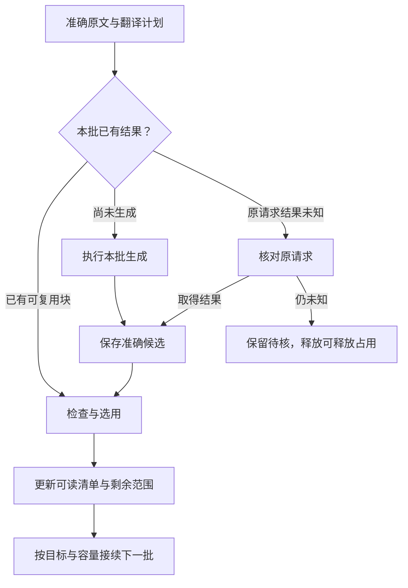

# WiseLink 主线完整规范目录（v1.10）

以下共同规则与附录 A—D 原文摘自 2026-10-27 v1.10 契约，用于按需查阅 13 个节点、47 条关系、58 个场景与 10 条规则。目录数量不是完成率，也不是首单必须全部接入的前置。原文中“第几节”等指 v1.10 章节，不指新版主文的同号章节。

现行主线：v1.11结构＋Codex原生职责修订，合并用户2026-10-29候选与[新分享](https://chatgpt.com/share/6ae2adf4-b884-83e8-a07b-264a0eaa083d)，以最新直接Goal保留Codex＋LiteLLM＋Host与完整Agent循环。本目录保留原增量11及v1.10的范围和成功判据；后继统一边界以[本地主契约第6节](../WISELINK_MAINLINE_GRAPH_CONTRACT.md#6-统一最小修订方案增量11)及原开发卡为准，N01—N24不是新节点或派工数量。旧运行观察在[历史验证快照](../history/mainline-graph/20261029-retired-verification/README.md)，不作为当前状态。

现行边界区分阶段seal／SAVE与任务明确final；原合同允许时同session可吸收准确回执继续，不一律新建请求。下列v1.10附录保留原文，不能据旧封存提交条款推导所有保存都终结工程任务，也不据新要求宣称中途SAVE已实现。

### 2.1 十项共同规则

| 规则 | 唯一规范含义 | 主要展开位置 |
| --- | --- | --- |
| R01 直接阅读 | 读取已保存内容和监控状态为只读操作；每项成果独立可见 | 第5节 |
| R02 原文判断 | 翻译服务阅读；工程分析使用准确原文和原始记录，全文翻译不是调查前置 | 附录B |
| R03 独立保存 | 分支分别保存；局部失败保留其他有效成果；保存、正式采用与目标结束分别判断 | 3.4、4.4 |
| R04 准确消费 | 请求基线固定，取证引用可在授权问题内增加；成果记录实际使用的准确输入 | 第3节 |
| R05 分开表达 | 执行、成果、依据覆盖、正式业务分别表达；确定性校验不替代语义质量 | 2.2、5.3 |
| R06 按影响更新 | 匹配已消费引用和已登记待补条件，只更新有关范围，保存只关闭实际覆盖的需求 | 4.1 |
| R07 真实并行 | 数据就绪与资源准入分开；独立工作可并行，共享写入由Host事务/CAS控制 | 3.3、4.2 |
| R08 复用与恢复 | 已保存先读回；未知先核原请求；封存提交只恢复原准确结果，不重生成或换键 | 4.4 |
| R09 责任清楚 | Host持有业务真值，原系统提供正式事实；同一请求只有一个有效执行与恢复owner | 2.2、2.3 |
| R10 图文同源 | 契约、实际消费者和投影共用含义；图不产生另一套任务状态 | 第6节 |

## 附录 A. 能力节点目录

共同规则适用于所有节点。当前目录有 13 个节点，允许随明确业务语义合理增删；ID 在含义不变时保持稳定。表内只列节点特有的输入、产物和目标成功判据；本次执行怎样结束见3.4；目录是覆盖索引，不表示本轮同时开工或已验收。

| nodeId | 性质与范围 | 主要输入 → 产物 | 成功判据 |
| --- | --- | --- | --- |
| source.register | 处理；来源/文件族/原生记录 | 原生身份、版本、取得范围 → 准确来源绑定与获取回执 | 目标内容取得并绑定；未取得范围明确 |
| source.original | 处理；DocumentVersion＋解析修订 | 准确原件 → 原文、结构、SourceRef/selector | 本次所需原文范围可定位、可读取 |
| document.reading | 处理；文档版本＋解读范围 | 准确原文 → 本版主旨、条件、变化与依据 | 目标解读保存且可读 |
| document.translation | 处理；文档版本＋翻译计划 | 原文与目标语言 → 块修订、检查结果、选用清单 | 目标范围按计划处理，可读与剩余限制准确 |
| assessment.applicability | 处理；文件条件＋目标范围 | 条款、目标/构型事实 → 适用、非适用、条件性结果或未知 | 本次判定范围保存，逐项理由和未决条件准确 |
| assessment.research | 处理；WorkItem/Matter＋问题范围 | 原文、方法、取证、事实 → 连贯工程工作；Program RC1含可信检查单绑定、工作级结果和方法用途 | 有依据的工作保存并准确读回，覆盖与未决问题清楚；实现/语义/正式采用分验 |
| assessment.overall | 处理；准确工作＋综合范围 | 保存工作及有关事实 → 综合建议与真实输入集合 | 目标综合保存可读，前提/冲突/措施/未知一致 |
| business.company_records | 事实；原评估/工程文件版本 | TDMS 原生记录 → 已批准意见、条件、工程文件与措施 | 指定事实准确取得可读，专业/版本/批准边界保留 |
| business.aeo_execution | 事实；AEO 版本＋原生执行要求/单机 | AEO 范围和反馈 → 分项状态及统计 | 原生范围、重复/修订/冲突、截至时间均可核 |
| business.software_configuration | 来源事实；LCM 记录/范围/时点 | 准确 LCM 观察与有关要求 → 单机/矩阵及有关对比 | 原生语义、身份、覆盖与时间保留 |
| knowledge.wiki | 处理；文档/事项、ATA4、ATA2、机型 | 准确成员及根来源 → 复用阅读/需要的跨材料综合 | 目标范围可读，实际成员和限制可追溯 |
| business.adoption | 显式业务动作；候选＋原业务目标 | 准确候选及原前置 → 原系统动作回执/正式记录 | 相应原业务结果可核；提交与批准分别记录 |
| surface.reading | 读取视图；获权对象/版本/时点 | 保存成果、事实、执行投影 → 工程阅读与任务显示 | 内容与关系准确、只读、按权限返回 |

## 附录 B. 专项规则

### B.1 来源、TDMS PDF 与文件解读

TDMS 是工程文件 PDF 原文的重要主线入口，与批准记录、AEO 和反馈的事实同步分别接入。选定准确文件/附件后，保留原生记录、附件版本、正式版次/有效性、取得回执及原件引用，进入 FileService/DocumentVersion 和原文解析，再由解读、翻译、适用性和调查消费。

文件元数据、下载链接或批准记录可读，不等于 PDF 已取得。PDF 不可读、版本不符或仅部分范围取得时，只限制相应消费者；已有评估、批准或 AEO 反馈不是取得原件的前置。

正式改版、同版受控更正、解析修复和来源位置移动分别处理。解析修订不冒充发布方改版，上传时间不决定当前有效版本。解读绑定指定版本和原文范围，概括文件主旨、决定性条件、变化与下一步，并可跳到原文。直接文档工作无需创建假 WorkItem。

### B.2 翻译：计划、局部保存、检查和接续

| 对象 | 用途 |
| --- | --- |
| SourceUnit | 原件中可定位的源单元，保留图表、公式、脚注等关系 |
| 语义块 | 适合连贯翻译的内容范围；不是任意页数或字符切片 |
| 批次 | 一次可执行的有限生成/检查范围 |
| 工作区 | 保存计划、上下文修订、候选、检查、覆盖与未决请求 |
| manifest/选用清单 | 选择当前可读的准确块修订，引用对应原文与检查结果 |

区分业务翻译请求、批次生成请求和一次执行/核对占用。一次核对结束不自动结束原生成请求；目标完成由工作区计划、选用清单和覆盖判断。

检查优先使用结构、数字、单位、引用和遗漏等确定性验证，结合生成过程内检查及必要的针对性复核。它不意味着每块强制第二次模型调用或逐块人工批准。块已保存但待检查时先检查；一个块失败只处理有关范围。

文字字符覆盖、源单元覆盖、图表处理和可读块数分别表达。文字 100% 不代表全部源内容处理完。排除项和无法处理项保留原因：可以“本次目标范围已处理，保留明确限制”，不能把未处理内容算成已翻译。计划拆分变化只影响真实依赖它的块；不依赖的有效块复用。

### B.3 适用性、JobAid 与 Overall

适用性模块提供文件条件与目标匹配结论、依据和例外。文件条件足够可先保存；缺目标事实时相应目标保持未知。不同事项涉及范围、适用性确认范围和 AEO 执行范围分别表达，差异对象可以查清。

JobAid 围绕工程问题调查原文、机理、目标事实、公司安排、相关参考和反证，保存连贯分析、采取方法、措施建议、适用条件及未决问题。问题数量、固定 token 配额或形式上的“全部问答结束”不替代实际工程充分性。普通更正通过明确问题和准确基线继续工作，不要求绕过原入口编辑历史结论。

未决问题保留稳定引用、影响范围和等待条件；条件到达后在原事项继续。原对象已有责任人/期限就复用。执行结束不自动关闭未决工程问题。

当前RC1 Program链的Overall由Host对独立READ的准确保存工作作确定性投影，不在Overall阶段另调模型。所需共同前提、冲突、措施和限制先进入真实分析及保存；不只加页面卡片。其他既有综合入口按其原合同和授权分别验，不用其模型能力改写本轮Program保存恢复边界。

新增工作影响已有综合时按 3.5 和 4.1 处理。更新一个适用条件，要核对受影响的结论、待核项、措施和综合一致性；增量减少重算范围，同时保留有关联判断的核对。

### B.4 分层 Wiki

文档和事项入口复用已有解读/工程工作正文。ATA4、ATA2、机型层组织跨材料知识；只有归属依据足够时纳入对应成员。只有 ATA2 的资料直接归 ATA2，归属未知的资料仍可独立阅读。机型族/子型号关系按真实语义保存，导航层级可以更简洁。

父层消费确切已保存子层和根来源；同一根来源经解读、工作和综合多次出现时保留不同用途，但不重复当作独立证据。层级是阅读范围，不要求每次变化依次做三级模型综合：子层已足够展示时直接投影，有跨材料整合价值且范围发生实质变化时再生成。

同一范围的更新合并并设最大等待条件。父层已有正文可读，受影响范围单列；缺一项依赖可以按请求允许的范围保存部分结果，同一缺项不反复触发相同生成。产物含义未变化时停止无价值的向上传播。持久需求和补扫保证唤醒丢失仍可接续。

### B.5 公司意见、正式动作与 AEO 落实

**公司批准意见。** 用户已明确公司意见来自已批准评估单意见及关联工程文件，并于 2026-10-23 确认评估单自身的 `Estimated` 就是当前批准/有效状态。Host 按准确留存的 `ENGINEER_ASSESSMENT` 原生状态映射；复用既有 `isEstimatedState`，只有 `rawName=Estimated` 且 `rawCode` 为 `Estimated` 或未暴露时成立，不增加第三方有效性证明。依据引用指向该评估单的真实 `sourceRevisionRef`，不另造有效性证书或关系记录。Host 继续核对准确 source、owner、version、actor、before/after 与正文资格，保存、CAS 和正式采用仍走原入口。

保留评估单、专业意见的原生身份、准确版本、专业范围、条件及修订关系。缺状态、`Estimating` 或冲突 rawCode 保持未知；稳定版本、处理单状态、同 ATA 或标题均不推导批准。草稿意见不进入批准意见库，也不覆盖旧批准意见。同一处理单下多份评估单可同时有效，不能只取最后一份；处理单改版与关联评估单同步核对版本关系。明确的撤销或取代按准确原生关系处理，未结构化解码的关系如实保留缺项。总体状态不能代替各专业内容；只有总状态而无明细时显示已取得范围。意见有条件或冲突时保留具体条件和对象，附件保存准确版本并关联原评估记录。

**公司工程文件。** 关联准确颁发版本、措施、对象、期限和被替代关系。已有正式文件独立进入事实区；系统建议紧邻显示与公司安排的关系。新草稿不替换有效批准版本，某专业批准不代表其他专业都已批准。

**正式动作。** business.adoption 复用既有采用/审批入口及原有角色规则。阅读候选不产生正式动作；提交成功与批准/颁发成立按原系统回执分别记录。原正式流程要求的前置照常适用，不增加技术性审批步骤。

**AEO 反馈。** 按本项目单机一次性 AEO 业务口径，以准确 AEO 版本、原生执行要求和目标单机集合统计。来源区分措施、步骤或部分落实时保留该颗粒度；不能因单机出现一条反馈就认定全部要求完成。来源只提供整份反馈时明确粒度，按原完成定义汇总。执行日期、反馈日期和同步时间分别保存；已有业务期限/到期状态直接呈现。若其他措施确有重复执行要求，按其原生类型与执行实例另行表达，不将所有 AEO 默认扩展成重复任务。

缺反馈、明确未完成、完成、冲突分别表达。更正、作废、取代关系用于决定有效反馈，不按最后导入时间强行覆盖冲突。AEO 改版后，只有明确的版本适用/替代关系允许复用旧反馈，否则保留差异待核。分母不明时显示已知数量和缺项；先逐份 AEO、逐项要求统计，不合成未经定义的事项总完成率。

评估记录的 Estimated 与单机执行反馈的完成字段分别按来源语义映射。LCM 观察符合目标不能代替 AEO 反馈；AEO 已完成也不自动证明长期效果已验证。普通反馈确定性刷新统计；异常或反证按实际用途进入有关调查。

### B.6 LCM 软件构型与机队显示

LCM 独立接入，提供自身范围内的构型观察。与文件要求、AEO 和反馈建立类型明确的关联，供确定性对比及相关适用性/调查消费。

当前实装及软件变化使用 LCM 的准确观察；AEO 提供允许、计划和执行要求及反馈关系。解析 AEO 文本不自动产生实际装机变化事实。

| 语义 | 对应事实 | 使用方式 |
| --- | --- | --- |
| 允许 | 来源确认可以使用的构型/件号 | 与实际装机和附带条件核对 |
| 要求 | 准确工程文件条款要求的目标构型 | 按对象和生效范围核对 |
| 计划 | AEO/工程措施安排达到的构型 | 保留计划及期限 |
| 观察 | LCM 某时点实际记录的装机情况 | 展示准确观察及覆盖 |
| 反馈 | TDMS 原生单机/措施执行陈述 | 用于原生反馈/完成状态统计，按来源区分声明与确认 |
| 确认落实 | 原系统确认程序形成的准确落实状态及依据 | 原来源区分反馈和落实确认时保留其原生状态 |

关联已核对只表示关系成立，落实确认按原系统事实保留。原生明确关联与确定性规则足以成立时自动复用；歧义关联待核，无需增加人工确认程序。

**显示保持两种：单机表和软件构型矩阵。** 按 LCM 正式软件名称归组，结合来源标识消歧；不能用相似名称跨软件合并。折叠单元格展示有来源依据的实际装机 PN；同机多位置存在不同 PN、冲突或装机语义未知时显示多项/差异/未知标识。展开后按 PN 行及各单机状态显示，能够查看准确位置与原记录。排序限于同一软件组，数量按飞机去重；多安装位置可下钻，不多算飞机。复用既定字典/代码压缩和按需读取，保持矩阵切换快速。

不另建构型全景或快照差异产品页。必要的前后比较属于后台影响核对，结果只在有关单机、软件、AEO 或问题处显示。

领域证据保留以下最小条件：

- 原生来源实例、记录/快照、sheet/行列或其他准确定位；保留原值、解释规则及其依据。
- 单机稳定身份与历史机号、设备/安装位置、LCM 正式软件名称和原生软件标识、PN/版本及必要兼容条件。
- 观察/生效时间、采集时间、导入时间和精度分别保留；晚导入旧快照不覆盖较新事实。
- 来源对“列示、允许且装机、仅允许、空白、未知”的含义按已核实规则解释；未出现或部分导出不表示未装/卸载。
- 覆盖范围、权威性、完整性和验证情况按来源证据记录。当前本地导入的限制不成为未来正式连接器永远受限的规则，导入成功也不自动提高证据等级。
- 文件/AEO 条款、目标范围、位置和时间用于关联；关联可多对多，明确允许、要求、计划或对比用途。

机队统计给出所选目标范围、实际覆盖和观察时点；分布数量与覆盖数量分别显示。装机观察与 AEO 反馈交叉核对时使用可比位置和时间：反馈后仍只有旧观察不能证明失败；反馈完成但较晚可比观察不符，保留具体差异；完成后更换/回退不抹掉落实历史。

同一可比范围出现冲突时保留证据及未解部分；不能以导入顺序当作更正关系。只有实际消费关系或已登记待补条件命中的变化才推进后继判断，其余更新事实视图。WiseLink 的对比不自动改写 LCM 或 TDMS 原始记录。

## 附录 C. 关系注册表

以下保留 v1.3 的 edgeId，作为静态关系模板。每条实际边展开为具体生产者、消费者和业务对象；精确版本放在运行观察中。复合起点、箭头链和“实际消费者”均展开，不能作为一个多头执行步骤。

表中的“需要时/实际使用时”由 3.3 的本次输入要求落实；变化匹配包括 4.1 的已消费引用和已登记待补条件。表内读回为目标语义，具体服务和 owner 按 6.2 接线。普通业务刷新、直接阅读与显式动作按关系类型分别处理。

### C.1 输入与工程成果

| edgeId | 关系类型 | 起点 → 终点 | 成果与精确绑定 | 激活/就绪条件 | 上游变化影响 | 消费关系读回 |
| --- | --- | --- | --- | --- | --- | --- |
| source.intake | 消费 | input.sources → source.register | 原生来源身份、获取范围与获权内容 | 明确请求或已启用来源策略 | 按实际身份/版本受理，不按发现次数重复创建 | 获取记录、登记结果及未取得范围 |
| tdms.intake | 消费 | input.tdms_documents → source.register | TDMS 文件/记录及附件身份、版次/有效性、获权 PDF 原件 | 明确请求或已启用且获授权的来源策略；取件失败保留缺项 | 正式改版/受控更正进入实际文档消费者，重复获取不制造新版 | 原生来源 → 原件/FileService → DocumentVersion 的绑定及获取回执 |
| source.original | 消费 | source.register → source.original | DocumentVersion、原件引用/原生结构 | 已获权且所需源内容可读 | 仅有关原文版本重新处理 | 解析产物中的来源绑定 |
| original.reading | 消费 | source.original → document.reading | parseRun、semanticRevision、原文范围 | 本轮解读所需范围可读 | 更新受影响解读 | 解读输入引用、覆盖及正文来源 |
| original.translation | 消费 | source.original → document.translation | 原文绑定、计划范围、目标语言 | 可形成语义块计划；已知缺失显式记录 | 定位受影响块，复用其余 | 工作区计划、块依赖与 manifest |
| original.applicability | 消费 | source.original → assessment.applicability | 文件范围和条件的 SourceRef | 相应条款可读 | 重新核对相关范围 | 适用性结果的文件依据 |
| target.applicability | 条件依赖 | input.target_facts → assessment.applicability | 目标集合、事实版本和有效时间 | 做目标匹配时必需；仅文件范围提取可不要求 | 目标/条件改变进入专业重算 | 结果的目标事实快照与缺项 |
| configuration.applicability | 条件依赖 | business.software_configuration → assessment.applicability | 准确单机/位置/软件观察、时间与证据限制 | 文件适用条件实际涉及有关软件构型 | 更新受影响目标的匹配与未知条件 | 结果所用快照/记录、原生定位和条件匹配 |
| original.research | 消费 | source.original → assessment.research | 本轮原文范围、正式版次与有效性说明 | 原文足以支持本轮问题 | 核对实际受影响问题 | 工作的实际读取与使用引用 |
| reference.research | 条件依赖 | input.references → assessment.research | 方法、参考、既有工作及根来源 | 本问题需要且已获权；不要求全库齐备 | 按用途与影响续接 | 工作中的参考用途、读取与根来源 |
| engineer.research | 条件依赖 | input.engineer → assessment.research | 明确问题/更正、目标工作与来源 | 受理为有范围的真实请求 | 后继工作处理有关内容 | 请求、基线及更正结果 |
| target.research | 条件依赖 | input.target_facts → assessment.research | 与本轮判断有关的目标事实 | 涉及目标条件时激活 | 重算有关判断，保留其他工作 | 工作输入及有关问题的使用记录 |
| configuration.research | 条件依赖 | business.software_configuration → assessment.research | 问题所需的软件观察、要求关联与差异证据 | 调查涉及软件变化、兼容性或构型异常 | 只影响相关问题；不把原生变化自动认定故障 | 工作实际使用的构型引用及限制 |
| applicability.research | 条件依赖 | assessment.applicability → assessment.research | 准确结果/证据版本与适用范围 | 判断依赖其结论时需要；未知可限制局部 | 影响相关问题；正式证据采用遵循专业链 | 工作所用结果及未解决条件 |
| company.applicability | 条件依赖 | business.company_records → assessment.applicability | 有效范围/构型等有关原生事实 | 实际用于目标匹配时激活 | 更新受影响匹配 | 适用性结果中的原生事实引用 |
| company.research | 条件依赖 | business.company_records → assessment.research | 批准意见、工程文件、条件及历史版本 | 与本轮问题相关且可读 | 补充/更正相关调查 | 工作的依据用途及原生版本 |
| feedback.research | 条件依赖 | business.aeo_execution → assessment.research | 准确 AEO 版本、执行要求、单机反馈修订与时间 | 调查实际涉及反馈异常、实施效果、反证或已登记待补条件时激活 | 普通计数变化默认只刷新统计；命中待补条件按 4.1 判断后继，能确定性处理时不调用模型 | 工作实际取得的反馈/要求引用、用途及有关内容处理 |
| research.overall | 消费 | assessment.research → assessment.overall | 准确workRef、工作修订、最终问题覆盖；Program RC1沿同一保存结果 | 本轮综合所需工作已保存并独立READ，不等全未来范围结束 | 标示新工作及影响，必要时更新；Program链只恢复同版确定性投影 | Overall的实际READ工作引用与保存修订 |
| applicability.overall | 条件依赖 | assessment.applicability → assessment.overall | 本次采用的结果版本 | 综合使用其目标判断时激活 | 相关共同前提重新核对 | Overall 输入与适用性限制 |
| company.overall | 条件依赖 | business.company_records → assessment.overall | 本次采用的批准记录/工程文件版本 | 实际用于综合时激活 | 标示待纳入变化，核对影响 | Overall 中原生依据及用途 |
| feedback.overall | 条件依赖 | business.aeo_execution → assessment.overall | 综合实际需要的 AEO 要求、单机反馈与准确范围 | 已有调查足够且本次综合确需处理实施事实时激活 | 普通计数变化默认只刷新统计；相关异常或待补条件满足按 4.1 处理，能直接投影时不调用模型 | Overall 实际使用的反馈引用、范围及结论处理 |
| configuration.overall | 条件依赖 | business.software_configuration → assessment.overall | 综合实际使用的准确构型/对比范围及依据 | 综合需要直接核对软件共同前提时激活 | 标示相关变化与待核范围；不因每次导入重跑 | Overall 输入的构型引用与用途 |
| context.overall | 条件依赖 | source.original / input.target_facts / input.references → assessment.overall | 已选择的共同原文、事实与参考绑定 | 综合确需使用时激活 | 只改变有关前提和范围 | 综合的完整输入集合与来源 |

### C.2 正式业务、知识与阅读

| edgeId | 关系类型 | 起点 → 终点 | 成果与精确绑定 | 激活/就绪条件 | 上游变化影响 | 消费关系读回 |
| --- | --- | --- | --- | --- | --- | --- |
| request.action | 显式操作 | input.engineer / surface.reading → 所选处理节点或 business.adoption | 明确动作、目标对象/版本及目标范围 | 仅显式操作经原入口校验后激活，普通读取不激活 | 基线变化按原入口重新判断 | 原业务请求、受理或拒绝回执 |
| business.company | 消费 | input.business_records → source.register → business.company_records | 原生批准/文件身份与版本 | 获权同步对应记录 | 对应事实更新，不改写历史 | 同步记录与原系统读回 |
| business.feedback | 消费 | input.business_records → source.register → business.aeo_execution | AEO、单机与反馈版本 | 身份/作用域匹配 | 更新准确落实统计 | 反馈清单、来源、截至时间 |
| lcm.configuration | 消费 | input.lcm_configuration → source.register → business.software_configuration | 来源实例、准确快照/记录、收集范围、原生语义与时间 | 获权取得并完成本轮范围登记；未核实内容保留限制 | 更新有关观察及对比，不覆盖来源历史 | 导入/同步回执、原件/行列定位、覆盖与证据质量 |
| target.configuration | 条件依赖 | input.target_facts → business.software_configuration | 单机稳定身份、机队成员范围及有关设备/硬件 | 做跨来源关联或机队投影时按需使用 | 重新核对有关身份、兼容条件和统计分母 | 选定目标集合及映射依据，不改写原始 LCM 行 |
| company.configuration | 条件依赖 | business.company_records → business.software_configuration | 工程文件/AEO 的准确软件条款、修订、有效性与目标范围 | 核对允许/要求/计划与构型观察的关系时激活 | 更新有关要求关联与差异，不制造新装机事实 | 类型明确的关系、条款来源及关联确认状态 |
| configuration.aeo | 条件依赖 | business.software_configuration → business.aeo_execution | 准确单机/位置的软件观察及 AEO 关联依据 | 对该 AEO 软件措施进行交叉核对时激活 | 更新对比/差异；正式落实状态按原系统保留 | AEO/反馈/LCM 各自版本、时间及核对结果 |
| company.aeo | 消费 | business.company_records → business.aeo_execution | 生效 AEO 及目标范围/修订 | 汇总该 AEO 时需要；范围缺失显示未知 | 重核分母和反馈归属，历史不混算 | 统计采用的 AEO 与目标集合 |
| candidate.adoption | 条件依赖 | assessment.research / assessment.overall → business.adoption | 动作所需的确切候选、来源和业务版本 | 明确授权动作及原有前置满足 | 已变更则按原业务规则重新核对 | 业务动作请求、回执、正式结果 |
| adoption.company | 读取投影 | business.adoption → business.company_records | 原系统真实批准/发布结果 | 对应动作确已成立并可核验 | 更新正式事实，不由提交成功推断批准 | 外部记录标识、版本及正式状态 |
| reading.wiki | 消费 | document.reading → knowledge.wiki | 准确解读、原文根来源、归属 | 已保存且选入获权范围 | 更新相关 Wiki，必要时登记事项影响 | Wiki 成员版本与实际覆盖 |
| research.wiki | 消费 | assessment.research → knowledge.wiki | 准确已保存工作、覆盖、根来源和限制 | 已保存并归入该范围，按允许范围独立交付 | 相关章节更新，不重写源工作 | 成员 workRef 与正文覆盖 |
| overall.wiki | 消费 | assessment.overall → knowledge.wiki | 确切综合及其输入闭包 | 被选为成员或工作阅读的一部分 | 相关段落更新；同源不重复计权 | 实际成员/工作阅读引用 |
| wiki.parent | 消费 | knowledge.wiki → knowledge.wiki | 确切已保存子层修订及根来源 | 实际父子归属成立、可读范围满足 | 只更新有关父层；不反向自动循环 | 父层成员版本及子层覆盖 |
| artifact.reading | 读取投影 | 各有可读成果的节点 → surface.reading | 准确成果/事实引用、范围、限制 | 当前有权且成果可读，不等待其他分支 | 更新选定版本/变化提示，不启动生成 | 页面返回的各项准确引用 |
| execution.reading | 读取投影 | control.execution → surface.reading | 原请求、尝试、业务进展和观察时间 | 有权观察该对象 | 只更新运行显示 | 节点详情和执行时间线 |

### C.3 变化与后继需求

| edgeId | 关系类型 | 变化起点 → 处理目标 | 激活判据 | 必须保留的读回 |
| --- | --- | --- | --- | --- |
| change.source | 更新触发 | source.register / source.original → 实际消费者 | 正式改版、有效性或实际使用范围改变 | 原/新来源绑定、受影响范围、核对结论 |
| change.correction | 更新触发 | input.engineer → assessment.research / document.reading / document.translation | 已受理的明确更正及准确对象 | 请求、目标版本、改动/无实质变化结果 |
| change.target | 更新触发 | input.target_facts → assessment.applicability → 相关调查/综合 | 有关事实或已采用证据改变 | 事实版本、专业重算及后续覆盖 |
| change.configuration | 更新触发 | business.software_configuration → assessment.applicability / assessment.research / assessment.overall | 软件事实、有效性或关联变化确实影响该消费者的目标条件/问题 | 新旧构型引用、时间、影响范围及消费覆盖；经有关工作/综合再更新 Wiki |
| change.work | 更新触发 | assessment.research → assessment.overall / knowledge.wiki | 新工作与下游范围有关 | 已消费工作、新工作、影响判断和未覆盖差额 |
| change.business | 更新触发 | business.company_records / business.aeo_execution → 相关工程问题 | 批准条件变化或反馈含实际异常/反证 | 原生变化、用途与明确受影响问题 |
| change.policy | 更新触发 | input.policy → 对应处理节点 | 已启用策略、有效授权、真实条件满足 | 策略、触发事实、受理范围与原请求 |
| change.access | 更新触发 | control.authorization → 所有受影响成果和执行 | 权限撤回、来源撤回或已确认不能继续使用 | 拒绝范围、仍可用范围及后续处置 |

## 附录 D. 验收覆盖目录

这是可选择的目标场景库，按本次改动和实际接入范围验证。记录准确源码/环境、对象与输入引用、实际动作、输出、独立读回及未覆盖范围。状态成功、字段存在或测试数量不替代具体工程内容核对。

| 编号 | 场景 | 必须观察到的结果 |
| --- | --- | --- |
| V01 | 文档登记后只请求原文/解读 | 可独立交付，不创建假 WorkItem，不等待翻译或审批。 |
| V02 | 翻译运行中，JobAid 原文输入已足够 | 输入就绪且执行容量允许即可开始；共享写入在提交时做短事务/CAS；冲突保留准确候选或原封存结果，按原协议核对或形成后继，不将其冒充已保存成果，具体同动作互斥按实际冲突说明。 |
| V03 | 适用性缺构型，其他原文问题可分析 | 只限制有关目标判断，其他工作可保存；不把未知当不适用。 |
| V04 | 翻译一批失败，前面已有可读块 | 保留有效块，只处理缺失/受影响范围。 |
| V05 | 已保存块仍待检查 | 继续检查，保存数与可读数不同，不重复生成。 |
| V06 | 文字覆盖 100%，仍有图/表未处理 | 目标完整性仍明确受限，不能显示全文全部完成。 |
| V07 | 翻译原生成结果未知 | 查询原请求，保持待核，不重复生成。 |
| V08 | 成果保存后执行端退出 | 成果可准确读回；恢复原收尾，不增加新模型请求。 |
| V09 | Host 明确在写入前拒绝保存 | 显示准确拒绝；纠正有关请求，不误入永久保存未知。 |
| V10 | 保存超时但持久记录已经存在 | 按原请求核对成功，不重复保存、不重生成。 |
| V11 | 旧 worker 在租约更替后迟到写入 | 旧 fence 被拒绝，当前成果与引用不被覆盖。 |
| V12 | JobAid 工作 4 保存，综合仍基于工作 3 | 连线显示准确消费关系与待纳入/待核范围，旧综合不配新依据；更新时核对新工作进入实际输入且有关新条件在正文中得到处理。 |
| V13 | 新工作只改变无关内容 | 保存有依据的无影响核对，不无条件重生成综合。 |
| V14 | 运行中有新来源/工作到达 | 原请求保持准确输入；新增需求不丢失，后继保存只清除实际覆盖范围。 |
| V15 | 文件正式改版与解析修复分别发生 | 两种版本明确区分，按实际影响更新，历史不被改写。 |
| V16 | 同一变化重复通知或空巡检 | 无重复任务、无重复工程修订、无无意义模型调用。 |
| V17 | 旧版本晚到或来源仅移动 | 保留历史/更新位置，不替代当前有效版本。 |
| V18 | 文档解读和事项工作分别进入 Wiki | 独立文档可上卷，真实事项保留；输入和根来源准确，重复引用不重复计权。 |
| V19 | ATA4 更新在途，ATA2 保留旧正文 | 父层只消费确切已保存子层；旧内容与待更新范围分别可读。 |
| V20 | Wiki 一个依赖失败或长期缺失 | 可按范围保存部分结果；同一缺项不循环生成；依赖变化后补齐有关范围。 |
| V21 | 普通 AEO 单机反馈更新 | 仅相关落实统计刷新，不无条件触发调查/综合。 |
| V22 | 反馈出现有工程意义的异常 | 保存原生事实与理由，只受理相关问题；准确反馈与对应要求进入实际分析输入，保存工作/综合正确处理该异常；不自动改正式批准。 |
| V23 | AEO 分母未知、反馈重复或修订不同 | 不显示虚假全量百分比；正确去重并保留版本范围。 |
| V24 | 用户只读取候选，没有正式动作 | 不产生采用、批准、发布或实施完成。 |
| V25 | 正式动作提交超时/候选版本变化 | 核对原请求与准确版本，不重复提交，不自动批准。 |
| V26 | 暂时读取失败与撤权分别发生 | 前者保留仍获权内容并显示观察时间；后者清除/拒绝受限正文、计数与关系。 |
| V27 | 源文件撤回但历史仍获权 | 标记失效及当前使用限制，保留准确历史，不冒充当前有效依据。 |
| V28 | 页面刷新、图切换和节点展开 | 只读取真实结果，不调用生成/领取/修复。 |
| V29 | 明确暂停、取消临近提交 | 暂停不自动绕过；取消返回实际是否生效及准确成果。 |
| V30 | 开发接线通过但未部署/未真实运行 | 开发视图如实显示证据层级，运行视图不伪造完成。 |
| V31 | LCM 矩阵同时含仅允许、允许且装机、空白和未知值 | 按该来源已核实的语义分别解释，保留原值/定位；列示、允许和未知不被改成已装或未装。 |
| V32 | 旧快照晚到、重新导出或重复导入 | 保留观察/生效/导入时间及准确历史；不覆盖较新事实，不重复计数或启动模型。 |
| V33 | 同名软件、机号变化或同机不同位置有多个版本 | 按经核对的身份、位置和来源关联；跨来源仅凭同名匹配只形成候选，同机不被多算为多架飞机。 |
| V34 | 软件命中文件的一项适用条件，但硬件/时间等条件缺失 | 保留有限匹配及必要未知；不自动推导整份文件适用/不适用或措施已完成。 |
| V35 | AEO 计划升级，只有此前旧构型观察 | 计划、观察和时间分别展示；不宣称已升级，也不据此断言实施失败。 |
| V36 | 反馈完成但较晚可比构型不符，或构型符合却缺反馈 | 展示双方准确证据及待核差异；不改写 LCM，不自动撤销或完成 AEO。 |
| V37 | 部分导出缺单机/软件项，机队分母不完整 | 缺失为未覆盖，不能当卸载；已知分布与总体覆盖分开，不显示虚假全机队比例。 |
| V38 | LCM 本地导入成功，但 authority/completeness 仍未核实 | 快照可读且证据限制可见；不提升为实时权威装机事实或正式采用。 |
| V39 | 一架飞机的软件变化只影响某文件条件与相关问题 | 只更新有关机队/AEO 对比和受影响适用性/工作/综合，Wiki 经实际成员变化更新；其余成果复用。 |
| V40 | 同一可比时段与位置出现冲突观察 | 原始证据、来源权威性与时间均保留；未解冲突显示未知/待核，不取最后导入值强行消除。 |
| V41 | LCM 来源撤权或只能查看部分机队 | 记录、派生正文、关系和计数均按当前权限约束；不从隐藏来源泄露全量分母或单机存在性。 |
| V42 | AEO 已落实后有更换/回退，或用较晚快照查较早时点 | 保留落实历史及后续变化；当前与历史判断分开，不用较晚观察无依据反推过去或持续安装。 |
| V43 | 从 TDMS 选择准确工程文件 PDF 并请求文档/工程处理 | 可读回原生文件/附件版本、原件、DocumentVersion 和解析绑定；有关主线消费者使用该原文，已有评估/批准/AEO 反馈不成为取件前置。 |
| V44 | TDMS 元数据同步成功，但 PDF 未取得、不可读或版本不符 | 显示准确缺项/错误或待核状态；不能以记录同步、批准意见或附件链接冒充原文已取得/主线完成；条件恢复后从有关环节接续。 |
| V45 | 在固定问题内发现新的相关参考，同时原主资料有新版到达 | 新参考登记准确取证引用后可继续；主资料基线保持原版，新版形成相关后继；保存引用来自本次实际输入，不回填后来取得的新版。 |
| V46 | 必需输入缺失与允许缺失输入分别出现 | 真实消费者和监控得到同一就绪结果；限制不得由模型临时降格；已有其他成果可读。 |
| V47 | 提交已封存，响应丢失或发生 CAS 冲突 | 原封存 payload 保持不变，由原恢复入口核对/提交；需要新内容时形成关联后继，不普通归还后重生成。 |
| V48 | 原来缺失的构型事实后来取得，或目标集合增加成员 | 命中已登记待补条件/目标范围，推进有关后继；不因旧消费表没有该新记录而遗漏。 |
| V49 | 翻译一次核对结束，但原生成仍未知 | 释放协议允许释放的本次占用；原生成请求仍待核，可读块保留，目标完成按工作区判断。 |
| V50 | 请求排队很久才开始，运行中持续心跳 | 执行超时从真实开始计；排队有效期和业务绝对截止分别生效；续租不改变业务截止。 |
| V51 | 较新基线结果已成为当前，较旧基线结果晚保存/返回 | 按 Host 规则处理旧候选或历史；它不能凭较晚时间替代较新有效当前结果。 |
| V52 | 同一 node/subject 有更新运行、原请求待核和历史可读成果 | 节点摘要保留请求集合；准确动作命中选定实例；最后一次失败不抹去可读成果或未知请求。 |
| V53 | 多专业意见含条件/分歧，随后出现新的评估草稿 | 保留原批准意见与各专业条件；草稿不进入批准意见集合；综合使用准确批准版本，新增决定性条件确实进入输入并在输出中处理。 |
| V54 | AEO 有两项执行要求，只反馈完成一项，随后 AEO 改版 | 按原生粒度保留部分完成；不把单机一条反馈当全部完成；新旧反馈按明确适用/取代关系处理。 |
| V55 | 新程序初评明确选 GLM，旧事项仍固定其他模型 | 新请求/任务和实际调用使用明确模型；旧请求、模型快照和 UNKNOWN 保留；通过正常入口完成 SAVE、独立 READ、合法初评 Overall 与同版阅读。 |
| V56 | 程序取得完整有效响应后保存失败，或只有错误 HTTP 响应 | 前者留存并只恢复同一响应保存；后者不显示已有评估；UNKNOWN 不重发模型，保存确认丢失按原幂等身份核对。 |
| V57 | 工作已保存，确定性综合失败或执行尚未收尾 | 正常工作正文立即可读；只恢复投影/收尾；准确 READ 的工作修订与 Overall 来源相符，不借 Review、不制造复核。图的成果与综合来源下钻定位准确工作版本；后发独立综合请求不被旧程序综合遮蔽。 |
| V58 | 连续材料跨页/跨表且条目超过接口单批范围 | 程序分批合法取数并完整装配，条件、否定、期限、列头、单位、脚注及原条目映射可核；容量不足明确限制，不冒称整份完成。本次材料按准确尝试惰性读取并重核来源授权，准备记录不冒充已发送或已正确处理。 |
